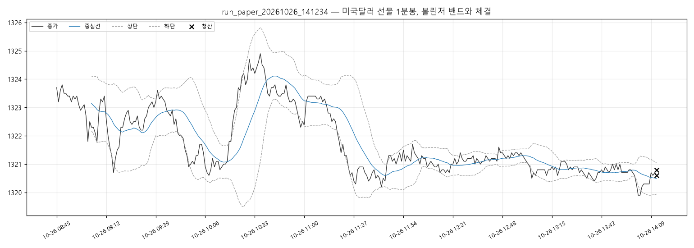

# 실행 요약 — run_paper_20261026_141234

| 항목 | 값 |
| --- | --- |
| 실행 환경 | 모의계좌 주문 |
| 접속 환경 | paper |
| 종목 | A756B000 |
| 시작 | 2026-10-26T14:12:34+09:00 |
| 종료 | 2026-10-26T14:13:35+09:00 |
| 종목명 / 최종거래일 | 미국달러 F 202611 / 20261116 |
| 처리한 봉 | 328 |

## 성과

| 항목 | 값 |
| --- | --- |
| 거래 수 (매수/매도) | 0 (0 / 0) |
| 승 / 패 | 0 / 0 |
| 승률 | - |
| 순손익 | **+0원** |
| 평균 이익 / 평균 손실 | +0원 / +0원 |
| Profit Factor | - |
| 최대 낙폭(실현 누적) | 0원 |
| 평균 보유 봉 | - |

### 청산 사유

| 사유 | 건수 | 순손익 합 |
| --- | --- | --- |

## 신호와 주문

- 진입 신호 0건 중 진입 0건
- 주문 2건: 체결 2

## API 호출

| API | 호출 | 오류 | 평균 지연(ms) |
| --- | --- | --- | --- |
| domestic_chart-minute | 11 | 0 | 68 |
| domestic_open-interest | 3 | 0 | 72 |
| domestic_order | 2 | 0 | 75 |
| domestic_order-history | 2 | 0 | 73 |
| domestic_price | 27 | 0 | 30 |
| domestic_product-detail | 1 | 0 | 4740 |
| token | 1 | 0 | 179 |

## 주의 이벤트

없음

