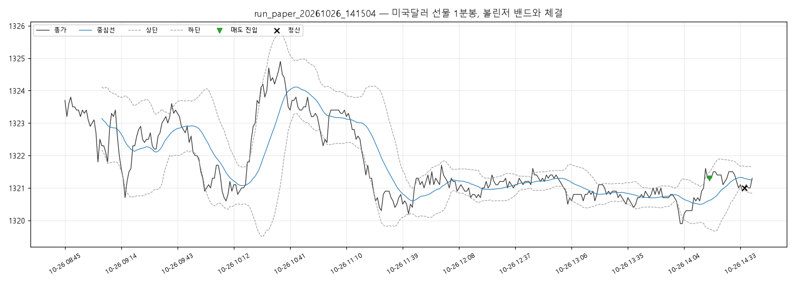

# 실행 요약 — run_paper_20261026_141504

| 항목 | 값 |
| --- | --- |
| 실행 환경 | 모의계좌 주문 |
| 접속 환경 | paper |
| 종목 | A756B000 |
| 시작 | 2026-10-26T14:15:04+09:00 |
| 종료 | 2026-10-26T14:40:06+09:00 |
| 종목명 / 최종거래일 | 미국달러 F 202611 / 20261116 |
| 처리한 봉 | 355 |

## 성과

| 항목 | 값 |
| --- | --- |
| 거래 수 (매수/매도) | 1 (0 / 1) |
| 승 / 패 | 1 / 0 |
| 승률 | 100.0% |
| 순손익 | **+3,000원** |
| 평균 이익 / 평균 손실 | +3,000원 / +0원 |
| Profit Factor | - |
| 최대 낙폭(실현 누적) | 0원 |
| 평균 보유 봉 | 15.0 |

### 청산 사유

| 사유 | 건수 | 순손익 합 |
| --- | --- | --- |
| 익절(중심선) | 1 | +3,000원 |

### 거래일별

| 날짜 | 거래 | 승 | 순손익 |
| --- | --- | --- | --- |
| 2026-10-26 | 1 | 1 | +3,000원 |

## 신호와 주문

- 진입 신호 2건 중 진입 1건
  - 보류: 밴드폭 1건
- 주문 2건: 체결 2
- 기준가(신호 봉 종가·손절 판정가) 대비 체결 미끄러짐: 평균 -1.00틱, 최대 -0.0틱 (양수 = 불리)

## API 호출

| API | 호출 | 오류 | 평균 지연(ms) |
| --- | --- | --- | --- |
| domestic_chart-minute | 23 | 0 | 96 |
| domestic_open-interest | 4 | 0 | 79 |
| domestic_order | 2 | 0 | 76 |
| domestic_order-history | 2 | 0 | 73 |
| domestic_price | 356 | 1 | 69 |
| domestic_product-detail | 1 | 0 | 4650 |

오류 코드: `TIMEOUT` 1건

## 주의 이벤트

api_error 1건
- 2026-10-26T14:35:34+09:00 [api_error] [domestic_price]  응답 시간 초과 — 처리 여부 불명, 주문내역으로 확인 필요 (연속 1회)

## 거래 목록

| # | 방향 | 진입 | 진입가 | 청산 | 청산가 | 사유 | 틱 | 순손익 |
| --- | --- | --- | --- | --- | --- | --- | --- | --- |
| 1 | SHORT | 10-26T14:17:04 | 1321.3 | 10-26T14:35:39 | 1321.0 | 익절(중심선) | 3.0 | +3,000 |

