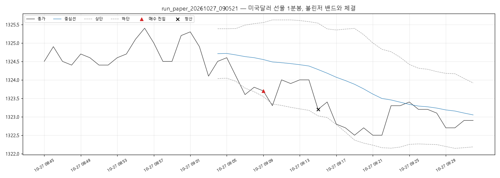

# 실행 요약 — run_paper_20261027_090521

| 항목 | 값 |
| --- | --- |
| 실행 환경 | 모의계좌 주문 |
| 접속 환경 | paper |
| 종목 | A756B000 |
| 시작 | 2026-10-27T09:05:21+09:00 |
| 종료 | 2026-10-27T09:33:55+09:00 |
| 종목명 / 최종거래일 | 미국달러 F 202611 / 20261116 |
| 처리한 봉 | 48 |

## 성과

| 항목 | 값 |
| --- | --- |
| 거래 수 (매수/매도) | 1 (1 / 0) |
| 승 / 패 | 0 / 1 |
| 승률 | 0.0% |
| 순손익 | **-5,000원** |
| 평균 이익 / 평균 손실 | +0원 / -5,000원 |
| Profit Factor | 0.00 |
| 최대 낙폭(실현 누적) | 5,000원 |
| 평균 보유 봉 | 6.0 |

### 청산 사유

| 사유 | 건수 | 순손익 합 |
| --- | --- | --- |
| 손절 | 1 | -5,000원 |

### 거래일별

| 날짜 | 거래 | 승 | 순손익 |
| --- | --- | --- | --- |
| 2026-10-27 | 1 | 0 | -5,000원 |

## 신호와 주문

- 진입 신호 1건 중 진입 1건
- 주문 2건: 체결 2
- 기준가(신호 봉 종가·손절 판정가) 대비 체결 미끄러짐: 평균 -0.50틱, 최대 -0.0틱 (양수 = 불리)

## 시간대별 (진입 시각 기준)

| 시간 | 평균 밴드폭(틱) | 신호 / 진입 | 거래 | 승률 | 익절 / 손절 / 시간 | 순손익 |
| --- | --- | --- | --- | --- | --- | --- |
| 09시 | 22.4 | 1 / 1 | 1 | 0% | 0 / 1 / 0 | -5,000원 |

- 오전(~12시): 거래 1건, 승률 0%, 순손익 -5,000원

## API 호출

| API | 호출 | 오류 | 평균 지연(ms) |
| --- | --- | --- | --- |
| domestic_chart-minute | 23 | 3 | 1337 |
| domestic_open-interest | 4 | 0 | 75 |
| domestic_order | 2 | 0 | 73 |
| domestic_order-history | 2 | 0 | 74 |
| domestic_price | 345 | 26 | 1359 |
| domestic_product-detail | 1 | 0 | 4796 |

오류 코드: `TIMEOUT` 28건, `TRANSPORT` 1건

## 주의 이벤트

api_error 29건
- 2026-10-27T09:06:25+09:00 [api_error] [domestic_price]  응답 시간 초과 — 처리 여부 불명, 주문내역으로 확인 필요 (연속 1회)
- 2026-10-27T09:06:39+09:00 [api_error] [domestic_price]  응답 시간 초과 — 처리 여부 불명, 주문내역으로 확인 필요 (연속 2회)
- 2026-10-27T09:07:01+09:00 [api_error] [domestic_price]  응답 시간 초과 — 처리 여부 불명, 주문내역으로 확인 필요 (연속 1회)
- 2026-10-27T09:07:15+09:00 [api_error] [domestic_chart-minute]  응답 시간 초과 — 처리 여부 불명, 주문내역으로 확인 필요 (연속 2회)
- 2026-10-27T09:07:35+09:00 [api_error] [domestic_price]  응답 시간 초과 — 처리 여부 불명, 주문내역으로 확인 필요 (연속 1회)
- 2026-10-27T09:08:16+09:00 [api_error] [domestic_price]  응답 시간 초과 — 처리 여부 불명, 주문내역으로 확인 필요 (연속 1회)
- 2026-10-27T09:10:16+09:00 [api_error] [domestic_price]  응답 시간 초과 — 처리 여부 불명, 주문내역으로 확인 필요 (연속 1회)
- 2026-10-27T09:10:54+09:00 [api_error] [domestic_price]  응답 시간 초과 — 처리 여부 불명, 주문내역으로 확인 필요 (연속 1회)
- 2026-10-27T09:11:14+09:00 [api_error] [domestic_price]  응답 시간 초과 — 처리 여부 불명, 주문내역으로 확인 필요 (연속 1회)
- 2026-10-27T09:12:26+09:00 [api_error] [domestic_price]  응답 시간 초과 — 처리 여부 불명, 주문내역으로 확인 필요 (연속 1회)
- 2026-10-27T09:12:54+09:00 [api_error] [domestic_price]  응답 시간 초과 — 처리 여부 불명, 주문내역으로 확인 필요 (연속 1회)
- 2026-10-27T09:13:43+09:00 [api_error] [domestic_price]  응답 시간 초과 — 처리 여부 불명, 주문내역으로 확인 필요 (연속 1회)
- 2026-10-27T09:14:05+09:00 [api_error] [domestic_price]  응답 시간 초과 — 처리 여부 불명, 주문내역으로 확인 필요 (연속 1회)
- 2026-10-27T09:14:26+09:00 [api_error] [domestic_price]  응답 시간 초과 — 처리 여부 불명, 주문내역으로 확인 필요 (연속 1회)
- 2026-10-27T09:15:10+09:00 [api_error] [domestic_price]  응답 시간 초과 — 처리 여부 불명, 주문내역으로 확인 필요 (연속 1회)
- 2026-10-27T09:15:24+09:00 [api_error] [domestic_price]  응답 시간 초과 — 처리 여부 불명, 주문내역으로 확인 필요 (연속 2회)
- 2026-10-27T09:15:51+09:00 [api_error] [domestic_price]  응답 시간 초과 — 처리 여부 불명, 주문내역으로 확인 필요 (연속 1회)
- 2026-10-27T09:16:08+09:00 [api_error] [domestic_price]  응답 시간 초과 — 처리 여부 불명, 주문내역으로 확인 필요 (연속 1회)
- 2026-10-27T09:16:22+09:00 [api_error] [domestic_chart-minute]  응답 시간 초과 — 처리 여부 불명, 주문내역으로 확인 필요 (연속 2회)
- 2026-10-27T09:16:40+09:00 [api_error] [domestic_price]  응답 시간 초과 — 처리 여부 불명, 주문내역으로 확인 필요 (연속 1회)
- 2026-10-27T09:17:00+09:00 [api_error] [domestic_price]  응답 시간 초과 — 처리 여부 불명, 주문내역으로 확인 필요 (연속 1회)
- 2026-10-27T09:18:22+09:00 [api_error] [domestic_price]  응답 시간 초과 — 처리 여부 불명, 주문내역으로 확인 필요 (연속 1회)
- 2026-10-27T09:19:56+09:00 [api_error] [domestic_price]  응답 시간 초과 — 처리 여부 불명, 주문내역으로 확인 필요 (연속 1회)
- 2026-10-27T09:20:56+09:00 [api_error] [domestic_price]  응답 시간 초과 — 처리 여부 불명, 주문내역으로 확인 필요 (연속 1회)
- 2026-10-27T09:21:12+09:00 [api_error] [domestic_chart-minute]  응답 시간 초과 — 처리 여부 불명, 주문내역으로 확인 필요 (연속 1회)
- 2026-10-27T09:21:26+09:00 [api_error] [domestic_price]  응답 시간 초과 — 처리 여부 불명, 주문내역으로 확인 필요 (연속 2회)
- 2026-10-27T09:25:35+09:00 [api_error] [domestic_price]  응답 시간 초과 — 처리 여부 불명, 주문내역으로 확인 필요 (연속 1회)
- 2026-10-27T09:33:14+09:00 [api_error] [domestic_price]  연결 실패: HTTPSConnectionPool(host='apidemo.futures.co.kr', port=443): Max retries exceeded with url: /trade/v1/domestic/price (Caused by NameResolutionError("HTTPSConnection(host='apidemo.futures.co.kr', port=443): Failed to resolve 'apidemo.futures.co.kr' ([Errno 11001] getaddrinfo failed)")) (연속 1회)
- 2026-10-27T09:33:28+09:00 [api_error] [domestic_price]  응답 시간 초과 — 처리 여부 불명, 주문내역으로 확인 필요 (연속 2회)

## 거래 목록

| # | 방향 | 진입 | 진입가 | 청산 | 청산가 | 사유 | 틱 | 순손익 |
| --- | --- | --- | --- | --- | --- | --- | --- | --- |
| 1 | LONG | 10-27T09:09:04 | 1323.7 | 10-27T09:15:56 | 1323.2 | 손절 | -5.0 | -5,000 |

