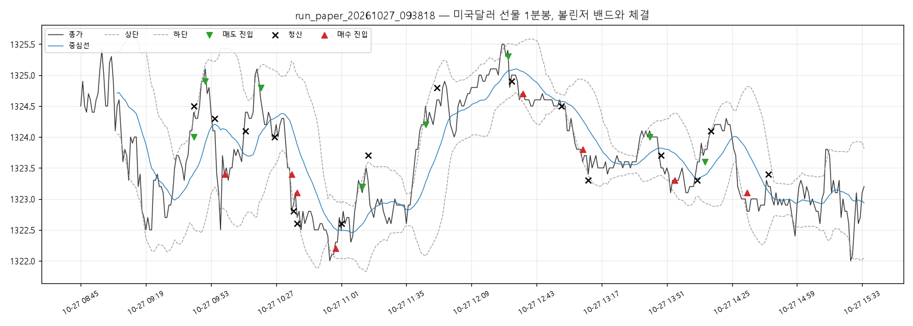

# 실행 요약 — run_paper_20261027_093818

| 항목 | 값 |
| --- | --- |
| 실행 환경 | 모의계좌 주문 |
| 접속 환경 | paper |
| 종목 | A756B000 |
| 시작 | 2026-10-27T09:38:18+09:00 |
| 종료 | 2026-10-27T15:40:00+09:00 |
| 종목명 / 최종거래일 | 미국달러 F 202611 / 20261116 |
| 처리한 봉 | 410 |

## 성과

| 항목 | 값 |
| --- | --- |
| 거래 수 (매수/매도) | 16 (8 / 8) |
| 승 / 패 | 7 / 9 |
| 승률 | 43.8% |
| 순손익 | **-4,000원** |
| 평균 이익 / 평균 손실 | +5,000원 / -4,333원 |
| Profit Factor | 0.90 |
| 최대 낙폭(실현 누적) | 23,000원 |
| 평균 보유 봉 | 5.8 |

### 청산 사유

| 사유 | 건수 | 순손익 합 |
| --- | --- | --- |
| 손절 | 7 | -37,000원 |
| 익절(중심선) | 9 | +33,000원 |

### 거래일별

| 날짜 | 거래 | 승 | 순손익 |
| --- | --- | --- | --- |
| 2026-10-27 | 16 | 7 | -4,000원 |

## 신호와 주문

- 진입 신호 24건 중 진입 16건
  - 보류: 손절 3건
  - 보류: 밴드폭 3건
  - 보류: 진입시간 2건
- 주문 32건: 체결 32
- 기준가(신호 봉 종가·손절 판정가) 대비 체결 미끄러짐: 평균 +0.19틱, 최대 +2.0틱 (양수 = 불리)

## 시간대별 (진입 시각 기준)

| 시간 | 평균 밴드폭(틱) | 신호 / 진입 | 거래 | 승률 | 익절 / 손절 / 시간 | 순손익 |
| --- | --- | --- | --- | --- | --- | --- |
| 09시 | 20.5 | 3 / 2 | 2 | 50% | 1 / 1 / 0 | +1,000원 |
| 10시 | 19.7 | 6 / 5 | 5 | 60% | 3 / 2 / 0 | +8,000원 |
| 11시 | 14.1 | 2 / 2 | 2 | 0% | 0 / 2 / 0 | -11,000원 |
| 12시 | 8.9 | 2 / 2 | 2 | 50% | 2 / 0 / 0 | +2,000원 |
| 13시 | 8.8 | 5 / 3 | 3 | 33% | 2 / 1 / 0 | -2,000원 |
| 14시 | 12.1 | 3 / 2 | 2 | 50% | 1 / 1 / 0 | -2,000원 |
| 15시 | 12.5 | 3 / 0 | 0 | - | - | - |

- 오전(~12시): 거래 9건, 승률 44%, 순손익 -2,000원

- 오후(12시~): 거래 7건, 승률 43%, 순손익 -2,000원

## API 호출

| API | 호출 | 오류 | 평균 지연(ms) |
| --- | --- | --- | --- |
| domestic_chart-minute | 403 | 0 | 100 |
| domestic_open-interest | 34 | 0 | 76 |
| domestic_order | 32 | 0 | 80 |
| domestic_order-history | 32 | 0 | 106 |
| domestic_price | 4270 | 3 | 56 |
| domestic_product-detail | 1 | 0 | 4712 |
| token | 1 | 0 | 320 |

오류 코드: `TIMEOUT` 3건

## 주의 이벤트

api_error 3건
- 2026-10-27T09:38:53+09:00 [api_error] [domestic_price]  응답 시간 초과 — 처리 여부 불명, 주문내역으로 확인 필요 (연속 1회)
- 2026-10-27T09:40:05+09:00 [api_error] [domestic_price]  응답 시간 초과 — 처리 여부 불명, 주문내역으로 확인 필요 (연속 1회)
- 2026-10-27T09:43:29+09:00 [api_error] [domestic_price]  응답 시간 초과 — 처리 여부 불명, 주문내역으로 확인 필요 (연속 1회)

## 거래 목록

| # | 방향 | 진입 | 진입가 | 청산 | 청산가 | 사유 | 틱 | 순손익 |
| --- | --- | --- | --- | --- | --- | --- | --- | --- |
| 1 | SHORT | 10-27T09:44:03 | 1324.0 | 10-27T09:44:44 | 1324.5 | 손절 | -5.0 | -5,000 |
| 2 | SHORT | 10-27T09:50:03 | 1324.9 | 10-27T09:55:07 | 1324.3 | 익절(중심선) | 6.0 | +6,000 |
| 3 | LONG | 10-27T10:00:05 | 1323.4 | 10-27T10:11:03 | 1324.1 | 익절(중심선) | 7.0 | +7,000 |
| 4 | SHORT | 10-27T10:19:04 | 1324.8 | 10-27T10:26:05 | 1324.0 | 익절(중심선) | 8.0 | +8,000 |
| 5 | LONG | 10-27T10:35:06 | 1323.4 | 10-27T10:36:02 | 1322.8 | 손절 | -6.0 | -6,000 |
| 6 | LONG | 10-27T10:38:05 | 1323.1 | 10-27T10:38:57 | 1322.6 | 손절 | -5.0 | -5,000 |
| 7 | LONG | 10-27T10:58:04 | 1322.2 | 10-27T11:01:07 | 1322.6 | 익절(중심선) | 4.0 | +4,000 |
| 8 | SHORT | 10-27T11:12:04 | 1323.2 | 10-27T11:15:12 | 1323.7 | 손절 | -5.0 | -5,000 |
| 9 | SHORT | 10-27T11:45:04 | 1324.2 | 10-27T11:51:19 | 1324.8 | 손절 | -6.0 | -6,000 |
| 10 | SHORT | 10-27T12:28:03 | 1325.3 | 10-27T12:30:06 | 1324.9 | 익절(중심선) | 4.0 | +4,000 |
| 11 | LONG | 10-27T12:36:07 | 1324.7 | 10-27T12:56:04 | 1324.5 | 익절(중심선) | -2.0 | -2,000 |
| 12 | LONG | 10-27T13:07:03 | 1323.8 | 10-27T13:10:31 | 1323.3 | 손절 | -5.0 | -5,000 |
| 13 | SHORT | 10-27T13:42:06 | 1324.0 | 10-27T13:48:07 | 1323.7 | 익절(중심선) | 3.0 | +3,000 |
| 14 | LONG | 10-27T13:55:04 | 1323.3 | 10-27T14:07:06 | 1323.3 | 익절(중심선) | 0.0 | +0 |
| 15 | SHORT | 10-27T14:11:09 | 1323.6 | 10-27T14:14:58 | 1324.1 | 손절 | -5.0 | -5,000 |
| 16 | LONG | 10-27T14:33:06 | 1323.1 | 10-27T14:44:07 | 1323.4 | 익절(중심선) | 3.0 | +3,000 |

