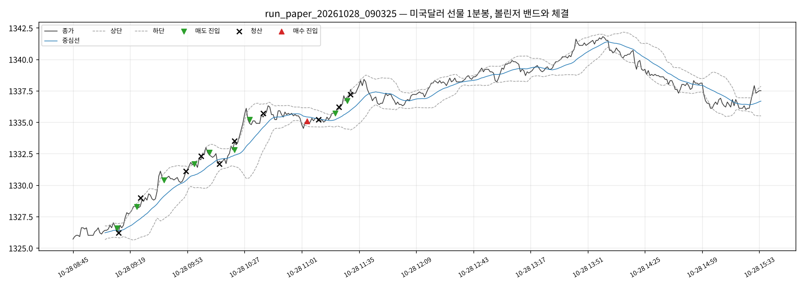

# 실행 요약 — run_paper_20261028_090325

| 항목 | 값 |
| --- | --- |
| 실행 환경 | 모의계좌 주문 |
| 접속 환경 | paper |
| 종목 | A756B000 |
| 시작 | 2026-10-28T09:03:25+09:00 |
| 종료 | 2026-10-28T15:40:04+09:00 |
| 종목명 / 최종거래일 | 미국달러 F 202611 / 20261116 |
| 처리한 봉 | 410 |

## 성과

| 항목 | 값 |
| --- | --- |
| 거래 수 (매수/매도) | 10 (1 / 9) |
| 승 / 패 | 3 / 7 |
| 승률 | 30.0% |
| 순손익 | **-28,000원** |
| 평균 이익 / 평균 손실 | +4,667원 / -6,000원 |
| Profit Factor | 0.33 |
| 최대 낙폭(실현 누적) | 32,000원 |
| 평균 보유 봉 | 4.3 |

### 청산 사유

| 사유 | 건수 | 순손익 합 |
| --- | --- | --- |
| 손절 | 7 | -42,000원 |
| 익절(중심선) | 3 | +14,000원 |

### 거래일별

| 날짜 | 거래 | 승 | 순손익 |
| --- | --- | --- | --- |
| 2026-10-28 | 10 | 3 | -28,000원 |

## 신호와 주문

- 진입 신호 25건 중 진입 10건
  - 보류: 남은 손실한도 12건
  - 보류: 손절 뒤 대기 1건
  - 보류: 밴드폭 1건
  - 보류: 진입시간 밖 1건
- 주문 20건: 체결 20
- 기준가(신호 봉 종가·손절 판정가) 대비 체결 미끄러짐: 평균 +0.35틱, 최대 +2.0틱 (양수 = 불리)

## 시간대별 (진입 시각 기준)

| 시간 | 평균 밴드폭(틱) | 신호 / 진입 | 거래 | 승률 | 익절 / 손절 / 시간 | 순손익 |
| --- | --- | --- | --- | --- | --- | --- |
| 09시 | 24.1 | 4 / 4 | 4 | 25% | 1 / 3 / 0 | -16,000원 |
| 10시 | 26.7 | 4 / 3 | 3 | 33% | 1 / 2 / 0 | -3,000원 |
| 11시 | 20.3 | 4 / 3 | 3 | 33% | 1 / 2 / 0 | -9,000원 |
| 12시 | 13.4 | 3 / 0 | 0 | - | - | - |
| 13시 | 17.0 | 3 / 0 | 0 | - | - | - |
| 14시 | 18.7 | 5 / 0 | 0 | - | - | - |
| 15시 | 20.3 | 2 / 0 | 0 | - | - | - |

- 오전(~12시): 거래 10건, 승률 30%, 순손익 -28,000원

## API 호출

| API | 호출 | 오류 | 평균 지연(ms) |
| --- | --- | --- | --- |
| domestic_chart-minute | 408 | 4 | 293 |
| domestic_open-interest | 22 | 0 | 133 |
| domestic_order | 20 | 0 | 98 |
| domestic_order-history | 20 | 0 | 111 |
| domestic_price | 4130 | 41 | 250 |
| domestic_product-detail | 1 | 0 | 4695 |
| token | 14 | 0 | 182 |

오류 코드: `TIMEOUT` 45건

## 주의 이벤트

없음

## 거래 목록

| # | 방향 | 진입 | 진입가 | 청산 | 청산가 | 사유 | 틱 | 순손익 |
| --- | --- | --- | --- | --- | --- | --- | --- | --- |
| 1 | SHORT | 10-28T09:11:03 | 1326.6 | 10-28T09:12:05 | 1326.2 | 익절(중심선) | 4.0 | +4,000 |
| 2 | SHORT | 10-28T09:23:11 | 1328.3 | 10-28T09:25:58 | 1329.0 | 손절 | -7.0 | -7,000 |
| 3 | SHORT | 10-28T09:39:26 | 1330.4 | 10-28T09:52:31 | 1331.1 | 손절 | -7.0 | -7,000 |
| 4 | SHORT | 10-28T09:57:04 | 1331.7 | 10-28T10:01:04 | 1332.3 | 손절 | -6.0 | -6,000 |
| 5 | SHORT | 10-28T10:06:03 | 1332.6 | 10-28T10:12:04 | 1331.7 | 익절(중심선) | 9.0 | +9,000 |
| 6 | SHORT | 10-28T10:21:06 | 1332.8 | 10-28T10:21:42 | 1333.5 | 손절 | -7.0 | -7,000 |
| 7 | SHORT | 10-28T10:30:04 | 1335.2 | 10-28T10:38:30 | 1335.7 | 손절 | -5.0 | -5,000 |
| 8 | LONG | 10-28T11:04:06 | 1335.1 | 10-28T11:11:08 | 1335.2 | 익절(중심선) | 1.0 | +1,000 |
| 9 | SHORT | 10-28T11:21:06 | 1335.7 | 10-28T11:23:14 | 1336.2 | 손절 | -5.0 | -5,000 |
| 10 | SHORT | 10-28T11:28:03 | 1336.7 | 10-28T11:30:05 | 1337.2 | 손절 | -5.0 | -5,000 |

