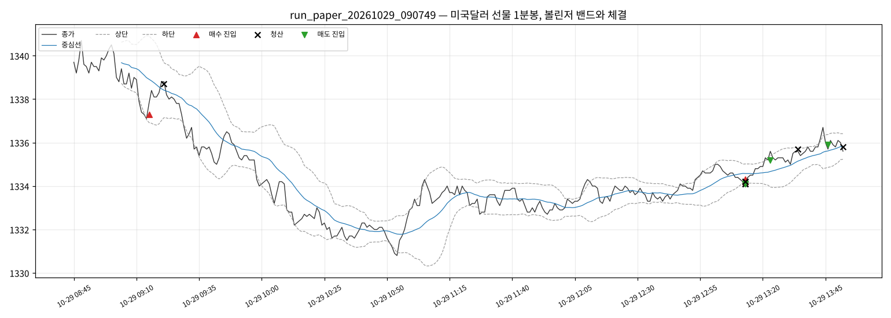

# 실행 요약 — run_paper_20261029_090749

| 항목 | 값 |
| --- | --- |
| 실행 환경 | 모의계좌 주문 |
| 접속 환경 | paper |
| 종목 | A756B000 |
| 시작 | 2026-10-29T09:07:49+09:00 |
| 종료 | 2026-10-29T16:52:23+09:00 |
| 종목명 / 최종거래일 | 미국달러 F 202611 / 20261116 |
| 처리한 봉 | 308 |

## 성과

| 항목 | 값 |
| --- | --- |
| 거래 수 (매수/매도) | 10 (5 / 5) |
| 승 / 패 | 2 / 8 |
| 승률 | 20.0% |
| 순손익 | **+3,000원** |
| 평균 이익 / 평균 손실 | +7,500원 / -1,500원 |
| Profit Factor | 1.25 |
| 최대 낙폭(실현 누적) | 12,000원 |
| 평균 보유 봉 | 12.0 |

### 청산 사유

| 사유 | 건수 | 순손익 합 |
| --- | --- | --- |
| 손절 | 1 | -5,000원 |
| 시간 청산 | 1 | -1,000원 |
| 익절(중심선) | 8 | +9,000원 |

### 거래일별

| 날짜 | 거래 | 승 | 순손익 |
| --- | --- | --- | --- |
| 2026-10-29 | 10 | 2 | +3,000원 |

## 신호와 주문

- 진입 신호 10건 중 진입 10건
- 주문 20건: 체결 20
- 기준가(신호 봉 종가·손절 판정가) 대비 체결 미끄러짐: 평균 -0.25틱, 최대 +27.0틱 (양수 = 불리)

## 시간대별 (진입 시각 기준)

| 시간 | 평균 밴드폭(틱) | 신호 / 진입 | 거래 | 승률 | 익절 / 손절 / 시간 | 순손익 |
| --- | --- | --- | --- | --- | --- | --- |
| 09시 | 28.6 | 2 / 2 | 1 | 100% | 1 / 0 / 0 | +14,000원 |
| 10시 | 21.8 | 2 / 2 | 0 | - | - | - |
| 11시 | 20.0 | 2 / 2 | 0 | - | - | - |
| 12시 | 11.8 | 2 / 2 | 0 | - | - | - |
| 13시 | 13.0 | 2 / 2 | 9 | 11% | 7 / 1 / 1 | -11,000원 |

- 오전(~12시): 거래 1건, 승률 100%, 순손익 +14,000원

- 오후(12시~): 거래 9건, 승률 11%, 순손익 -11,000원

## API 호출

| API | 호출 | 오류 | 평균 지연(ms) |
| --- | --- | --- | --- |
| domestic_chart-minute | 63 | 0 | 89 |
| domestic_open-interest | 22 | 0 | 85 |
| domestic_order | 20 | 0 | 86 |
| domestic_order-history | 20 | 0 | 91 |
| domestic_price | 711 | 2 | 16043 |
| domestic_product-detail | 1 | 0 | 4758 |
| token | 3 | 2 | 638992 |

오류 코드: `TRANSPORT` 4건

## 주의 이벤트

없음

## 거래 목록

| # | 방향 | 진입 | 진입가 | 청산 | 청산가 | 사유 | 틱 | 순손익 |
| --- | --- | --- | --- | --- | --- | --- | --- | --- |
| 1 | LONG | 10-29T09:15:05 | 1337.3 | 10-29T09:21:05 | 1338.7 | 익절(중심선) | 14.0 | +14,000 |
| 2 | LONG | 10-29T13:13:06 | 1334.3 | 10-29T13:13:07 | 1334.2 | 익절(중심선) | -1.0 | -1,000 |
| 3 | LONG | 10-29T13:13:08 | 1334.2 | 10-29T13:13:14 | 1334.1 | 시간 청산 | -1.0 | -1,000 |
| 4 | LONG | 10-29T13:13:15 | 1334.2 | 10-29T13:13:16 | 1334.1 | 익절(중심선) | -1.0 | -1,000 |
| 5 | SHORT | 10-29T13:13:17 | 1334.1 | 10-29T13:13:18 | 1334.2 | 익절(중심선) | -1.0 | -1,000 |
| 6 | LONG | 10-29T13:13:19 | 1334.2 | 10-29T13:13:20 | 1334.1 | 익절(중심선) | -1.0 | -1,000 |
| 7 | SHORT | 10-29T13:13:21 | 1334.1 | 10-29T13:13:22 | 1334.2 | 익절(중심선) | -1.0 | -1,000 |
| 8 | SHORT | 10-29T13:13:23 | 1334.1 | 10-29T13:13:24 | 1334.2 | 익절(중심선) | -1.0 | -1,000 |
| 9 | SHORT | 10-29T13:23:04 | 1335.2 | 10-29T13:34:13 | 1335.7 | 손절 | -5.0 | -5,000 |
| 10 | SHORT | 10-29T13:46:03 | 1335.9 | 10-29T13:53:04 | 1335.8 | 익절(중심선) | 1.0 | +1,000 |

