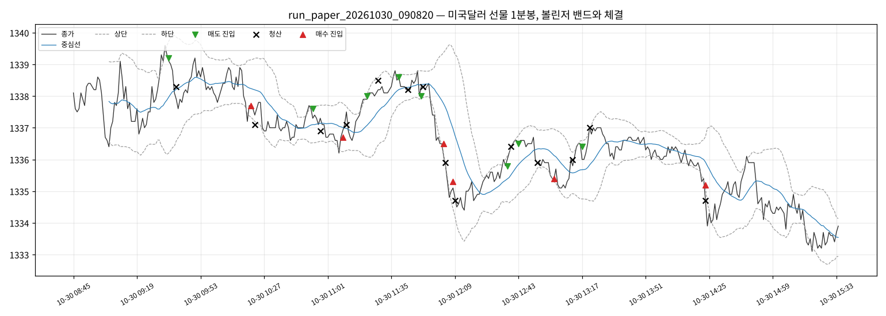

# 실행 요약 — run_paper_20261030_090820

| 항목 | 값 |
| --- | --- |
| 실행 환경 | 모의계좌 주문 |
| 접속 환경 | paper |
| 종목 | A756B000 |
| 시작 | 2026-10-30T09:08:20+09:00 |
| 종료 | 2026-10-30T15:40:05+09:00 |
| 종목명 / 최종거래일 | 미국달러 F 202611 / 20261116 |
| 처리한 봉 | 410 |

## 성과

| 항목 | 값 |
| --- | --- |
| 거래 수 (매수/매도) | 14 (6 / 8) |
| 승 / 패 | 6 / 8 |
| 승률 | 42.9% |
| 순손익 | **-7,000원** |
| 평균 이익 / 평균 손실 | +6,000원 / -5,375원 |
| Profit Factor | 0.84 |
| 최대 낙폭(실현 누적) | 22,000원 |
| 평균 보유 봉 | 3.7 |

### 청산 사유

| 사유 | 건수 | 순손익 합 |
| --- | --- | --- |
| 손절 | 7 | -40,000원 |
| 익절(중심선) | 7 | +33,000원 |

### 거래일별

| 날짜 | 거래 | 승 | 순손익 |
| --- | --- | --- | --- |
| 2026-10-30 | 14 | 6 | -7,000원 |

## 신호와 주문

- 진입 신호 19건 중 진입 14건
  - 보류: 밴드폭 2건
  - 보류: 진입시간 밖 2건
  - 보류: 손절 뒤 대기 1건
- 주문 28건: 체결 28
- 기준가(신호 봉 종가·손절 판정가) 대비 체결 미끄러짐: 평균 +0.18틱, 최대 +3.0틱 (양수 = 불리)

## 시간대별 (진입 시각 기준)

| 시간 | 평균 밴드폭(틱) | 신호 / 진입 | 거래 | 승률 | 익절 / 손절 / 시간 | 순손익 |
| --- | --- | --- | --- | --- | --- | --- |
| 09시 | 25.8 | 1 / 1 | 1 | 100% | 1 / 0 / 0 | +9,000원 |
| 10시 | 14.6 | 2 / 2 | 2 | 50% | 1 / 1 / 0 | +1,000원 |
| 11시 | 13.4 | 4 / 4 | 4 | 50% | 3 / 1 / 0 | +0원 |
| 12시 | 23.7 | 4 / 4 | 4 | 25% | 1 / 3 / 0 | -12,000원 |
| 13시 | 14.9 | 4 / 2 | 2 | 50% | 1 / 1 / 0 | +0원 |
| 14시 | 9.2 | 2 / 1 | 1 | 0% | 0 / 1 / 0 | -5,000원 |
| 15시 | 16.0 | 2 / 0 | 0 | - | - | - |

- 오전(~12시): 거래 7건, 승률 57%, 순손익 +10,000원

- 오후(12시~): 거래 7건, 승률 29%, 순손익 -17,000원

## API 호출

| API | 호출 | 오류 | 평균 지연(ms) |
| --- | --- | --- | --- |
| domestic_chart-minute | 393 | 1 | 148 |
| domestic_open-interest | 30 | 0 | 135 |
| domestic_order | 28 | 0 | 92 |
| domestic_order-history | 28 | 0 | 117 |
| domestic_price | 4076 | 7 | 100 |
| domestic_product-detail | 1 | 0 | 4734 |

오류 코드: `TIMEOUT` 8건

## 주의 이벤트

gap 1건, pause 1건
- 2026-10-30T15:08:51+09:00 [pause] 실행이 43.8분 멈췄다가 다시 돎 (14:25:03→15:08:51, PC 절전·네트워크 끊김 추정)
- 2026-10-30T15:09:12+09:00 [gap] 밀린 봉 42개(14:25~15:06)는 지표만 갱신하고 주문하지 않음

## 거래 목록

| # | 방향 | 진입 | 진입가 | 청산 | 청산가 | 사유 | 틱 | 순손익 |
| --- | --- | --- | --- | --- | --- | --- | --- | --- |
| 1 | SHORT | 10-30T09:36:06 | 1339.2 | 10-30T09:40:05 | 1338.3 | 익절(중심선) | 9.0 | +9,000 |
| 2 | LONG | 10-30T10:20:03 | 1337.7 | 10-30T10:22:31 | 1337.1 | 손절 | -6.0 | -6,000 |
| 3 | SHORT | 10-30T10:53:03 | 1337.6 | 10-30T10:57:07 | 1336.9 | 익절(중심선) | 7.0 | +7,000 |
| 4 | LONG | 10-30T11:09:06 | 1336.7 | 10-30T11:11:03 | 1337.1 | 익절(중심선) | 4.0 | +4,000 |
| 5 | SHORT | 10-30T11:22:03 | 1338.0 | 10-30T11:28:33 | 1338.5 | 손절 | -5.0 | -5,000 |
| 6 | SHORT | 10-30T11:39:08 | 1338.6 | 10-30T11:44:07 | 1338.2 | 익절(중심선) | 4.0 | +4,000 |
| 7 | SHORT | 10-30T11:51:03 | 1338.0 | 10-30T11:52:05 | 1338.3 | 익절(중심선) | -3.0 | -3,000 |
| 8 | LONG | 10-30T12:03:04 | 1336.5 | 10-30T12:04:16 | 1335.9 | 손절 | -6.0 | -6,000 |
| 9 | LONG | 10-30T12:08:05 | 1335.3 | 10-30T12:09:16 | 1334.7 | 손절 | -6.0 | -6,000 |
| 10 | SHORT | 10-30T12:37:07 | 1335.8 | 10-30T12:39:09 | 1336.4 | 손절 | -6.0 | -6,000 |
| 11 | SHORT | 10-30T12:43:04 | 1336.5 | 10-30T12:53:05 | 1335.9 | 익절(중심선) | 6.0 | +6,000 |
| 12 | LONG | 10-30T13:02:04 | 1335.4 | 10-30T13:12:04 | 1336.0 | 익절(중심선) | 6.0 | +6,000 |
| 13 | SHORT | 10-30T13:17:05 | 1336.4 | 10-30T13:21:57 | 1337.0 | 손절 | -6.0 | -6,000 |
| 14 | LONG | 10-30T14:23:06 | 1335.2 | 10-30T14:23:17 | 1334.7 | 손절 | -5.0 | -5,000 |

