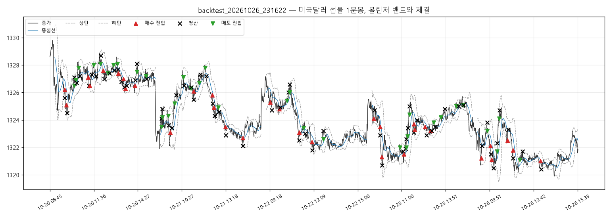

# 실행 요약 — backtest_20261026_231622

| 항목 | 값 |
| --- | --- |
| 실행 환경 | 백테스트(봉 체결 가정) |
| 종목 | A756B000 |
| 데이터 | domestic_chart-minute (paper) 최근 5거래일 |
| 첫 봉 | 2026-10-20T08:45:00+09:00 |
| 마지막 봉 | 2026-10-26T15:45:00+09:00 |
| 슬리피지(틱) | 1 |
| 처리한 봉 | 2055 |

## 성과

| 항목 | 값 |
| --- | --- |
| 거래 수 (매수/매도) | 68 (33 / 35) |
| 승 / 패 | 23 / 45 |
| 승률 | 33.8% |
| 순손익 | **-131,000원** |
| 평균 이익 / 평균 손실 | +4,783원 / -5,356원 |
| Profit Factor | 0.46 |
| 최대 낙폭(실현 누적) | 131,000원 |
| 평균 보유 봉 | 3.5 |

### 청산 사유

| 사유 | 건수 | 순손익 합 |
| --- | --- | --- |
| 손절 | 40 | -240,000원 |
| 익절(중심선) | 28 | +109,000원 |

### 거래일별

| 날짜 | 거래 | 승 | 순손익 |
| --- | --- | --- | --- |
| 2026-10-20 | 19 | 9 | -14,000원 |
| 2026-10-21 | 15 | 5 | -30,000원 |
| 2026-10-22 | 8 | 2 | -31,000원 |
| 2026-10-23 | 16 | 5 | -25,000원 |
| 2026-10-26 | 10 | 2 | -31,000원 |

## 신호와 주문

- 진입 신호 115건 중 진입 68건
  - 보류: 중지:일일 23건
  - 보류: 밴드폭 12건
  - 보류: 손절 5건
  - 보류: 진입시간 5건
  - 보류: 남은 2건
- 주문 136건: BT_FILLED 136
- 기준가(신호 봉 종가·손절 판정가) 대비 체결 미끄러짐: 평균 +0.64틱, 최대 +3.0틱 (양수 = 불리)

## 시간대별 (진입 시각 기준)

| 시간 | 평균 밴드폭(틱) | 신호 / 진입 | 거래 | 승률 | 익절 / 손절 / 시간 | 순손익 |
| --- | --- | --- | --- | --- | --- | --- |
| 09시 | 24.6 | 16 / 16 | 16 | 31% | 5 / 11 / 0 | -40,000원 |
| 10시 | 18.3 | 11 / 9 | 9 | 44% | 4 / 5 / 0 | -13,000원 |
| 11시 | 17.6 | 20 / 18 | 18 | 39% | 8 / 10 / 0 | -16,000원 |
| 12시 | 11.5 | 16 / 11 | 11 | 18% | 4 / 7 / 0 | -35,000원 |
| 13시 | 9.2 | 11 / 8 | 8 | 38% | 3 / 5 / 0 | -21,000원 |
| 14시 | 10.6 | 26 / 6 | 6 | 33% | 4 / 2 / 0 | -6,000원 |
| 15시 | 12.6 | 15 / 0 | 0 | - | - | - |

- 오전(~12시): 거래 43건, 승률 37%, 순손익 -69,000원

- 오후(12시~): 거래 25건, 승률 28%, 순손익 -62,000원

## 주의 이벤트

risk 2건
- 2026-10-22T12:47:00+09:00 [risk] 일일 손실 -31,000원 — 오늘 신규 진입 중지
- 2026-10-26T13:12:00+09:00 [risk] 일일 손실 -31,000원 — 오늘 신규 진입 중지

## 거래 목록

| # | 방향 | 진입 | 진입가 | 청산 | 청산가 | 사유 | 틱 | 순손익 |
| --- | --- | --- | --- | --- | --- | --- | --- | --- |
| 1 | LONG | 10-20T09:43:00 | 1326.2 | 10-20T09:43:30 | 1325.6 | 손절 | -6.0 | -6,000 |
| 2 | LONG | 10-20T09:48:00 | 1325.1 | 10-20T09:51:30 | 1324.5 | 손절 | -6.0 | -6,000 |
| 3 | SHORT | 10-20T10:19:00 | 1326.5 | 10-20T10:19:30 | 1327.1 | 손절 | -6.0 | -6,000 |
| 4 | SHORT | 10-20T10:25:00 | 1326.9 | 10-20T10:29:00 | 1326.7 | 익절(중심선) | 2.0 | +2,000 |
| 5 | SHORT | 10-20T10:37:00 | 1327.8 | 10-20T10:41:00 | 1327.2 | 익절(중심선) | 6.0 | +6,000 |
| 6 | LONG | 10-20T11:14:00 | 1327.1 | 10-20T11:17:30 | 1326.5 | 손절 | -6.0 | -6,000 |
| 7 | LONG | 10-20T11:20:00 | 1326.5 | 10-20T11:28:00 | 1327.3 | 익절(중심선) | 8.0 | +8,000 |
| 8 | SHORT | 10-20T11:35:00 | 1328.0 | 10-20T11:44:00 | 1327.2 | 익절(중심선) | 8.0 | +8,000 |
| 9 | SHORT | 10-20T12:01:00 | 1328.1 | 10-20T12:03:30 | 1328.7 | 손절 | -6.0 | -6,000 |
| 10 | LONG | 10-20T12:12:00 | 1327.6 | 10-20T12:16:30 | 1327.0 | 손절 | -6.0 | -6,000 |
| 11 | SHORT | 10-20T12:30:00 | 1327.4 | 10-20T12:37:00 | 1327.4 | 익절(중심선) | -0.0 | +0 |
| 12 | SHORT | 10-20T12:52:00 | 1328.0 | 10-20T12:55:00 | 1327.6 | 익절(중심선) | 4.0 | +4,000 |
| 13 | SHORT | 10-20T13:07:00 | 1328.1 | 10-20T13:09:00 | 1327.7 | 익절(중심선) | 4.0 | +4,000 |
| 14 | LONG | 10-20T13:11:00 | 1327.4 | 10-20T13:23:30 | 1326.8 | 손절 | -6.0 | -6,000 |
| 15 | LONG | 10-20T13:31:00 | 1327.0 | 10-20T13:34:30 | 1326.4 | 손절 | -6.0 | -6,000 |
| 16 | LONG | 10-20T13:38:00 | 1326.3 | 10-20T13:43:00 | 1326.5 | 익절(중심선) | 2.0 | +2,000 |
| 17 | LONG | 10-20T14:16:00 | 1326.5 | 10-20T14:17:00 | 1326.9 | 익절(중심선) | 4.0 | +4,000 |
| 18 | SHORT | 10-20T14:24:00 | 1327.5 | 10-20T14:24:30 | 1328.1 | 손절 | -6.0 | -6,000 |
| 19 | SHORT | 10-20T14:59:00 | 1327.2 | 10-20T15:01:00 | 1327.0 | 익절(중심선) | 2.0 | +2,000 |
| 20 | SHORT | 10-21T09:08:00 | 1323.5 | 10-21T09:08:30 | 1324.1 | 손절 | -6.0 | -6,000 |
| 21 | SHORT | 10-21T09:11:00 | 1324.2 | 10-21T09:11:30 | 1324.8 | 손절 | -6.0 | -6,000 |
| 22 | SHORT | 10-21T09:34:00 | 1324.3 | 10-21T09:36:00 | 1323.6 | 익절(중심선) | 7.0 | +7,000 |
| 23 | LONG | 10-21T09:42:00 | 1323.1 | 10-21T09:48:00 | 1323.4 | 익절(중심선) | 3.0 | +3,000 |
| 24 | SHORT | 10-21T09:59:00 | 1325.2 | 10-21T10:05:30 | 1325.8 | 손절 | -6.0 | -6,000 |
| 25 | SHORT | 10-21T10:33:00 | 1327.1 | 10-21T10:36:00 | 1326.5 | 익절(중심선) | 6.0 | +6,000 |
| 26 | SHORT | 10-21T11:02:00 | 1326.3 | 10-21T11:03:00 | 1326.4 | 익절(중심선) | -1.0 | -1,000 |
| 27 | LONG | 10-21T11:13:00 | 1326.1 | 10-21T11:13:30 | 1325.5 | 손절 | -6.0 | -6,000 |
| 28 | SHORT | 10-21T11:34:00 | 1326.7 | 10-21T11:39:30 | 1327.3 | 손절 | -6.0 | -6,000 |
| 29 | SHORT | 10-21T11:58:00 | 1327.8 | 10-21T12:03:00 | 1327.2 | 익절(중심선) | 6.0 | +6,000 |
| 30 | LONG | 10-21T12:25:00 | 1325.8 | 10-21T12:27:30 | 1325.2 | 손절 | -6.0 | -6,000 |
| 31 | LONG | 10-21T12:32:00 | 1324.9 | 10-21T12:35:30 | 1324.3 | 손절 | -6.0 | -6,000 |
| 32 | SHORT | 10-21T12:48:00 | 1324.9 | 10-21T12:52:00 | 1324.6 | 익절(중심선) | 3.0 | +3,000 |
| 33 | LONG | 10-21T13:17:00 | 1323.5 | 10-21T13:18:30 | 1322.9 | 손절 | -6.0 | -6,000 |
| 34 | LONG | 10-21T14:24:00 | 1322.7 | 10-21T14:24:30 | 1322.1 | 손절 | -6.0 | -6,000 |
| 35 | LONG | 10-22T09:19:00 | 1325.3 | 10-22T09:26:30 | 1324.7 | 손절 | -6.0 | -6,000 |
| 36 | LONG | 10-22T09:55:00 | 1324.8 | 10-22T09:59:00 | 1324.9 | 익절(중심선) | 1.0 | +1,000 |
| 37 | SHORT | 10-22T10:24:00 | 1325.4 | 10-22T10:31:30 | 1326.0 | 손절 | -6.0 | -6,000 |
| 38 | SHORT | 10-22T10:36:00 | 1326.0 | 10-22T10:36:30 | 1326.6 | 손절 | -6.0 | -6,000 |
| 39 | LONG | 10-22T11:13:00 | 1323.1 | 10-22T11:13:30 | 1322.5 | 손절 | -6.0 | -6,000 |
| 40 | SHORT | 10-22T11:30:00 | 1323.4 | 10-22T11:36:00 | 1323.0 | 익절(중심선) | 4.0 | +4,000 |
| 41 | LONG | 10-22T12:01:00 | 1322.4 | 10-22T12:03:30 | 1321.8 | 손절 | -6.0 | -6,000 |
| 42 | SHORT | 10-22T12:46:00 | 1322.6 | 10-22T12:47:30 | 1323.2 | 손절 | -6.0 | -6,000 |
| 43 | LONG | 10-23T09:11:00 | 1324.1 | 10-23T09:14:00 | 1324.7 | 익절(중심선) | 6.0 | +6,000 |
| 44 | LONG | 10-23T09:36:00 | 1323.5 | 10-23T09:36:30 | 1322.9 | 손절 | -6.0 | -6,000 |
| 45 | LONG | 10-23T09:43:00 | 1321.3 | 10-23T09:44:30 | 1320.7 | 손절 | -6.0 | -6,000 |
| 46 | SHORT | 10-23T10:54:00 | 1322.0 | 10-23T11:05:00 | 1321.7 | 익절(중심선) | 3.0 | +3,000 |
| 47 | LONG | 10-23T11:09:00 | 1321.5 | 10-23T11:15:00 | 1321.9 | 익절(중심선) | 4.0 | +4,000 |
| 48 | SHORT | 10-23T11:18:00 | 1322.0 | 10-23T11:18:30 | 1322.6 | 손절 | -6.0 | -6,000 |
| 49 | SHORT | 10-23T11:23:00 | 1322.8 | 10-23T11:24:30 | 1323.4 | 손절 | -6.0 | -6,000 |
| 50 | SHORT | 10-23T11:30:00 | 1324.4 | 10-23T11:31:30 | 1325.0 | 손절 | -6.0 | -6,000 |
| 51 | LONG | 10-23T11:48:00 | 1323.7 | 10-23T11:48:30 | 1323.1 | 손절 | -6.0 | -6,000 |
| 52 | LONG | 10-23T11:51:00 | 1323.3 | 10-23T12:00:00 | 1324.0 | 익절(중심선) | 7.0 | +7,000 |
| 53 | LONG | 10-23T12:31:00 | 1323.5 | 10-23T12:36:30 | 1322.9 | 손절 | -6.0 | -6,000 |
| 54 | LONG | 10-23T12:52:00 | 1323.2 | 10-23T12:56:00 | 1323.2 | 익절(중심선) | 0.0 | +0 |
| 55 | SHORT | 10-23T13:04:00 | 1323.8 | 10-23T13:11:00 | 1323.5 | 익절(중심선) | 3.0 | +3,000 |
| 56 | SHORT | 10-23T13:32:00 | 1324.2 | 10-23T13:47:30 | 1324.8 | 손절 | -6.0 | -6,000 |
| 57 | SHORT | 10-23T14:33:00 | 1325.0 | 10-23T14:42:00 | 1325.0 | 익절(중심선) | -0.0 | +0 |
| 58 | SHORT | 10-23T14:59:00 | 1325.1 | 10-23T15:00:00 | 1325.1 | 익절(중심선) | -0.0 | +0 |
| 59 | LONG | 10-26T09:18:00 | 1321.2 | 10-26T09:21:00 | 1322.1 | 익절(중심선) | 9.0 | +9,000 |
| 60 | SHORT | 10-26T09:42:00 | 1323.2 | 10-26T09:42:30 | 1323.8 | 손절 | -6.0 | -6,000 |
| 61 | LONG | 10-26T09:54:00 | 1322.1 | 10-26T09:55:30 | 1321.5 | 손절 | -6.0 | -6,000 |
| 62 | LONG | 10-26T09:59:00 | 1321.1 | 10-26T10:07:30 | 1320.5 | 손절 | -6.0 | -6,000 |
| 63 | SHORT | 10-26T10:21:00 | 1321.7 | 10-26T10:21:30 | 1322.3 | 손절 | -6.0 | -6,000 |
| 64 | SHORT | 10-26T10:28:00 | 1324.1 | 10-26T10:30:30 | 1324.7 | 손절 | -6.0 | -6,000 |
| 65 | LONG | 10-26T11:00:00 | 1322.5 | 10-26T11:03:00 | 1323.3 | 익절(중심선) | 8.0 | +8,000 |
| 66 | LONG | 10-26T11:22:00 | 1321.8 | 10-26T11:22:30 | 1321.2 | 손절 | -6.0 | -6,000 |
| 67 | SHORT | 10-26T11:49:00 | 1321.1 | 10-26T11:59:30 | 1321.7 | 손절 | -6.0 | -6,000 |
| 68 | LONG | 10-26T13:08:00 | 1321.0 | 10-26T13:12:30 | 1320.4 | 손절 | -6.0 | -6,000 |

