# 3주차 · 해외상품·거래소 전략 구현 — 아시아 지수선물 「현물 개장 범위 돌파」

**제출: 2026/11/06(금) 23:59** · 팀 리드랙(LeadLag) · team-02 · 주제 4. 아시아 주가지수

> 수치는 모두 `results/` 의 원본 기록에서 읽은 값입니다. **최종 갱신 11/6** — 실행 4일(11/3~11/6) 전체를 반영했습니다.
>
> **실행 환경을 섞지 않습니다.** 이 보고서의 숫자는 세 종류이고, 절마다 어느 것인지 밝힙니다.
> ① **백테스트** — 과거 1분봉으로 프로그램 안에서 계산(`backtest_orb.py`) ② **해외 모의계좌 실주문** — NH선물 모의 서버에 실제로 낸 주문과 체결(`run_orb.py`, `fills`·`orders` 기록의 `source = paper_account`) ③ **서버 주문내역 대조** — 같은 계좌의 주문내역을 서버에서 다시 조회한 값(`order_history.py`)

| 항목 | 내용 |
| --- | --- |
| 전략 | 중국 본토·홍콩 **현물이 열리는 시각(10:30, 점심 뒤 14:00 KST)** 의 첫 15분 범위를 벗어나는 쪽으로 따라 들어가는 돌파(추세 추종) |
| 대상 종목 | **SGX FTSE China A50** 2026년 11월물 `SFCX26` (USD) · **HKEX 미니 항셍** 2026년 11월물 `MHIX26` (HKD) — 실행 시작 때 현재가 조회로 근월물을 확인해 기록 |
| 비교 기준 | 2주차 볼린저(20, 2.0) 평균회귀 — 계획했으나 시간 관계상 이번 주에는 하지 못해 9절로 넘김 |
| 기준 봉 | 1분봉, 봉 마감 때 판정 |
| 실행 환경 | **해외 모의계좌 주문** (`apidemo.futures.co.kr`, 해외 모의 APP Key). 프로그램 안 시뮬레이션은 쓰지 않음 |
| 실행 계좌 | 11/3 오전: 팀원 해외 모의계좌 · 11/3 오후부터: 남혜원 해외 모의계좌 — **같은 코드·같은 설정**, 키는 실행 PC 환경변수에서 읽음 |
| 코드 | Python 3.10+ · 실행·점검은 `requests` 만, 백테스트·대조 실험(`backtest_orb.py`, `placebo_orb.py`)만 `pandas` 추가 |

## 폴더 구성

| 경로 | 내용 |
| --- | --- |
| `README.md` | 이 보고서 |
| `nh_overseas.py` | 해외 API 호출부 — 인증·토큰 캐시·호출 간격·본문 기반 성공 판정·호출 기록(`api_calls.csv`) |
| `check_overseas.py` | 실행 전 점검 — 장운영정보·품목세부정보 조회, 근월물 찾기, 과거 1분봉 내려받기, 주문 왕복 시험(`--smoke-order`), 잔고 정리(`--flatten`) |
| `run_orb.py` | **실시간 실행** — 두 종목 × 두 세션, 주문·체결 확인·잔고 대조·기록, 16:57 자동 종료 |
| `backtest_orb.py` | 백테스트 — 실행과 같은 규칙값, 봉 체결 가정 |
| `placebo_orb.py` | 대조 실험 — 같은 규칙을 30분마다 다른 시각에 걸어 현물 개장 시각과 비교 |
| `order_history.py` | 서버 주문내역 조회 → 표·CSV (프로그램 기록과 대조용, 주문 없음) |
| `repro_overseas.py` | 오류 제보용 재현 — 요청·응답 원본을 JSON 으로 저장 (계좌번호 칸 가림, 주문 없음) |
| `download_contracts.py` | 만기 지난 월물 분봉 조회 시도 (결과: 조회 불가, 8-1절) |
| `ws_probe.py` | 웹소켓 실시간 체결(`FA`) 기록 전용 — 주문 없음, REST 조회와 비교용(5-4절) |
| `figures/` | 보고서 그림(PNG, matplotlib). `figures/html/` 에 같은 그림의 **Plotly 인터랙티브 버전** — 저장소에서 바로 열리지 않으니 내려받아 브라우저로 열면 마우스로 값을 확인할 수 있습니다(인터넷 연결 필요) |
| `results/` | 실행 하나 = 폴더 하나 (`check_*`, `run_orb_*`, `order_history_*`, `repro_*`) |
| `screenshots/` | 실행 화면·서버 주문내역 캡처 (키·계좌번호 가림) |

## 1. 요약

**우리가 확인하려던 것.** 2주차 원/달러 볼린저 평균회귀는 박스권 날엔 거의 본전, 추세가 선 날엔 손실 대부분을 냈습니다. 그래서 3주차에는 반대로 **「추세가 생기기 쉬운 시점을 미리 알 수 있다면, 그때는 따라가는 게 맞지 않을까」** 를 물었습니다. 아시아 지수선물에는 그 시점이 시간표로 정해져 있습니다 — 본토 A주와 홍콩 주식이 **10:30 KST 에 함께 열리고, 14:00 에 점심 뒤 함께 다시 열립니다.** A50 선물은 그보다 30분 먼저(10:00) 열려 「선물만 움직이는 구간」이 있습니다.

**우리가 한 것.**
1. 해외 API 명세에 맞춰 인증·시세·주문·체결 확인·잔고 대조·기록 프로그램을 새로 작성하고, 두 종목 1계약 **주문 왕복을 모의계좌에서 확인**했습니다(6-1절).
2. 규칙값을 **결과를 보기 전에 고정**하고, 과거 1분봉(약 8거래일)으로 백테스트했습니다(6-2절).
3. 11/3 ~ 11/6 매일 해외 모의계좌로 실제 주문을 내며 돌렸습니다. 11/5 아침에는 모의 서버의 해외 종목 조회 장애(약 24분)를 겪었고, 자동 재시도로 복구 즉시 실행을 이어 갔습니다.
4. 실행 기록을 **백테스트(신호 봉·손절폭·청산 사유)** 와 **서버 주문내역(체결가)** 두 방향으로 대조했습니다(6-4절).
5. 「현물 개장이 정말 특별한가」를 같은 규칙의 **대조 실험(다른 시각)** 으로 시험하고, 거기서 나온 새 가설(H4)을 **그 뒤 실행 데이터로 검증**했습니다(7절).
6. 11/5 운영진 안내(「REST 는 처음에만, 이후는 웹소켓 실시간」)를 받고, 11/6 에 **웹소켓 실시간 체결을 매매와 나란히 기록**해 REST 5초 조회가 얼마나 늦는지 쟀습니다(5-4절).

**알게 된 것.**
- 실행 8건 모두 백테스트와 **신호 봉·손절폭·청산 사유가 같았고**, 「돌파 없음」 세션도 같았습니다. 차이는 체결가에서만 났습니다(합계 실제 +78틱, 백테스트 +76틱). 프로그램 체결가는 서버 주문내역과 8건 모두 일치했습니다.
- 실제 실행 8건은 4승 4패, 틱 합계 A50 0틱 · MHI +78틱(약 +13.3만원)이었습니다. 그러나 백테스트까지 합친 41건으로 보면 **비용을 반영한 거래당 평균 손익이 0보다 크다는 근거는 없었습니다.** A50 은 **−0.54R [95% 구간 −0.92, −0.03]** 으로 오히려 손실이 통계적으로 확인됐고, MHI 는 +0.40R [−0.09, +0.89] 로 플러스였지만 우연과 구분되지 않았습니다.
- **2주차와 달리 비용은 결과를 정하지 않았습니다.** 손절폭이 평균 30~40틱이라 미끄러짐 0→2틱에도 결과가 거의 같았습니다. 3주차의 결과를 정한 것은 **돌파 직후의 방향**과 **종목**이었습니다(손절 × 익절 16개 조합에서 A50 은 모두 손실, MHI 는 15개가 이익).
- 설계 데이터에서 강하게 보인 「A50 은 개장 돌파가 되돌아온다(H4)」는 **그 뒤 데이터(11/3~11/6)에서 뒤집혔습니다** — 검증 4건 모두 30분 뒤 돌파 방향으로 이어졌습니다. 표본이 작을 때 설계 구간의 쏠림이 새 데이터에서 사라지는 모습으로, 2주차 V5 사례와 같은 교훈입니다. 실행 중 규칙을 H4 쪽으로 바꾸지 않은 판단이 옳았습니다.
- **「돌파 직후 흔들림에 손절이 먼저 걸린다」** 는 관찰이 반복됐습니다. 손절 거래의 38~44% 는 손절 뒤 익절가까지 갔습니다. 그러나 **손절을 넓히는 것만으로는 해결되지 않았습니다**(A50 은 ATR 1.5~4배 모두 손실). A50 은 이긴 거래도 손절폭의 0.74배까지 역행했다 돌아오는, 돌파 직후 흔들림이 큰 종목이었습니다 → 다음 개선은 진입 방식(되돌림 확인 뒤 진입 등)입니다(7-4절).
- **웹소켓으로 재 보니 5초 조회는 체결을 약 2초 늦게 알았고**(11/6 MHI 익절), 그 지연(평균 2.5초) 동안 가격은 A50 평균 2.1틱·MHI 3.8틱(90% 구간 4·8틱) 움직였습니다. 손절 체결이 손절가보다 0~5틱 불리했던 크기와 맞아, 다음 주차에 손절·익절 판정을 웹소켓으로 옮길 근거가 됩니다(5-4절).
- 11/5 서버 장애로 두 종목의 오전 첫 돌파를 늦게 보아 규칙대로 건너뛰었는데, 백테스트로는 **둘 다 익절**(약 +21만원)이었을 거래였습니다. 실행 결과에는 넣지 않고 운영 위험의 크기로 따로 적습니다.

| 프로그램이 하는 일 | 방법 | 기록 |
| --- | --- | --- |
| 시세 수신 | 분봉 `chart-minute` 을 매분 마감 2초 뒤 **세션 시작 봉까지 연속조회**, 보유 중에는 현재가 `price` 를 5초마다 | `bars_*.csv`, `api_calls.csv` |
| 신호 판정 | 세션 범위(15분) 뒤 첫 돌파 봉. 마감된 지 90초가 지난 봉은 주문하지 않고 그 세션을 건너뜀 | `signals.csv`, `events.jsonl` |
| 주문 처리 | SFC 시장가 · **MHI 는 체결될 만한 지정가**(HKEX 시장가 불가) → 주문내역으로 체결 확인 → 미체결 취소 → 잔고 대조. 응답 없는 주문은 재전송하지 않음 | `orders.csv`, `trades.csv` |
| 위험 관리 | 종목·세션마다 1회(하루 최대 2회), ATR 손절, 현물 점심·마감 5분 전 시간 청산, 시작 잔고가 0 이 아니면 실행 거부, 종료 때 남은 포지션 정리 | `run_meta.json` |
| 실행 기록 | 사건 로그 · CSV · 실행 메타 · 멈춤(`pause`) 감지 | `results/run_orb_<시각>/` |
| 장애 대응 | 시작 때 시세를 못 받으면 종료 → 셸에서 1분마다 다시 실행(종목별 창 분리), 복구 즉시 시작 | 실행 화면 캡처 |

## 2. 실행 방법

```powershell
python -m pip install requests   # 실행·점검: run_orb, check_overseas, nh_overseas, order_history, repro_overseas
python -m pip install pandas     # 백테스트·대조 실험만: backtest_orb, placebo_orb (실행 PC 에는 필요 없음)
# 키: 사용자 환경변수 NH_OVS_APP_KEY / NH_OVS_APP_SECRET (해외 모의 APP Key). 코드·저장소에 넣지 않음

# ① 점검: 장운영정보·품목세부정보·근월물·과거 1분봉 내려받기 (+ 1계약 주문 왕복, 잔고 대조)
python check_overseas.py --smoke-order

# ② 백테스트 (①에서 받은 분봉)
python backtest_orb.py results/check_<시각>/bars_SFC_SFCX26.csv --product SFC --grid
python backtest_orb.py results/check_<시각>/bars_MHI_MHIX26.csv --product MHI --grid

# ③ 본 실행: 10:20 전에 켜면 오전·오후 두 세션을 돌고 16:57 에 스스로 끝남
python run_orb.py --usdkrw <당일 원/달러> --hkdkrw <당일 원/홍콩달러>
python run_orb.py --sessions pm ...     # 오후만 (점심에 실행 PC 를 옮길 때)
python run_orb.py --dry-run --test-at 10:25 --speed 20   # 사전 점검: 오늘 분봉을 빨리 감아 다시 돌림, 주문 없음

# 서버 장애로 시작이 실패할 때: 1분마다 다시 시도 (종목별로 창을 나눠 먼저 복구된 쪽부터 시작)
while ($true) { python run_orb.py --products MHI --usdkrw <..> --hkdkrw <..>; if ($LASTEXITCODE -eq 0) { break }; Start-Sleep 60 }

# ④ 대조·분석
python order_history.py                 # 서버 주문내역 → 표·CSV
python placebo_orb.py                   # 대조 실험
```

`run_orb.py` 는 시작 때 두 종목 잔고가 0 이 아니면 실행을 거부합니다(`check_overseas.py --flatten` 으로 정리). 종료(16:57, Ctrl+C 모두) 때는 남은 포지션을 정리하고 잔고를 다시 대조합니다. 원화 환산은 참고용이며, 실행일 원/달러(11/3 서울외국환중개 매매기준율 1,341.0원, 11/4 개장가 1,344.0원, 11/5 개장가 1,338.5원, 11/6 개장가 1,338.5원)와 홍콩달러 페그 7.83 으로 계산했습니다.

## 3. 상품 특성과 전략에 반영한 방법

### 3-1. 두 종목

| 항목 | A50 (`SFCX26`) | 미니 항셍 (`MHIX26`) | 출처 |
| --- | --- | --- | --- |
| 거래소 / 통화 | SGX (싱가포르, 역외) / **USD** | HKEX (홍콩) / **HKD** | 장운영정보 `market-operations` |
| 1틱 | **1pt = US$1** | **1pt = HK$10** | 품목세부정보 `product-detail` |
| 선물 주간 (KST) | 10:00 ~ 17:35, 점심 휴장 없음 | 10:15 ~ 13:00, **14:00 ~ 17:30** | 장운영정보 |
| 선물 야간 (KST) | 18:00 ~ 다음 날 06:15 | 18:15 ~ 다음 날 04:00 | 장운영정보 |
| 기초 현물 개장 / 점심 / 마감 (KST) | 10:30 / 12:30 ~ 14:00 / 16:00 (본토 A주) | 10:30 / 13:00 ~ 14:00 / 17:00 (홍콩) | 상하이·홍콩 거래소 시간표 |
| 주문 | 시장가 가능 | **시장가 불가** (오류 7032) | 11/2 주문 시험 |
| 조회용 거래소 코드 | `FSGX` | **`FHKE`** (장운영정보 표기는 `HKEX`) | 11/2 실측, 8-1절 |

**A50 은 왜 달러인가.** 이 선물은 중국이 아니라 싱가포르 거래소가 해외 투자자용으로 만든 역외 상품이고 현금 결제라 위안화가 오갈 필요가 없습니다. 지수는 위안화 주식으로 계산되지만 「1포인트 = 1달러」로 고정된 퀀토 구조라, 계약 손익에 위안화 환율이 직접 들어가지 않습니다. 우리 계좌 기준으로는 USD·HKD → 원화 환산이 따로 붙습니다.

### 3-2. 특성을 규칙에 넣은 곳

| 특성 | 규칙·코드에 반영한 방법 |
| --- | --- |
| 현물 개장 10:30, 점심 뒤 재개 14:00 이 두 시장 같음 | 두 종목에 **같은 세션 시각**을 걸어 같은 가설을 두 시장에서 비교, 하루 2세션으로 표본 확대 |
| 점심 휴장 시각이 다름 (본토 12:30, 홍콩 13:00) | 오전 시간 청산을 종목별로: **A50 12:25 · MHI 12:55** (현물 쉬기 5분 전) |
| 현물 마감이 다름 (본토 16:00, 홍콩 17:00) | 오후 시간 청산: **A50 15:55 · MHI 16:55** |
| MHI 선물 자체가 점심에 멈춤 | 분봉 공백을 봉 공백으로 다루고, 오전 포지션은 휴장 전에 반드시 청산 |
| HKEX 시장가 불가 | MHI 는 「매수 = 매도1호가 + 3틱, 매도 = 매수1호가 − 3틱」 지정가로 대신, 10초 안에 안 채워지면 취소 |
| 통화가 다름 | 손익은 USD·HKD 로 기록하고 원화 환산값을 따로 남김 (`--usdkrw`, `--hkdkrw`) |
| 틱 가치가 다름 | 손절을 고정 틱이 아니라 **ATR(1분봉 14개) × 2** 로 — 종목·날짜의 변동성에 맞춤 |
| 만기 지난 월물 분봉 조회 불가 | 백테스트는 11월물이 활발한 날만 사용(근월물 전환 전 한산한 날 제외), 표본 한계를 7-4절에 명시 |

## 4. 전략과 매매 규칙

### 4-1. 왜 이 전략인가

| 후보 | 판단 |
| --- | --- |
| **현물 개장 범위 돌파 (채택)** | 시장 구조(현물 개장 시각)에서 바로 나온 가설이고, 두 종목에 같은 시각으로 걸 수 있음 |
| 2주차 볼린저를 그대로 옮기기 | 구현은 쉽지만 「이번 주에 새로 설계한 것」이 숫자 조정뿐 → 비교 기준으로만 사용 |
| 개장 전(10:00~10:30) 움직임의 되돌림 | 하루 한 번뿐인 데다 「크게 움직인 날」만 골라 신호가 더 드물고 「과도한 반응」 판정 기준에 긴 분포가 필요 → 향후 계획 |
| 업종(금융·기술) 방향 필터 | 동기화된 업종 시세가 필요하고 같은 봉 정보로 미래를 쓰기 쉬움 → 향후 계획 |

**돌파 추종은 평균회귀와 반대입니다.** 범위 아래로 뚫으면 2주차 볼린저는 「반등한다」에 매수하지만, 이 전략은 「계속 내려간다」에 매도합니다.

### 4-2. 매매 규칙 (11/2 고정, 실행 중 바꾸지 않음)

| 구분 | 규칙 |
| --- | --- |
| 기준 범위 | 세션 개장부터 15분(오전 10:30~10:45, 오후 14:00~14:15) 1분봉의 최고가·최저가 |
| 매수 / 매도 진입 | 범위 뒤 마감된 1분봉 종가가 범위 고가 위 / 저가 아래인 **첫 봉** |
| 진입 가능 시간 | 오전 10:45~11:29 봉 · 오후 14:15~14:59 봉, **종목·세션마다 1회** |
| 손절 | 진입 체결가에서 ATR(1분봉 14개) × 2, 틱 올림, 최소 2틱 |
| 익절 | 손절폭 × 1.5 |
| 시간 청산 | 오전 = 현물 점심 5분 전(A50 12:25 · MHI 12:55), 오후 = 현물 마감 5분 전(A50 15:55 · MHI 16:55) |
| 진입 거름 | 범위 폭 < 8틱(왕복 비용 2틱의 4배)이면 그 세션 거래 안 함 |
| 놓친 신호 | 첫 돌파 봉을 마감 90초 안에 못 봤으면 그 세션 건너뜀(뒤 봉으로 들어가면 규칙과 달라짐) |
| 주문 | 1계약, A50 시장가 · MHI 지정가 대체 |

종목·세션마다 1회 규칙이라 하루 최대 손실은 「종목 2 × 세션 2 × 손절 1회」로 정해집니다. 2주차 같은 일일 손실 한도는 두지 않았습니다(이유는 4-3절).

ATR 은 [TradingView 의 ATR 설명](https://www.tradingview.com/support/solutions/43000501823-average-true-range-atr/)과 같은 **True Range**(그 봉의 고가−저가, |고가−직전 종가|, |저가−직전 종가| 중 가장 큰 값)를 씁니다. 다만 평균 방식은 TradingView 기본값(RMA, 와일더 평활)이 아니라 **최근 14개 1분봉 True Range 의 단순평균(SMA)** 입니다(`run_orb.py` 의 `atr_at`, `backtest_orb.py` 의 `rolling(14).mean()`). 단순평균은 최근 봉에 더 빨리 반응해, 개장 직후처럼 변동이 커질 때 손절폭이 와일더 방식보다 조금 더 빨리 넓어집니다.

### 4-3. 값마다 그렇게 정한 이유

| 규칙 | 값 | 이유 |
| --- | --- | --- |
| 범위 15분 | — | 현물 첫 주문이 몰리는 구간. 30분은 표본을 더 줄임(격자에서 비교만) |
| 손절 ATR × 2 | — | 2주차에 고정 5틱이 「보통 출렁임」에 걸렸던 교훈 → 그날 변동성에 맞춤 |
| 익절 1.5배 | — | 이기면 지는 폭보다 크게. 손익분기 승률 40% |
| 시간 청산 | 현물 점심·마감 5분 전 | 기초 현물이 쉬거나 닫히면 「현물 개장 효과」의 전제가 사라짐 |
| 종목·세션마다 1회 | 하루 최대 2회/종목 | ① 가설이 현물 개장 직후 **첫 돌파**에 관한 것 — 첫 돌파가 실패한 뒤의 재돌파는 시장이 한 번 흔들린 뒤라 성격이 다름 ② 범위 근처에서 오르내리는 날 위·아래 돌파마다 손절이 쌓이는 것을 막음(2주차 10/28 연속 손절 교훈) ③ 하루 최대 손실이 「2종목 × 2세션 × 손절 1번」으로 고정되어 일일 손실 한도가 따로 필요 없음 ④ 세션마다 거래가 하나라 거래끼리 독립에 가까워 신뢰구간 계산이 부풀지 않음. 대가: 표본이 적고, 신호 하나를 놓친 영향이 큼(11/5 장애) |
| 설정 고정 | — | 백테스트 표본이 약 8거래일뿐이라 설계/검증 분할이 불가능. 좋아 보이는 칸을 고르면 과최적화(2주차 V5) |

### 4-4. 검증할 가설

| 가설 | 확인 방법 |
| --- | --- |
| **H1.** 현물 개장 직후 범위 돌파는 비용을 빼고도 평균손익이 양수 | 백테스트·실행 거래당 평균 손익(틱), 미끄러짐 0/1틱 |
| **H2.** 본토(A50)와 역외(MHI)의 개장 효과가 다르다 | 종목별 승률·평균손익·돌파 뒤 범위 복귀 비율 |
| **H3.** 평균회귀(볼린저)는 개장 직후보다 그 밖의 시간대에 낫다 | 볼린저 백테스트를 시간대로 나눔 — **이번 주 미실시**, 9절 향후 계획 |
| **H4 (11/3 작성).** A50 은 현물 개장 직후 돌파가 30분 안에 범위로 되돌아온다. MHI 는 그렇지 않다 | 11/2 까지 데이터로 세우고, **11/3 이후 데이터로만** 검증 |

### 4-5. 미리 알고 있는 약점

- **실행 표본이 작습니다.** 하루 2세션 × 2종목이라 4일에 최대 16건. 결론은 백테스트와 대조 실험까지 합쳐 냅니다.
- **시세는 REST 조회 방식**입니다. 분봉은 매분, 손절·익절 판정용 현재가는 보유 중 5초마다 조회합니다. 운영진은 11/5 「처음에만 REST 로 받고 이후는 웹소켓 실시간 값을 받는 방식이 더 정확하다」고 안내했습니다 — 실제로 손절 체결이 손절가보다 0~5틱 불리했던 원인이 이 조회 간격입니다(7-5절). 실행 중 방식을 바꾸면 날짜끼리 비교가 깨지므로 11/6 까지 REST 방식을 유지하고, 웹소켓은 같은 날 **기록용으로 병행**해 차이를 쟀습니다(5-4절).
- **ATR 손절이라 한 번 손실액이 날마다 다릅니다.** 개장 직후 출렁임이 큰 날은 손절폭이 커집니다(6-3절 11/4 오전 MHI 62틱).
- 모의 서버 체결은 실제 시장보다 후할 수 있습니다(체결 방식 비공개).

## 5. 사용 API와 프로그램 구조

### 5-1. 사용 API (해외)

| 용도 | API | 경로 | 언제 |
| --- | --- | --- | --- |
| 접근토큰 | 접근토큰 발급 | `POST /auth-service/v1/token` | 시작 때, 만료 1분 전, 401 때 (1분에 한 번으로 제한) |
| 거래시간·통화 | 해외_장운영정보 | `/trade/v1/overseas/market-operations` | 시작 때 |
| 틱·틱가치 | 해외_품목별세부정보 | `/trade/v1/overseas/product-detail` | 시작 때 |
| 근월물 확인·손절 판정 | 해외_현재가 | `/trade/v1/overseas/price` | 시작 때 후보 월물 조회, 보유 중 5초마다 |
| 지표용 봉 | 해외_차트(분) | `/trade/v1/overseas/chart-minute` | 매분 마감 2초 뒤, `nxt_key` 로 세션 시작 봉까지 연속조회 |
| 신규·취소 주문 | 해외_주문 | `/trade/v1/overseas/order` (`qt_div_cd` 1 신규 · 3 취소) | 신호·청산마다 |
| 체결 확인 | 해외_주문내역 | `/trade/v1/overseas/order-history` | 주문 뒤 0.7초 간격, 최대 15초 |
| 잔고 대조 | 해외_잔고 | `/trade/v1/overseas/open-interest` | 시작·체결 뒤·종료 |

### 5-2. 국내 API 와 다르게 처리한 것

| 국내(2주차) | 해외(3주차) | 우리 처리 |
| --- | --- | --- |
| 주문 성공 시 `msg_cd` 빈 문자열 | 주문 성공 시 **`err_cd = "00000"`** 「주문이 정상처리 되었습니다」 | 0 만으로 된 코드는 정상으로 판정 (처음엔 실패로 오판 → 8-2절) |
| 종목코드만으로 시세 조회 | **거래소 코드 + 종목코드** (`FSGX`, `FHKE`) | 장운영정보 거래소명으로 만들고, 시세가 비면 다른 형식으로 재시도 |
| 시장가 주문 | HKEX 는 시장가 거절(7032) | MHI 는 체결될 만한 지정가로 대신 |
| 주문내역 매매구분 | 이름 칸 없이 **코드 `trd_tp`(1 매수, 2 매도)** | 응답 원본으로 확인 후 코드로 판정 |
| 분봉 연속조회 | 최신 봉부터 한 쪽씩 | 세션 시작 봉까지 최대 10쪽 이어 받음 |

### 5-3. API 를 쓸 때 지킨 것 (2주차에서 이어짐)

- **성공 판정은 본문으로**: HTTP 200 이어도 `errorCode`·`err_cd`·`msg_cd` 에 오류가 있으면 실패.
- **주문 재전송 금지**: 응답을 못 받으면 다시 보내지 않고 주문내역·잔고로 확인.
- **조회만 재시도**: 시세·차트는 시간 초과 때 최대 2회 재시도, 주문은 0회.
- **잔고 대조**: 시작 때 잔고 0 확인, 체결 뒤마다 다시 조회해 엔진 상태와 비교(`reconcile_ok` / `position_mismatch`).
- **멈춤 감지**: 반복 간격이 실제 시간 60초를 넘으면 `pause` 로 기록하고, 밀린 봉으로는 주문하지 않음.
- **키·토큰**: 환경변수에서 읽고, 토큰 캐시는 `.gitignore`. 재현 기록의 계좌번호 칸은 저장 전에 가림.

### 5-4. 시세 수신 방식 — REST 조회와 웹소켓

| | 우리 실행(`run_orb.py`) | 운영진 권장 (11/5 공지) |
| --- | --- | --- |
| 과거 봉 | REST `chart-minute` 연속조회 | REST 로 처음 한 번 |
| 이후 시세 | REST 로 분봉 매분, 현재가는 보유 중 5초마다 | 웹소켓 실시간 체결(해외 `FA`) |

11/6 에는 매매는 그대로 REST 로 하고, 옆에서 `ws_probe.py` 로 **웹소켓 실시간 체결을 기록만**(주문 없음) 해서 같은 시각의 손절 판정이 얼마나 늦었는지 비교했습니다. 웹소켓 연결은 접속키 발급(`/permission/v1/web-socket-key`) → `wss://…/trade/ws-stream` 접속 → 세션 초기화 → `FA` 구독 → 서버의 `pingpong` 을 그대로 되돌려 세션 유지 순서입니다(참고 저장소 `backend/realtime/link.py` 의 절차).

| 11/6 웹소켓 기록 결과 (`results/ws_20261106_100401/`) | 값 |
| --- | --- |
| 연결·구독 | 첫 시도에 접속·세션 초기화 성공, A50·MHI `FA` 구독 모두 `RT_INIT`(수락) |
| 받은 체결 | A50 **47,813건**, MHI **24,005건** (10:04~15:03), 현물 세션 중 초당 약 2.5건·1.3건 |
| 수신 지연 | 체결 시각(`ko_exec_tm`) → 우리 PC 수신까지 중앙값 0.31초, 95% 0.87초 |
| 끊김 | 1회 — 실행 PC 가 12:34~12:56 멈춘 뒤 90초 무신호로 끊김을 감지하고 **5초 만에 새 접속키로 자동 재연결** |
| REST 분봉과 대조 | 웹소켓 체결로 만든 1분 종가가 REST 분봉 종가와 A50 99.6%·MHI 98.6% 일치 |

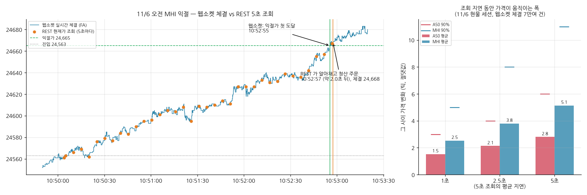

- **실제 거래 하나로 본 지연**: 11/6 오전 MHI 는 웹소켓으로 10:52:55 에 익절가(24,665)에 처음 닿았고, REST 5초 조회는 10:52:57 에 알아채 청산 주문을 냈습니다(**약 2초 늦음**). 이번에는 그 사이 가격이 더 올라 24,668 로 오히려 유리하게 체결됐지만, 손절이었다면 그만큼 불리했을 것입니다.
- **하루 전체로 본 지연의 비용**: 5초 조회의 평균 지연(2.5초) 동안 가격은 A50 평균 2.1틱(90% 4틱), MHI 평균 3.8틱(90% 8틱) 움직였습니다. 실행 중 손절 체결이 손절가보다 0~5틱 불리했던 것과 같은 크기입니다.
- 결론: 진입 판단(1분봉 마감)은 REST 분봉으로도 충분하지만, **손절·익절 판정은 웹소켓으로 옮기는 것이 맞습니다** → 9절 1번.

| 웹소켓 연결 화면 | 하루 기록 끝 (받은 체결 수) |
| --- | --- |
| 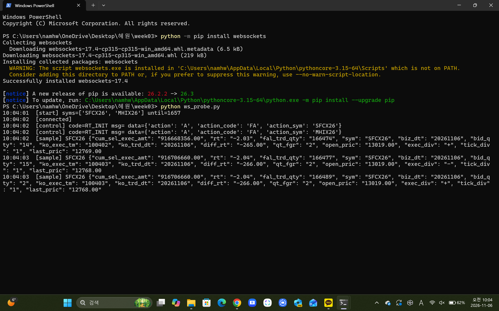 | 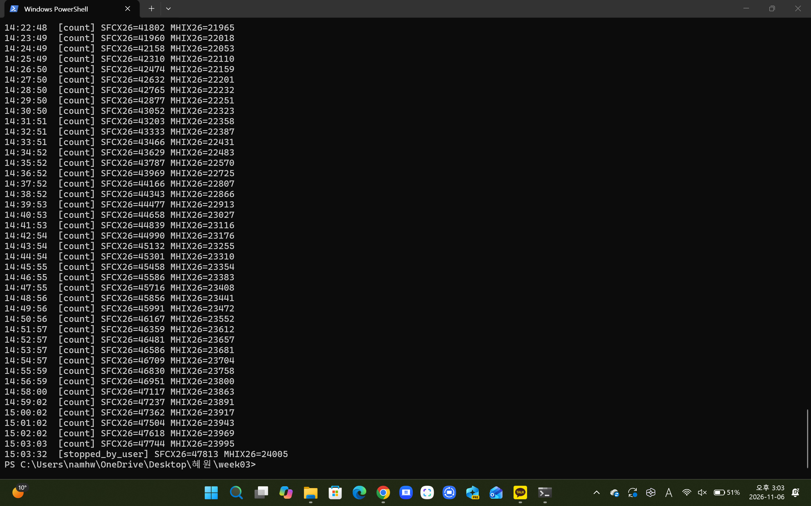 |

## 6. 실행 결과

### 6-1. 해외 주문 API 왕복 확인 (11/2, `check_overseas.py --smoke-order`)

| 종목 | 주문 | 매수 체결 | 매도 체결 | 왕복 뒤 잔고 |
| --- | --- | --- | --- | --- |
| A50 `SFCX26` | 시장가 | 12,858.00 | 12,857.00 | 0 (OK) |
| MHI `MHIX26` | 지정가 23,373 / 23,365 | **23,369** | **23,366** | 0 (OK) |

MHI 는 지정가가 「최소한 이 가격」 역할만 하고, 실제로는 그 순간 호가로 더 좋게 체결됐습니다. 기록: `results/check_20261102_172849/`.


### 6-2. 백테스트 (11월물이 활발한 약 8거래일, ~11/2)

| 미끄러짐 1틱 | 거래 | 승률 | 거래당 평균 | 합계 |
| --- | --- | --- | --- | --- |
| A50 오전 (10:30) | 8 | 13% | −20.6틱 | −US$165 |
| A50 오후 (14:00) | 8 | 13% | −16.8틱 | −US$134 |
| MHI 오전 (10:30) | 7 | 57% | +16.1틱 | +HK$1,130 |
| MHI 오후 (14:00) | 8 | 50% | +4.4틱 | +HK$350 |

- 「유동성 있는 날」 기준에 거래량 조건을 더하면 MHI 가 4일로 줄고 오전 결과가 마이너스로 뒤집혔습니다. **이 표본에서는 결과가 기준 하나에 흔들립니다** — 가설 수준으로만 읽습니다.
- 손절 × 익절 × 범위 길이 격자: `results/backtest_orb_*/grid_slip1.csv` (설정은 바꾸지 않고 민감도만 확인, 그림은 7-4절).

### 6-3. 본 실행 (해외 모의계좌)

| 날짜 | 세션 | 종목 | 진입 | 손절폭 | 청산 | 결과 | 원화 환산 |
| --- | --- | --- | --- | --- | --- | --- | --- |
| 11/3 | 오전 | A50·MHI | — 돌파 없음 (범위 폭 206·186틱) | | | | |
| 11/3 | 오후 | A50 | 14:31 매도 12,727 | 26틱 | 14:36 손절 12,756 | −29틱 · −US$29 | 약 −38,900원 |
| 11/3 | 오후 | MHI | 14:45 매도 23,456 | 27틱 | 15:02 익절 23,415 | +41틱 · +HK$410 | 약 +70,200원 |
| 11/4 | 오전 | MHI | 10:46 매수 23,522 | 62틱 | 10:47 손절 23,455 | −67틱 · −HK$670 | 약 −115,000원 |
| 11/4 | 오전 | A50 | 11:16 매도 12,751 | 26틱 | 11:21 손절 12,777 | −26틱 · −US$26 | 약 −34,900원 |
| 11/4 | 오후 | MHI | 14:19 매수 23,643 | 30틱 | 14:30 익절 23,688 | +45틱 · +HK$450 | 약 +77,200원 |
| 11/4 | 오후 | A50 | 14:32 매수 12,910 | 35틱 | 14:46 익절 12,965 | +55틱 · +US$55 | 약 +73,900원 |
| 11/5 | 오전 | A50·MHI | — 서버 장애로 첫 돌파(A50 10:45 봉, MHI 10:47 봉)를 늦게 감지 → 규칙대로 건너뜀 | | | | |
| 11/5 | 오후 | A50 | — 돌파 없음 (범위 폭 53틱) | | | | |
| 11/5 | 오후 | MHI | 14:16 매수 24,719 | 45틱 | 14:44 손절 24,673 | −46틱 · −HK$460 | 약 −78,600원 |
| 11/6 | 오전 | MHI | 10:50 매수 24,563 | 68틱 | 10:52 익절 24,668 | **+105틱 · +HK$1,050** | 약 +179,400원 |
| 11/6 | 오전 | A50 | — 돌파 없음 (범위 폭 86틱) | | | | |
| 11/6 | 오후 | A50·MHI | — 돌파 없음 (범위 폭 68·106틱) | | | | |

| 누적 (11/3~11/6) | 거래 | 승 | 틱 합계 | 원화 환산 |
| --- | --- | --- | --- | --- |
| A50 | 3 | 1 | 0틱 | 약 0원 |
| MHI | 5 | 3 | +78틱 | 약 +133,300원 |
| 합계 | 8 | 4 | | **약 +133,400원** |

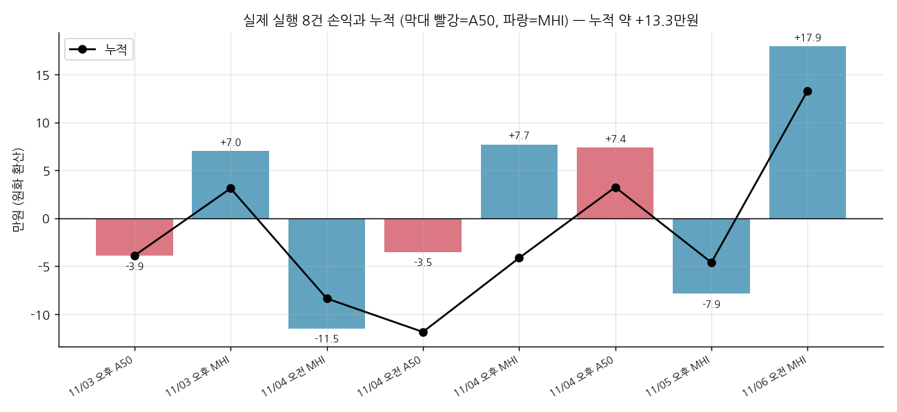

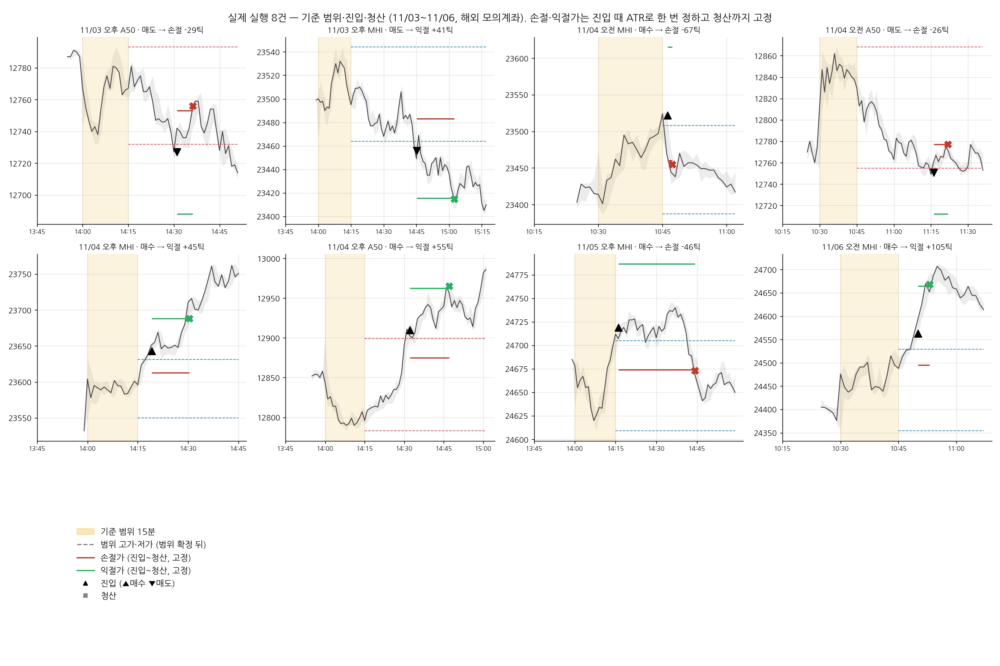

손절·익절가는 신호 봉의 ATR 로 **진입 때 한 번 정하고 청산까지 고정**합니다(가격을 따라 옮기는 트레일링 스톱이 아님). 그래서 그림의 손절·익절선은 진입부터 청산까지만 수평으로 그렸고, 범위 고가·저가 점선은 범위가 확정된 시각(10:45·14:15)부터 그렸습니다.

- **주문·체결**: 실행 주문 16건 모두 체결. 진입·청산 뒤 잔고 대조는 모두 일치(`reconcile_ok`)했고, 11/5 A50 종료 때 한 번 네트워크로 대조가 실패(`reconcile_failed`)해 **서버 잔고 조회로 0 을 따로 확인**했습니다(`results/check_20261105_172338/`).
- **11/3 오전 「돌파 없음」 확인**: 개장 15분 범위가 넓었고(A50 206틱, MHI 186틱), 10:45~11:29 종가가 한 번도 범위를 벗어나지 않았습니다. 같은 날 분봉 백테스트도 「돌파 없음」.
- **11/4 실행 공백**: 12:51 ~ 13:33 약 42분(`pause seconds=2515`, 실행 PC 절전·이동), 깨어난 직후 DNS 오류 4회 뒤 회복, 14:55 에 약 3분(`pause seconds=205`). **두 공백 모두 보유 포지션이 없는 구간**이었고, 공백 동안의 분봉은 깨어난 뒤 연속조회로 다시 받아 기록에 빠진 시간이 없습니다.
- **11/5 서버 장애**: 10:27 부터 해외 현재가가 SGX·HKEX 전 종목 HTTP 400 `ETR029`(전날 같은 요청은 정상, 계좌 조회는 정상) → 종목별 1분 재시도 → **MHI 10:51:01, A50 10:51:37 복구 즉시 시작**. 두 종목 모두 오전 첫 돌파를 182초·337초 늦게 감지해 `missed_first_signal` 로 오전을 건너뛰었습니다(8-1절 제보). 미국 중간선거 결과가 반영된 날로, MHI 는 전날 오후보다 약 4% 높은 가격대에서 거래됐습니다.
- **11/5 이동 중 멈춤**: 15:42 ~ 16:07 약 25분(`pause seconds=1481`). MHI 손절(14:44) 이후라 보유 포지션 없음. 보유 중에는 이동하지 않고 청산을 기다린 뒤 움직였습니다.
- **11/5 재시도 기록**: 장애 중 1분마다 다시 시작한 시도(종목별)는 거의 빈 폴더라 `results/retry_20261105_outage.zip` 하나로 묶었습니다.
- **11/6**: MHI 오전 1건이 진입 3분 만에 익절(+105틱, 3주차 최대 이익). 12:34~12:56 약 22분 실행 PC 멈춤(`pause seconds=1331`)은 무포지션 구간이었고, 오후는 두 종목 모두 돌파 없음. 15:03 에 수동 종료(두 종목 잔고 0 확인).

**장애로 놓친 신호 (백테스트, 실행 결과에 넣지 않음)**

| 11/5 오전 | 첫 돌파 | 들어갔다면 (미끄러짐 1틱) | 결과 |
| --- | --- | --- | --- |
| A50 | 10:45 봉 위로 | 10:46 매수 12,991 | 11:09 익절 **+45틱** (약 +60,200원) |
| MHI | 10:47 봉 위로 | 10:48 매수 24,547 | 11:02 익절 **+88틱** (약 +150,400원) |

| 11/3 오후 실행 화면 | 서버 주문내역 (같은 계좌) |
| --- | --- |
| 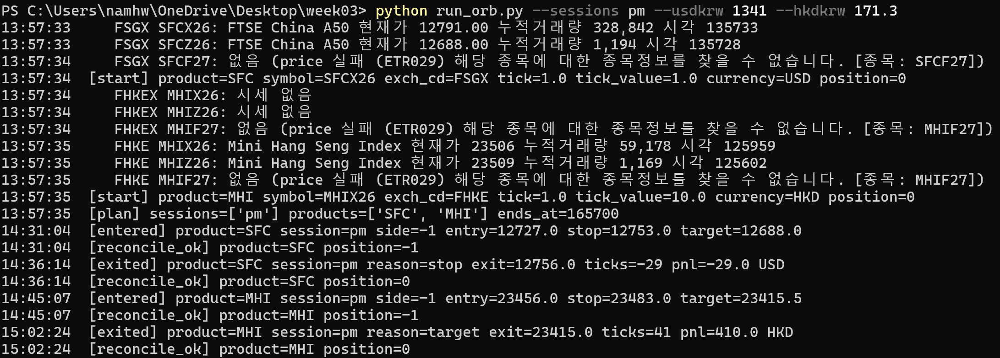 | 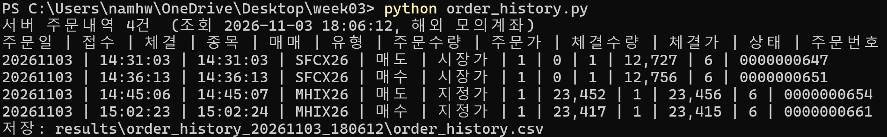 |

| 11/5 A50 장애·복구 | 11/5 MHI 장애·복구·오후 |
| --- | --- |
| 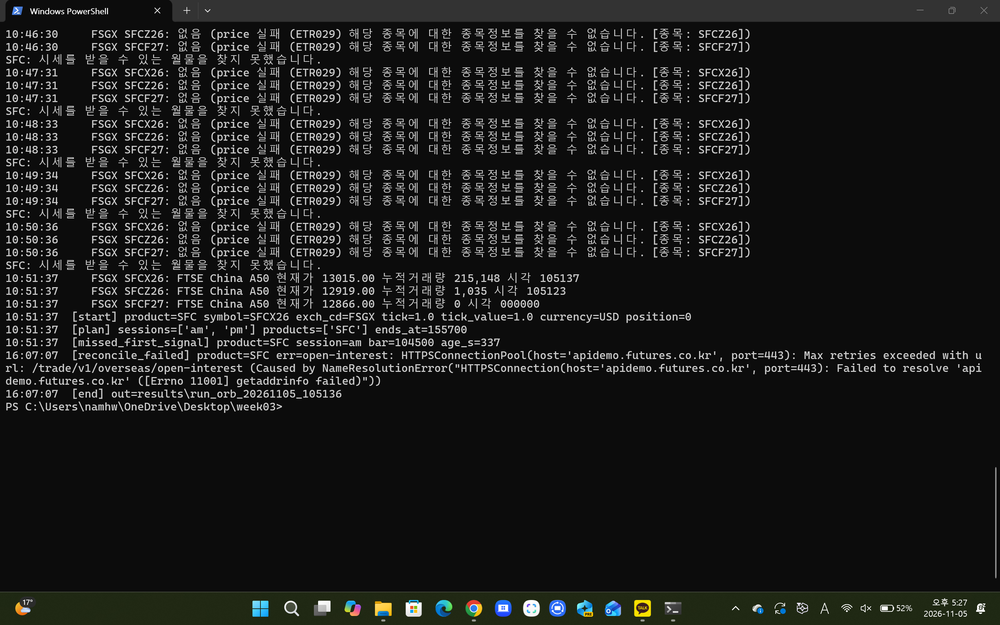 | 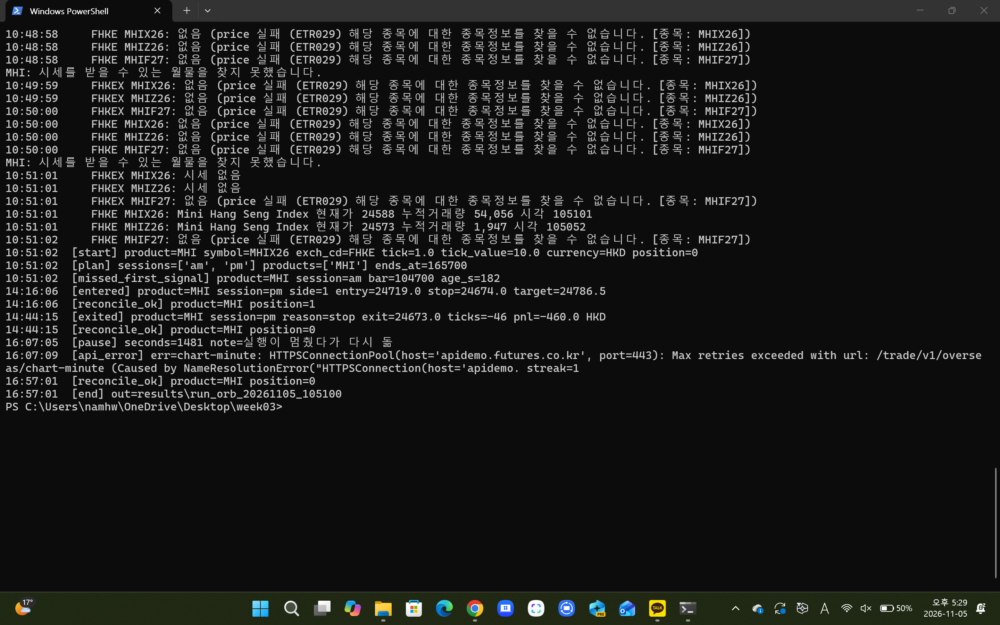 |

| 11/6 실행 종료 화면 | 11/6 서버 주문내역 |
| --- | --- |
| 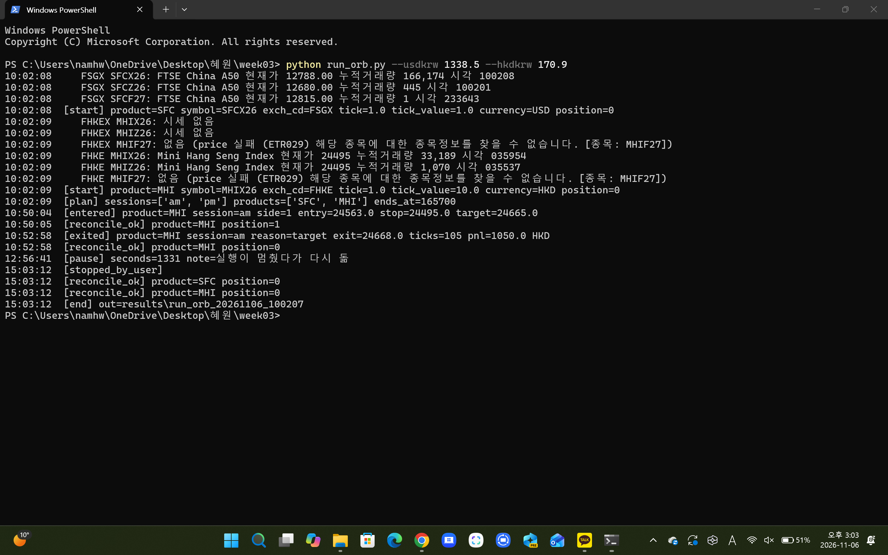 | 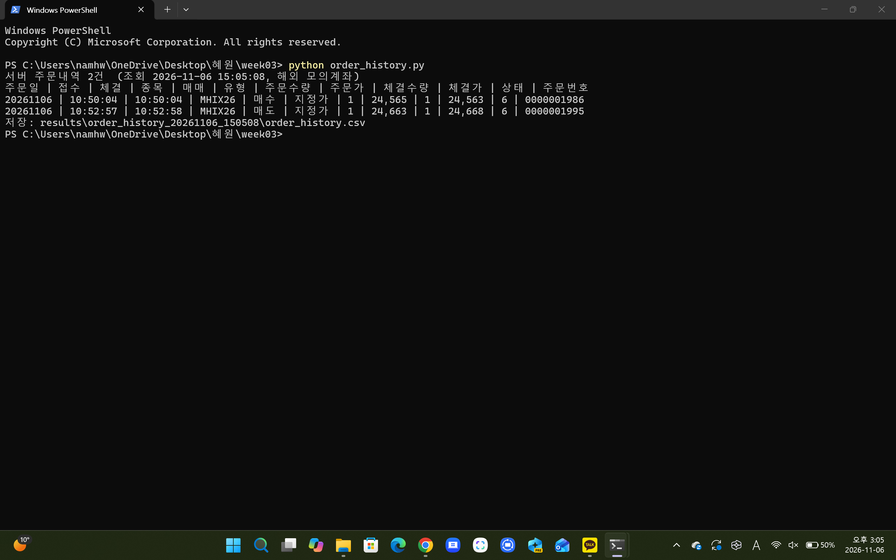 |

### 6-4. 실행이 규칙대로 돌았는가 — 두 방향 대조

**① 백테스트와 대조 (같은 날 분봉, 8건)**

| 거래 | 신호 봉 | 손절폭 | 청산 사유 | 실제 | 백테스트(1틱) |
| --- | --- | --- | --- | --- | --- |
| 11/3 오후 A50 | 14:30 = | 26 = | 손절 = | −29틱 | −27틱 |
| 11/3 오후 MHI | 14:44 = | 27 = | 익절 = | +41틱 | +40틱 |
| 11/4 오전 MHI | 10:45 = | 62 = | 손절 = | −67틱 | −63틱 |
| 11/4 오전 A50 | 11:15 = | 26 = | 손절 = | −26틱 | −27틱 |
| 11/4 오후 MHI | 14:18 = | 30 = | 익절 = | +45틱 | +45틱 |
| 11/4 오후 A50 | 14:31 = | 35 = | 익절 = | +55틱 | +52틱 |
| 11/5 오후 MHI | 14:15 = | 45 = | 손절 = | −46틱 | −46틱 |
| 11/6 오전 MHI | 10:49 = | 68 = | 익절 = | +105틱 | +102틱 |
| 11/3 오전 · 11/5 오후 A50 · 11/6 오전 A50·오후 두 종목 | 돌파 없음 = | | | — | — |

**8건 모두 신호 봉·손절폭·청산 사유가 같았고**, 「돌파 없음」 세션도 같았습니다. 차이는 체결가에서만 났습니다(8건 합계 실제 +78틱, 백테스트 +76틱). A50 은 손절 판정 지연으로 불리, MHI 는 지정가 대체로 유리한 경우가 많았습니다. 실행 전에도 같은 확인을 했습니다 — 실행 스크립트의 신호 함수를 백테스트 33개 세션에 돌려 진입 시각·방향·손절폭이 **33개 모두 일치**.

**② 서버 주문내역과 대조 (11/3·11/5·11/6, 8건)**

| 시각 | 종목 | 매매 | 유형 | 주문가 | 서버 체결가 | 프로그램 기록 |
| --- | --- | --- | --- | --- | --- | --- |
| 11/3 14:31:03 | SFCX26 | 매도 | 시장가 | — | 12,727 | 12,727 ✓ |
| 11/3 14:36:13 | SFCX26 | 매수 | 시장가 | — | 12,756 | 12,756 ✓ |
| 11/3 14:45:06 | MHIX26 | 매도 | 지정가 | 23,452 | 23,456 | 23,456 ✓ |
| 11/3 15:02:23 | MHIX26 | 매수 | 지정가 | 23,417 | 23,415 | 23,415 ✓ |
| 11/5 14:16:04 | MHIX26 | 매수 | 지정가 | 24,720 | 24,719 | 24,719 ✓ |
| 11/5 14:44:14 | MHIX26 | 매도 | 지정가 | 24,671 | 24,673 | 24,673 ✓ |
| 11/6 10:50:04 | MHIX26 | 매수 | 지정가 | 24,565 | 24,563 | 24,563 ✓ |
| 11/6 10:52:57 | MHIX26 | 매도 | 지정가 | 24,663 | 24,668 | 24,668 ✓ |

기록: `results/order_history_20261103_180612/`, `results/order_history_20261105_172352/`, `results/order_history_20261106_150508/`. 주문내역 API 는 당일 주문만 돌려주어, 11/4 주문은 체결 직후 잔고 대조(`reconcile_ok`)로 확인했습니다. 지정가로 낸 MHI 주문 6건은 모두 주문가보다 1~5틱 유리하게 체결됐습니다.

## 7. 결과 해석

> 11/3~11/6 실행 전체 기준입니다.

### 7-1. H1 — 현물 개장 직후 돌파는 이어지는가

실행 8건 4승 4패, 틱 합계 A50 0틱 · MHI +78틱. 백테스트(~11/2)는 A50 크게 마이너스, MHI 플러스. 둘을 합쳐 봐도 **비용을 반영한 거래당 평균 손익이 0보다 크다는 근거는 없었습니다.**

| 거래당 평균 (손절폭 배수 R, 미끄러짐 1틱, ~11/6 전체 41건) | 평균 | 95% 부트스트랩 구간 |
| --- | --- | --- |
| A50 (20건) | **−0.54R** | [−0.92, −0.03] |
| MHI (21건) | +0.40R | [−0.09, +0.89] |
| 합계 (41건) | −0.06R | [−0.43, +0.32] |

A50 은 구간 전체가 0 아래라 이 표본에서는 돌파 추종이 졌다고 말할 수 있고(경계선), MHI 는 플러스지만 0 을 포함해 우연과 구분되지 않습니다. 다만 아래 대조 실험과 H4 검증은 「돌파 자체는 이어지는 경우가 많고, 손익을 깎은 것은 직후 흔들림에 걸린 손절」일 가능성을 보여 줍니다.

### 7-2. 대조 실험 — 「현물 개장」 시각이 정말 특별한가 (설계 데이터, ~11/2)

같은 돌파 규칙을 10:00 ~ 16:30 에 30분마다 걸어, 돌파 뒤 30분 움직임(돌파 방향 +, 1분봉 ATR 배수)과 30분 안 범위 복귀 비율을 쟀습니다(`placebo_orb.py`).

| | 돌파 수 | 30분 뒤 움직임 (평균 / 중앙값) | 30분 안 범위 복귀 |
| --- | --- | --- | --- |
| A50 · 현물 개장 (10:30·14:00) | 16 | **−0.98 / −0.99** | **100%** |
| A50 · 그 밖의 시각 | 91 | −0.03 / −0.37 | 88% |
| MHI · 현물 개장 | 15 | −0.23 / −0.12 | 67% |
| MHI · 그 밖의 시각 | 40 | +0.55 / +1.33 | 85% |

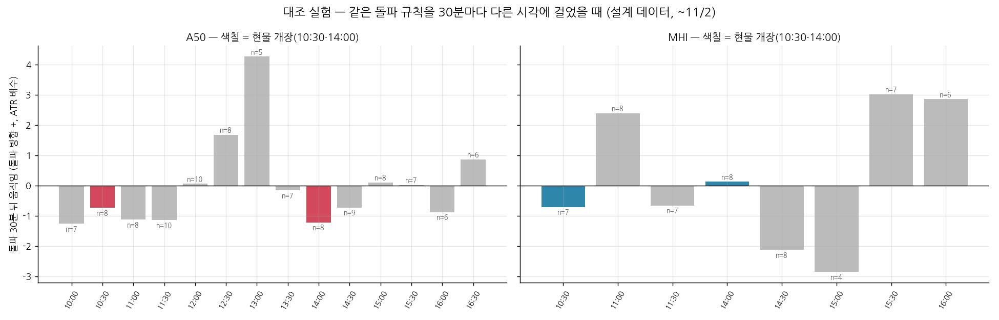

그림으로 보면 A50 은 10:30·14:00 뿐 아니라 **오전 10:00~11:30 대부분이 마이너스**입니다. 「현물 개장 시각만의 특성」이라기보다 「A50 오전 전반의 성격」일 수도 있다는 점을 함께 적어 둡니다.

- A50 은 현물 개장 때만 돌파가 되돌아오는 쏠림이 뚜렷했습니다(t ≈ −1.8 ~ −2.2, 경계선). 선물이 먼저 튀었다가 현물 지수 쪽으로 끌려 돌아오는 모습과 들어맞습니다.
- MHI 는 개장 때와 그 밖의 시각 사이에 뚜렷한 차이가 없었습니다 → MHI 의 좋은 성과는 「개장 효과」보다 **MHI 자체가 돌파 뒤 이어지는 편**이라서일 가능성.
- 14개 시각을 비교했으므로 하나쯤 우연히 튀는 시각이 나올 수 있습니다 → **이 관찰을 H4 로 적고(11/3), 그 뒤 데이터로만 검증**했습니다.

### 7-3. H4 검증 — 그 뒤 데이터에서 뒤집힘

| 현물 개장 돌파 | A50 설계 (~11/2) | A50 검증 (11/3~11/6) | MHI 검증 (11/3~11/6) |
| --- | --- | --- | --- |
| 횟수 | 16 | 4 | 6 |
| 30분 안 범위 복귀 | 100% | 75% | 50% |
| 30분 뒤 움직임 (ATR 배수) | −0.98 (되돌아옴) | **+2.70 (4건 모두 이어짐)** | +1.02 |

A50 검증 4건은 **모두** 설계와 반대 방향(돌파 방향으로 이어짐)이었습니다. 4건으로 단정할 수는 없지만, 설계 구간에서 강했던 쏠림이 새 데이터에서 사라진 것은 **H4 를 기각**하기에 충분하고, 표본이 작을 때의 우연·과최적화를 보여 주는 사례입니다. 실행 중 규칙을 H4 쪽(A50 역추세)으로 바꾸지 않은 것이 옳았습니다.

검증 기간의 MHI 는 설계 기간과 반대로, 현물 개장 돌파(6건, 30분 뒤 +1.02)가 그 밖의 시각 돌파(19건, −1.21)보다 이어지는 쪽이었습니다. H1(개장 직후 돌파는 이어진다)에 맞는 그림이지만 6건이라 **관찰로만** 적습니다.

**반복된 관찰 — 손절 위치.** A50 검증 4건 중 3건이 30분 안에 범위로 한 번 되돌아왔다가 30분 시점엔 돌파 방향에 있었습니다. 실제 A50 손절 2건(11/3 오후, 11/4 오전)도 5~6분 만에 손절된 뒤 같은 모양이었습니다. 「돌파는 이어지는데, 직후 흔들림이 ATR × 2 손절 안쪽까지 온다」 — 이것을 전체 데이터로 잰 것이 7-4절입니다.

### 7-4. 손실은 어디서 났나 — 손절 진단 (~11/6 전체 41건, 미끄러짐 1틱)

규칙은 바꾸지 않고, 거래마다 진입 뒤 시간 청산까지의 경로로 **최대 역행(MAE)·최대 순행(MFE)** 을 손절폭 배수로 쟀습니다.

| | A50 | MHI |
| --- | --- | --- |
| 거래 / 손절 | 20 / 16 | 21 / 9 |
| 손절된 거래 중, 손절 뒤 익절가까지 간 비율 | 38% (6건) | 44% (4건) |
| 손절 거래 중 10분 안에 손절된 비율 | 62% | 67% |
| 익절 거래가 익절 전 겪은 최대 역행 (중앙값) | **손절폭의 0.74배** | 0.16배 |
| 전체 MFE 중앙값 | 1.36배 (목표 1.5배 미만) | 2.87배 |

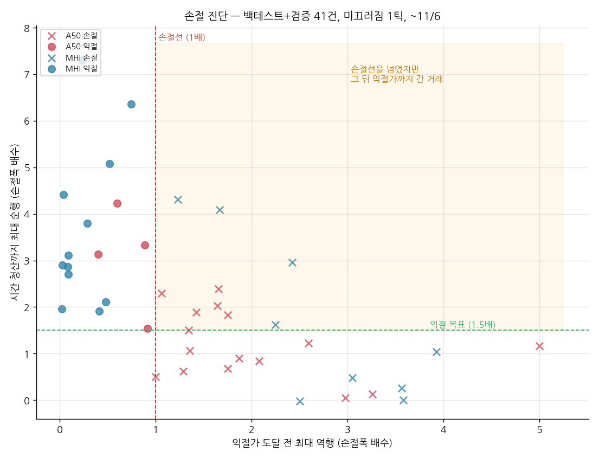

**그럼 손절을 넓히면?** 손절 배수만 바꿔 같은 거래를 다시 계산했습니다(진단용, 규칙은 2배 고정).

| 손절 = ATR × | 1.5 | **2 (규칙)** | 3 | 4 |
| --- | --- | --- | --- | --- |
| A50 합계 (틱) | −295 | **−256** | −388 | −205 |
| MHI 합계 (틱) | +157 | **+314** | +330 | +243 |

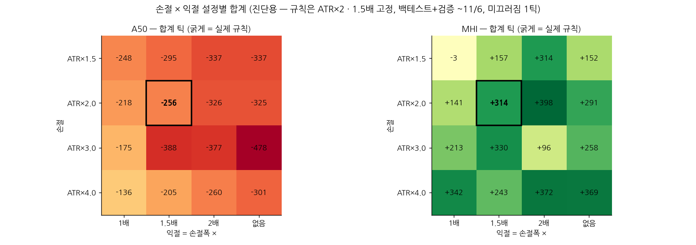

- 손절 × 익절 16개 조합 전체에서 **A50 은 모두 손실, MHI 는 15개가 이익**이었습니다. 결과를 정한 것은 설정이 아니라 **종목**이었고, 실제 규칙(굵은 칸)이 유난히 좋거나 나쁜 칸도 아니었습니다(과최적화 아님).
- 손절 뒤 익절가까지 간 거래가 많아 「손절 위치가 문제」로 보였지만, **A50 은 손절을 어디에 두어도 손실**이었습니다. 손절을 넓히면 한 번의 손실과 익절 목표(손절폭 × 1.5)도 같이 멀어지기 때문입니다.
- A50 은 이긴 거래조차 손절 직전(0.74배)까지 갔다 돌아오고, 순행 중앙값(1.36배)이 목표(1.5배)에 못 미쳤습니다. **돌파 직후 흔들림이 크고, 이어지는 폭은 작은 종목**입니다.
- MHI 는 이긴 거래의 역행이 작고(0.16배) 순행이 커서(2.87배), 같은 규칙이 비교적 맞았습니다.
- 결론: 다음 개선은 손절 폭이 아니라 **진입 방식**(돌파 뒤 되돌림을 확인하고 진입, 또는 첫 흔들림 동안 손절 유예)입니다. 표 하나로 손절 배수를 고르면 과최적화이므로 다음 주차 설계 데이터로만 비교합니다.

### 7-5. 백테스트와 실행의 차이, 비용, 그리고 한계

| 미끄러짐 (~11/6 전체) | 0틱 | 1틱 | 2틱 |
| --- | --- | --- | --- |
| A50 합계 (20건) | −236틱 | −256틱 | −274틱 |
| MHI 합계 (21건) | +324틱 | +314틱 | +309틱 |

- **2주차와 반대로, 비용은 결과를 정하지 않았습니다.** 2주차는 손절 5틱이라 왕복 1~2틱 비용이 결정적이었지만, 3주차는 손절이 평균 30~40틱이라 비용 비중이 작았습니다.

- **체결과 조회 방식**: 손절 체결은 손절가보다 0 ~ 5틱 불리했습니다(11/3 A50 3틱, 11/4 MHI 5틱, 11/4 A50 0틱, 11/5 MHI 1틱). 5초 조회 사이에 가격이 손절가를 지나간 만큼이고, 11/6 웹소켓 기록으로 잰 「조회 지연 동안의 가격 변화」(A50 평균 2.1틱·MHI 3.8틱)와 같은 크기입니다(5-4절). MHI 는 지정가 대체 덕분에 주문가보다 1~5틱 유리하게 체결된 경우가 많았습니다. 모의 서버 체결을 실제 시장 비용으로 일반화하지 않습니다.
- **손절폭 변동**: ATR × 2 라 MHI 손절폭이 27틱(11/3) ~ 62틱(11/4 오전)으로 두 배 넘게 달랐습니다. 거래당 위험 금액이 일정하지 않습니다.
- **표본**: 백테스트 약 8거래일 · 개장 돌파 31건, 실행 8건(11/3~11/6). 해외 분봉 API 가 만기 지난 월물을 주지 않아 더 늘릴 수 없었습니다. 「경향은 보이지만 통계적으로 확신할 수준은 아니다」로 읽습니다.
- **운영 위험**: 세션당 1회 규칙이라 신호 하나를 놓친 영향이 큽니다. 11/5 서버 장애 24분 동안 놓친 두 신호가 백테스트로는 둘 다 익절(약 +21만원)이었습니다 — 실행 누적 손익(약 +13.3만원)에 견줄 만한 크기입니다.


## 8. 오류와 개선

### 8-1. 오류 제보

| 항목 | 내용 |
| --- | --- |
| 제보 | **해외 현재가에 잘못된 거래소 코드를 넣으면 오류 없이 빈 줄이 옴** — 2026-11-03 오류-문의 채널 제보 <!-- 운영진 답변이 오면 「확인됨 / 재현 안 됨」 기입 --> |
| 재현 | `FHKEX` + MHIX26 → HTTP 200, 오류 칸 없음, `Occurs1` 1줄이지만 종목·현재가·거래량 모두 빈 문자열 / `FHKE` + MHIX26 → 정상 / `FHKE` + MHIF27(없는 종목) → **HTTP 400, ETR029** |
| 영향 | 형식상 정상 응답이라 「시세가 아직 없는 종목」과 구분 불가. 우리 프로그램이 실제로 빈 시세 종목을 근월물로 잘못 골랐음(11/2 16:53) |
| 근거 | `results/repro_20261103_195550/case_price_*.json` (요청·응답 원본, 계좌번호 칸 가림), 캡처 |

| 항목 | 내용 |
| --- | --- |
| 제보 | **어제 정상이던 해외 현재가 요청이 오늘 아침 전부 ETR029 (서버 장애 의심)** — 2026-11-05 10:3x 오류-문의 채널 제보, 10:51 복구 확인을 댓글로 추가 |
| 운영진 공지 | 「11/5 10:50 현재 해외 모의 서버 점검으로 서비스 이용이 일시 제한」 — 우리 기록상 시작은 10:27, 복구는 10:51 |
| 재현 | 10:29 `FHKE` + MHIX26, `FSGX` + SFCX26 → **HTTP 400 ETR029** (11/3 같은 요청은 200 정상). 같은 시각 해외 주문내역 조회는 200 정상 → 인증·계좌는 정상, 해외 종목 정보만 조회 불가 |
| 기간 | 약 10:27 ~ 10:51 (1분 간격 재시도 기록으로 확인) |
| 영향 | 10:30 현물 개장 세션 실행 불가 — 두 종목 오전 첫 돌파를 놓침 |
| 근거 | `results/repro_20261105_102931/` (장애 중), 복구 후 재현 기록, 실행 화면 캡처 |

참고: 다른 팀의 「빈 배열 → 빈 줄」 제보(11/5)가 우리 11/3 제보를 「증상은 비슷하지만 다른 건」으로 언급했습니다.

**제보하지 않은 것과 이유.**
- 주문 성공 응답이 `err_cd = "00000"` 으로 옴 → 참고 저장소에 이미 적혀 있는 동작. 우리가 못 읽은 것(사용 미숙)이라 8-2절로.
- 주문내역 매매구분 이름 칸이 비어 보임 → 응답 원본 확인 결과 그런 칸이 원래 없고 코드(`trd_tp`)로만 옴. 우리 착오.
- 만기 지난 월물 분봉 조회 불가(`EMG_001`) → 설계로 보임. 개선 제안 후보.
- 바탕화면 앱이 Windows 스마트 앱 컨트롤에 막힘 → 서명 없는 실행 파일에 대한 Windows 정책. 서버 주문내역 조회로 대체.

### 8-2. 실행 중 고친 우리 코드

| 날짜 | 문제 | 원인 | 고친 것 |
| --- | --- | --- | --- |
| 11/2 | 주문 성공을 실패로 오판 → **A50 1계약이 남음** | 해외 성공 응답 `err_cd "00000"` 을 오류로 판정 | 0 만으로 된 코드는 정상. 남은 포지션은 `--flatten` 으로 정리(17:26, 12,853 매도) |
| 11/2 | 분봉 조회가 `[F:]종목을 찾을 수 없습니다` | 장운영정보에서 거래소명을 못 찾아 거래소 코드가 `F` 만 나감 | 품목별 기본 거래소, 빈 시세 응답은 건너뜀 |
| 11/2 | MHI 주문 거절 7032 | HKEX 시장가 불가 | 체결될 만한 지정가로 대신, 미체결 취소 |
| 11/2 밤 | 사전 점검(dry-run)에서 신호가 하나도 안 남 | 분봉 응답이 최신 봉부터 한 쪽(약 300개)만 와서 오전 봉을 못 봄 | 세션 시작 봉까지 연속조회(최대 10쪽) |
| 11/2 밤 | 첫 돌파를 놓치면 뒤 봉으로 진입할 수 있었음 | 「첫 돌파」 규칙과 다름 | 놓친 세션은 건너뛰고 `missed_first_signal` 기록 |
| 11/3 | 재현 기록 JSON 에 계좌번호가 남음(올리기 전 발견) | 칸 이름이 `occurs1_ac_no` 라 가리기 규칙에 안 걸림 | `ac_no`·`acno` 추가, 해당 파일 가림 처리 |

### 8-3. 운영에서 배운 것

- 실행 PC 를 옮기면 절전·네트워크 변경으로 실행이 멈춥니다(11/4). **포지션이 없는 점심(12:57~13:55)에만 옮기고, 그때는 `--sessions` 로 나눠 실행**하는 것을 운영 수칙으로 정했습니다.
- 웹에서 저장소에 올릴 때는 `.gitignore` 에 기대지 않고 토큰 캐시·`__pycache__` 를 직접 지운 뒤 올립니다.
- 서버 장애 때는 **종목별로 창을 나눠 1분 재시도**합니다. 한 창에서 두 종목을 함께 시작하면 먼저 복구된 종목도 기다리게 됩니다(11/5).
- 종료 직전 네트워크가 끊겨 잔고 대조가 실패하면, `check_overseas.py --flatten` 과 `order_history.py` 로 서버 잔고·주문을 따로 확인해 기록을 메웁니다(11/5).
- 실행 PC 가 멈췄다 깨어나면 웹소켓은 90초 무신호로 끊김을 감지하고 새 접속키로 다시 붙습니다(11/6). 끊긴 동안의 체결은 다시 오지 않으므로, 매매에 쓸 때는 다시 붙은 뒤 REST 로 빈 구간을 채워야 합니다.
- 보유 중에는 이동하지 않습니다. 꼭 떠나야 하면 Ctrl+C 로 정리하고(`forced` 로 따로 표시), 그 종목은 **그날 다시 켜지 않습니다** — 프로그램이 「이미 거래함」을 기억하지 않아 두 번째 진입이 생길 수 있기 때문입니다.

## 9. 향후 계획

1. **시세를 웹소켓으로**: 11/5 운영진 안내대로 과거 봉만 REST 로 받고, 손절·익절 판정은 웹소켓 실시간 체결(`FA`)로. 11/6 병행 기록(5-4절)을 근거로 다음 주차부터 적용.
2. **진입 방식 비교**: 손절 폭만 바꿔서는 A50 이 개선되지 않았으므로(7-4절) 「돌파 뒤 되돌림 확인 후 진입」·「첫 N분 손절 유예」·**「첫 돌파 손절 뒤 재진입 허용(반대 방향 포함, 세션당 최대 2회)」** 을 다음 주차 설계 데이터로 비교. 재진입은 표본을 늘리는 대신 흔들리는 날 손실이 커질 수 있어, 세션당 1회 규칙과 손실 분포를 함께 비교합니다. 거래당 위험 금액을 일정하게 맞추는 방법도 함께.
3. **「이미 거래함」 상태 저장**: 재시작해도 세션당 1회 규칙이 지켜지도록 당일 거래 상태를 파일로 남기기.
4. **H4 이후 관찰 계속**: 데이터를 주차마다 쌓아 A50 개장 돌파의 되돌림이 우연이었는지 확인.
5. **개장 전 구간(10:00~10:30) 분석**: A50 만 열리는 30분의 움직임과 10:30 이후의 관계.
6. **H3 볼린저 비교**: 2주차 볼린저 평균회귀를 같은 두 종목·기간에 걸어 「개장 직후 vs 그 밖의 시간」 성과를 비교(이번 주 미실시).
7. 과거 월물 분봉 조회 지원을 개선 제안으로 올리기.

## 10. 팀 탐구 주제와의 연결

우리 팀의 탐구 주제는 **USD/KRW 통화선물을 수출 산업 실적의 선행지표로 쓰는 대시보드**입니다. 중국·홍콩은 한국 수출의 최대 수요처라, A50·항셍 지수선물은 「수출 수요의 대리 지표」 후보입니다.

| 3주차에서 나오는 것 | 탐구 주제에서 쓰는 곳 |
| --- | --- |
| A50·MHI 1분봉(실행마다 `bars_*.csv`) | 원/달러 1분봉(2주차)과 같은 시각으로 맞춰 중국 지수와 환율의 동조·시차 관찰 |
| 해외 API 수집 코드(연속조회, 거래소 코드, 토큰 캐시) | 대시보드가 해외 지수를 주기적으로 받아 올 때의 수집 코드로 재사용 |

<!-- TODO: 절마다 작성자 표시 (예: 1·3·6절 남혜원 / 4·7절 ○○) -->
