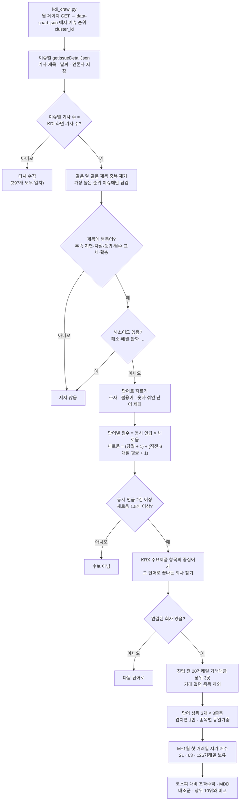
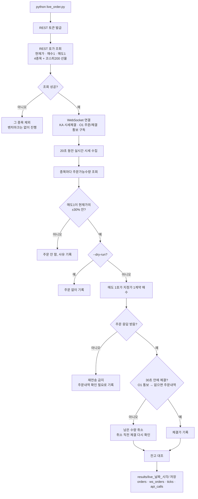

# 5주차 · 데이터 기반 전략 — KDI 월간 경제 이슈 텍스트 × 「2차 병목」 발견 전략

**제출: 2026/11/20(금) 23:59** · 팀 리드랙(LeadLag) · team-02

> 초안(11/19). 모의 주문 평가(11/20 · 12/10)와 스크린샷은 실행 후 채웁니다.
> 수치는 모두 `results/` 의 원본 기록에서 읽은 값입니다.

| 항목 | 내용 |
| --- | --- |
| 가설 | 정책·경제 뉴스에서 「부족·지연·차질·품귀」 같은 **병목어와 함께 새로 늘어난 단어**는 공급이 모자란 소재·부품·인프라를 가리키고, 그것을 만드는 회사는 다음 달 이후 시장보다 오른다 |
| 데이터 | KDI 경제교육·정보센터 「월간 경제 이슈」 2026년 1~10월 — **이슈 397개 · 기사 제목 77,212건**(직접 수집) |
| 신호 | 달마다 병목어 제목 속 단어를 세어 「새로움」이 큰 단어 → KRX 상장사 **주요제품**의 중심어로 종목 자동 연결 → 진입 전 20거래일 거래대금 상위 3종목 |
| 매매 | 다음 달 첫 거래일 시가에 종목별 동일가중 매수, 21·63·126거래일(1·3·6개월) 보유 |
| 검증 | 코스피 대비 초과수익 · MDD · 초과수익 > 0 비율, **대조군**(병목어 조건 없음) · **민감도**(상위 10위 이슈만) · **표본 외 검증**(빅카인즈 2023-12 ~ 2024-11, 규칙 그대로) |
| 실행 환경 | 백테스트(과거 데이터 시뮬레이션) + NH선물 **모의계좌** 주문(6절) |
| 코드 | 수집 `kdi_crawl.py`(Python + requests) · 분석 `kdi_bottleneck.py`(pandas · FinanceDataReader) · 설정 `strategy_config.json` |

## 1. 요약

**한 것.** KDI 월간 경제 이슈의 이슈별 기사 목록을 수집 코드로 모두 받아, 미리 정한 규칙(코드)으로만 신호를 냈습니다. 사람이나 LLM 이 키워드·종목을 고르지 않습니다(2절).

**결과.** 기간이 끝난 신호 기준 코스피 대비 초과수익은 **1개월 −0.6%(4개 중 3개 플러스), 3개월 +2.7%(3개 중 2개)** 로 0 근처입니다. 병목어 조건을 뺀 대조군(1개월 −5.5%, 3개월 +6.8%)과도 일관된 차이가 없습니다. 기간이 끝난 신호가 3~4개뿐이라 이것만으로는 판단할 수 없어, **같은 규칙을 빅카인즈 2023-12 ~ 2024-11 뉴스(8,898건)에 그대로 적용**했습니다. 신호 8개 모두 기간이 끝났고 초과수익은 **1개월 −2.3% · 3개월 −3.6% · 6개월 −2.8%**(플러스인 달 8개 중 2~3개)였습니다. 두 표본 모두에서 **가설을 지지하는 증거는 없습니다**(5절). 이어서 **주 단위 진입 · 맥락 좁히기 · 코스피200 헤지**를 시험했지만(6개 조합) 역시 초과수익은 없었고, 원인은 「단어 → 종목 연결」 단계로 좁혀졌습니다. 그래서 **DART 공급계약 공시로 실제 납품 관계를 따라가는 「진짜 2차」 연결**(반도체 → SK하이닉스 → 한미반도체 등)을 구현했지만, 연결의 질은 좋아진 반면 초과수익은 여전히 확인되지 않았습니다. 마지막으로 공급계약 공시 2,611건으로 「공시 다음 날 매수」 를 시험한 결과, 공시는 당일에 반영되고(+0.79%) 다음 날 시가 매수는 하루 평균 −0.87%로 **20개월 모두 손해**였습니다. 팀 가설 「진입이 늦다」 를 일 단위(다음 거래일 진입)까지 시험했지만 오히려 1주 성과가 가장 나빠, **늦어서 못 먹은 것이 아니라 급증 직후 매수는 되돌림을 맞는다**는 결론입니다(10절, 시험한 조합 10개).

**알게 된 것.**
- 2026년 경제 뉴스에서 병목어는 공급 부족보다 **파업발 차질**(삼성전자·현대차·KTX·레미콘)과 **주택 공급**에 많이 쓰였습니다.
- 2024년 사례(변압기·원전·방산)로 만든 키워드 사전은 2026년 데이터에서 신호를 **2개**밖에 내지 못했습니다 → 발견 모드로 전환(4-1절).
- 실제 데이터를 돌리며 설계 오류 3가지를 찾아 고쳤고, 결과를 본 뒤 바꾼 것은 모두 기록하고 이전 버전 결과도 함께 보고합니다(4절).

## 2. 미래 편향 · 사후 선택 편향을 막은 방법

| 위험 | 막은 방법 |
| --- | --- |
| M월 신호에 M월 이후 정보 사용 | `date ≤ M월 말` 기사만 사용 · 「새로움」 기준선은 직전 6개월(최소 3개월)만 · 진입은 M+1월 첫 거래일 시가(코스피 거래일 달력에서 계산) |
| 결과를 아는 LLM 이 키워드를 고름 | LLM 은 코드 작성·정리에만 사용. 신호는 고정 규칙으로만 산출(누가 돌려도 같은 결과) |
| 오른 걸 아는 달·종목만 시험 | 모든 달에 같은 규칙 · 단어→종목은 **KRX 주요제품 문자열 규칙**으로 자동 연결 · 종목 순위는 **진입 전 20거래일 거래대금**(그 시점에 알 수 있던 값) · 진입일에 상장 전인 회사 제외 |
| 결과를 보고 규칙을 고침 | 값은 `strategy_config.json` 에 고정, 바꿀 때마다 `_변경기록` 에 날짜·이유·「결과를 보기 전/후」 를 남김 · 결과 후 변경은 이전 버전도 함께 보고(5절 v1) |
| 대조 없이 수익만 봄 | 대조군(병목어 조건 없이 새로 많이 나온 단어로 같은 과정) · 민감도(상위 10위 이슈만) |

## 3. 데이터 수집 (`kdi_crawl.py`)

**수집 허용 확인(2026-11-18).** `robots.txt` = `User-agent: * / Allow: /`, 이용약관에 자동 수집 금지 조항 없음(`screenshots/kdi_robots_20261118.png`).

**요청 구조(브라우저 개발자도구로 확인).**

| 용도 | 요청 | 응답 |
| --- | --- | --- |
| 월 페이지 | `GET /bigdata/monthlyEconomicIssue.do?year=2026&month=09` | HTML. 이슈맵 차트 데이터 `data-chart-json` 에 이슈별 **순위 · cluster_id · 이슈명 · 기사 수** |
| 이슈 기사 | `GET /bigdata/monthlyEconomicIssue/getIssueDetailJson.do?cluster_id=…&pub_date=…&issue_name=…` | JSON `{keyword, news[], newsMinMaxDate, sentiment, trend}` — 기사 목록 전체 |

- 기사 **제목·날짜·언론사**만 저장, 기사 본문(네이버 뉴스)에는 접속하지 않음 · 요청 간격 1.5초 · 받은 원본은 `results/news/raw/` 에 저장하고 다시 돌리면 저장본 사용.
- **수집 검증:** 이슈마다 받은 기사 수를 KDI 화면의 기사 수(`kdi_cnt`)와 비교 → **397개 이슈 모두 일치**(`results/news/kdi_2026_all_crawl_log.csv`).

| 파일 | 범위 | 이슈 | 기사 | 같은 달·같은 제목 중복 |
| --- | --- | --- | --- | --- |
| `results/news/kdi_2026_all.csv` (본 분석) | 순위 40위 이내 전체 | 397 | 77,212 | 745건(1.0%) |
| `results/news/kdi_2026.csv` (민감도) | 순위 10위 이내 | 101 | 41,750 | 405건(1.0%) |

중복 기사는 가장 높은 순위 이슈의 1건만 남깁니다(한 기사가 여러 이슈에 묶인 경우).

```powershell
python kdi_crawl.py --start 2026-01 --end 2026-10 --max-rank 40 --out results/news/kdi_2026_all.csv
python kdi_crawl.py --start 2026-01 --end 2026-10 --max-rank 10 --out results/news/kdi_2026.csv
```

## 4. 전략 규칙과 설계 변경

### 4-0. 전체 흐름



M월 신호에는 M월 말까지의 기사만 쓰고, 「새로움」 기준선은 직전 달들만 씁니다(2절).

### 4-1. 사전 모드 → 발견 모드 (11/18, 결과 보기 전)

처음 설계는 사람이 정한 키워드 사전(변압기·전력망·원전기자재·탄약 등 8개)이 병목어와 **같은 제목**에 나온 횟수로 신호를 내는 방식이었습니다. 2026년 데이터에서는 신호가 **2개**(8월·9월 전력망)뿐이고 둘 다 보유기간이 끝나지 않아 검증이 불가능했습니다. 사전이 2024년 사례를 보고 만든 것이라는 한계도 있어, 사전 없이 데이터에서 단어를 찾는 **발견 모드**로 바꿨습니다.

### 4-2. 매매 규칙 (`strategy_config.json`)

| 단계 | 규칙 | 값 · 근거 |
| --- | --- | --- |
| 병목어 | 부족 · 지연 · 차질 · 품귀 · 필수 · 교체 · 확충 | 처음 기획 그대로 |
| 해소어 필터 | 병목어 + 해소·해결·완화·풀려·정상화·극복·숨통·진정세·안정세가 같은 제목에 있으면 제외 | 「부족 해소」 처럼 병목이 풀린 기사(팀 검토 반영) |
| 단어 세기 | 병목어 제목을 단어로 자르고 조사 제거, 불용어(정부·시장·우려 등) 제외. 기사 1건 = 1(동일 가중) | 상위 이슈는 기사 수가 이미 많아 순위 가중은 이중 반영(팀 검토) |
| 새로움 | (당월 + 1) ÷ (직전 6개월 평균 + 1) | 늘 나오던 단어와 새로 늘어난 단어 구분 |
| 후보 | 동시 언급 2건 이상 · 새로움 1.5배 이상, 점수(언급 × 새로움) 상위 30개 | 기사 한 건짜리 우연 배제 |
| 단어 → 종목 | 주요제품을 쉼표로 나눈 **항목의 마지막 단어(중심어)가 그 단어로 끝나는** 회사 · 숫자 섞인 단어 제외 · 「부품·제품·장비」 등 일반어 제외 | KRX KIND 상장법인목록(2,750곳, 11/18 다운로드) |
| 종목 선택 | 단어당 진입 전 20거래일 평균 거래대금 상위 3곳 · 그 기간 거래일의 절반 이상 거래가 있어야 함 | 그 시점에 알 수 있는 값 · 거래정지 종목 제외 |
| 포트폴리오 | 연결되는 단어 상위 3개 × 3종목, 같은 달 겹치는 종목 1번, 종목별 동일가중 | |
| 진입 · 보유 | M+1월 첫 거래일 시가 · 21 · 63 · 126거래일 | 처음 기획(3·6개월) + 1개월(결과가 나온 신호를 늘리려고 추가) |
| 과열 익절 | 그 단어가 상위 10위 이슈명의 30% 이상에 나오면 다음 달 첫 거래일 시가에 절반 매도 | 「TOP 10 도배」 를 숫자로 정의 |
| 비용 | 왕복 0.3% | 수수료 + 거래세 추정 |

### 4-3. 변경 기록 (`strategy_config.json` `_변경기록`)

| 날짜 | 바꾼 것 | 이유 | 결과를 |
| --- | --- | --- | --- |
| 11/18 | 순위 가중 1/순위 → 동일 가중 · 해소어 필터 · 이슈 간 중복 1건 | 팀 검토 | 보기 전 |
| 11/18 | 이슈명은 세지 않고 기사 제목만 셈 | 이슈명 「전력망 **확충** …」 이 기사 253건마다 반복돼 동시 언급이 253건으로 부풀려짐(실제 2건) | 보기 전 |
| 11/18 | 사전 모드 → 발견 모드 · 보유 21거래일 추가 | 신호 2개로 검증 불가 | 보기 전 |
| 11/18 | 상위 10위 → 전체 이슈(본 분석), 상위 10위는 민감도 | 병목어 제목 445 → 899건 | 보기 전 |
| 11/18 | **v2:** 숫자 단어 제외 · 주요제품 「중심어」 일치 | v1 연결 17건 중 7건이 엉뚱함(「2차 부분파업」→2차전지 회사, 「15」→볼펜 회사, 「서울」→리츠) | **본 뒤**(수익률이 아니라 연결 오류 때문, v1 결과 함께 보고) |
| 11/18 | 시가 0 · 거래 없는 종목 제외 | 대조군에서 6개월 내내 가격이 고정된 거래정지 종목이 선택됨(본 분석에는 없음) | **본 뒤** |

## 5. 결과

### 5-1. 신호

| 신호 달 | 단어(동시 언급 수) | 연결된 종목 |
| --- | --- | --- |
| 4월 | 플라스틱(4) · 반도체(4) | 포스코인터내셔널 · 세우글로벌 · SK하이닉스 · 동진쎄미켐 · 아이씨티케이 |
| 6월 | 레미콘(18) · 반도체(17) · 공사(5) | 서산 · 강동씨앤엘 · 모헨즈 · SK하이닉스 · 동진쎄미켐 · 에스에이엠티 · 대우건설 · 대한전선 · GS건설 |
| 7월 | 메모리(7) · 점검(4) · 물류센터(3) | 삼성전자 · 에스에이엠티 · 유니트론텍 · 한전KPS · 마스턴프리미어리츠 |
| 8월 | 매출(3) · 메모리(5) | 압타바이오 · 삼성전자 · 에스에이엠티 · 유니트론텍 |
| 10월 | AI(12) · 인프라(5) · 로봇(3) | LG씨엔에스 · 현대오토에버 · 스트라드비젼 · 케이씨에스 · 누리플렉스 · 네이블 · 로보티즈 · 레인보우로보틱스 · 코스모로보틱스 |

5월·9월은 후보 단어(사측·파업·포스코 등)가 주요제품과 연결되지 않아 신호가 없습니다. 단어별 전체 연결 기록은 `results/bt_discover_all_v2/token_mapping.csv`.

### 5-2. 비교 (기간이 끝난 신호만, 코스피 대비 초과수익)

| 분석 | 1개월 평균 | 1개월 > 0 | 3개월 평균 | 3개월 > 0 | 3개월 평균 MDD |
| --- | --- | --- | --- | --- | --- |
| **본 분석 v2** (전체 이슈) | **−0.6%** | 3/4 | **+2.7%** | 2/3 | −32.3% |
| 대조군 v2 (병목어 조건 없음) | −5.5% | 1/4 | +6.8% | 2/3 | −26.6% |
| 민감도: 상위 10위 v2 | −6.3% | 2/4 | +0.9% | 1/2 | −20.4% |
| 민감도: 진입 M+1월 15일 이후 v2 | +3.0% | 2/4 | +4.0% | 2/3 | −32.8% |
| 참고: v1 (연결 보완 전) | −5.5% | 4/5 | −7.6% | 2/3 | −38.0% |

6개월(126거래일)은 기간이 끝난 신호가 0~1개라 판단에서 제외합니다. 결과 폴더: `results/bt_discover_all_v2/` · `bt_control_v2/` · `bt_top10_v2/` · `bt_discover_all_v1/` · `bt_v2_entry15/`.

### 5-3. 해석

- **우위의 증거가 없음.** 본 분석의 초과수익은 0 근처이고, 표본(3~4개)으로는 우연과 구별되지 않습니다.
- **병목 맥락의 효과도 확인되지 않음.** 대조군보다 1개월은 앞서고 3개월은 뒤처져 방향이 일관되지 않습니다.
- **v1 → v2 개선은 성과로 보지 않음.** 결과를 본 뒤 연결 규칙을 고쳤기 때문입니다.
- **변동성이 매우 큼.** 3개월 평균 MDD −30% 안팎. 같은 기간 코스피도 한 달에 +27%(5/4→6/4), −35%(7/1→7/30) 움직였습니다(네이버 증권 시세와 대조해 확인).
- **「2차」 가설과 어긋남.** 발견 모드는 1차·2차를 구분하지 못해 「반도체」 에 SK하이닉스·삼성전자 같은 대장주가 들어갔습니다(거래대금 순위 규칙이 대형주를 고르기 쉬움).

### 5-4. 표본 외 검증 — 빅카인즈 2023-12 ~ 2024-11 (11/20)

KDI 2026년 표본은 기간이 끝난 신호가 3~4개뿐이라, **규칙을 하나도 바꾸지 않고**(커밋 `7246ed7` 의 `strategy_config.json` 그대로) 다른 기간·다른 출처의 뉴스에 적용했습니다.

**데이터.** 한국언론진흥재단 빅카인즈 뉴스 검색 → 엑셀 다운로드(`bigkinds_to_csv.py` 로 변환).

| 항목 | 값 |
| --- | --- |
| 검색식 | `부족 OR 지연 OR 차질 OR 품귀 OR 필수 OR 교체 OR 확충` · 검색어 범위 = **제목** · 통합분류 = 경제 |
| 기간 | 2023-12 ~ 2024-11, 월별로 따로 검색(12개 파일) |
| 건수 | 8,967건 → 같은 날 같은 제목 중복 제외 **8,898건**(월 637~1,094건) |
| 신호 달 | 2024-03 ~ 2024-11(앞 3개월은 「새로움」 기준선) → 신호가 난 달 **8개**, 126거래일 보유까지 **모두 끝남** |

2024-12 ~ 2025-12 도 받을 계획이었으나 빅카인즈 시스템 점검(11/19 ~ 11/20)으로 받지 못했습니다.

**신호와 연결된 종목** (`results/bt_bigkinds_v2/token_mapping.csv`)

| 신호 달 | 단어(동시 언급 수) | 연결된 종목 |
| --- | --- | --- |
| 2024-03 | 필터(16) · 건설기계(9) | 에코프로 · 시노펙스 · 웰크론 · 혜인 |
| 2024-04 | 반도체(33) | SK하이닉스 · 동진쎄미켐 · 가온칩스 |
| 2024-05 | 반도체(72) · 제재(10) | SK하이닉스 · 아이씨티케이 · 동진쎄미켐 · 대성미생물 · 파마리서치바이오 |
| 2024-06 | 숙박(7) · AI(25) | 호텔신라 · 현대지에프홀딩스 · 현대오토에버 · 알체라 · 아이티아이즈 |
| 2024-07 | 충전기(14) | 알에프텍 · SK시그넷 · 피에스텍 |
| 2024-08 | 진단키트(9) · 치료제(9) | 휴마시스 · 엑세스바이오 · 에스디바이오센서 · 파미셀 · 메디톡스 · 보로노이 |
| 2024-09 | 운반선(8) · AI(32) · 포기(7) | 삼성중공업 · 현대오토에버 · 알체라 · 아이티아이즈 · HB솔루션 |
| 2024-10 | 분양(20) · 합병(15) | 현대건설 · 아난티 · 모나용평 · 모비데이즈 · 지아이에스 · 원텍 |

2024-11 은 후보 단어(롯데 · CEO · 부사장 승진 등 인사 기사)가 주요제품과 연결되지 않아 신호가 없습니다.

**결과** (8개 모두 기간 끝남, 코스피 대비)

| 보유 | 평균 수익률 | 코스피 | 평균 초과수익 | 초과수익 > 0 | t값 | 평균 MDD | 최악 MDD |
| --- | --- | --- | --- | --- | --- | --- | --- |
| 1개월(21일) | −3.5% | −1.3% | **−2.3%** | 3/8 | −0.6 | −9.2% | −15.2% |
| 3개월(63일) | −6.8% | −3.1% | **−3.6%** | 2/8 | −0.9 | −18.8% | −27.4% |
| 6개월(126일) | −9.1% | −6.3% | **−2.8%** | 3/8 | −0.5 | −25.2% | −39.0% |

t값 = 평균 초과수익 ÷ 표준오차(보유기간이 겹치므로 실제 불확실성은 더 큼). 결과 폴더: `results/bt_bigkinds_v2/`.

**해석.**
- **표본 외에서도 우위가 없음.** 세 보유기간 모두 초과수익이 마이너스이고, 플러스인 달은 8개 중 2~3개입니다. 통계적으로 0과 구별되지는 않지만(|t| < 1), KDI 표본의 「0 근처」 결과와 합치면 **가설을 지지하는 증거는 없다**는 결론이 더 분명해졌습니다.
- **대조군은 이 데이터로는 의미가 없음.** 대조군(`results/bt_bigkinds_control/`)도 돌렸지만 결과가 본 분석과 **완전히 같았습니다.** 검색 단계에서 이미 병목어가 제목에 있는 기사만 받았기 때문에(8,967건 100%), 「병목어 조건을 뺀」 대조군을 만들 수 없습니다. 의미 있는 대조군에는 병목어와 상관없는 경제 기사 전체가 필요하지만 한 달 수만 건이라 받지 못했습니다. 따라서 이 검증은 **코스피 대비**로만 판단합니다.
- **연결 오류가 남아 있음.** 「제재」(대북·대중 제재 기사 → 바이오 회사) · 「포기」 · 「합병」은 병목과 무관한 단어인데 주요제품 항목의 끝말과 우연히 일치했습니다. 이 셋을 뺀 사후 점검에서도 초과수익은 1개월 −1.8% · 3개월 −3.7% · 6개월 −2.4%로 결론이 같습니다(규칙 변경이 아니라 확인용).
- **과열 익절은 작동하지 않음.** 빅카인즈 데이터에는 KDI 의 이슈 순위가 없어서 「상위 10위 이슈명 30%」 판정을 할 수 없습니다. 이 검증은 과열 익절 없이 보유기간까지 들고 간 결과입니다.

## 6. NH선물 API 실행 (모의계좌)

**무엇을 했나.** 가장 최근 신호(10월 텍스트 → 11월 포트폴리오, 9종목) 중 **주식선물이 상장된 4종목**의 12월물을 1계약씩 모의계좌로 매수했습니다. 상장 여부는 NH FUTURES API 앱이 받아 둔 종목 마스터 `stk_fut_opt.mst`(`~/NHFutures/master/날짜/`)에서 확인했습니다. 나머지 5종목(스트라드비젼 · 케이씨에스 · 누리플렉스 · 네이블 · 코스모로보틱스)은 주식선물이 없습니다.

**실행 흐름(`live_order.py`, 4주차 `nh_client.py` · `ws_feed.py` 재사용).**



**실행 결과 — 2026-11-19(목) 15:02** (`results/live_20261119_150206/`, 15:01 실행은 `--dry-run`)

| 종목 | 코드(12월물, 만기 12/10) | 주문 직전 매수1 / 매도1 | 체결가 | 계약 금액(승수 10) | 체결 확인 | 잔고 |
| --- | --- | --- | --- | --- | --- | --- |
| LG씨엔에스 | `A2K6C000` | 75,200 / 75,400 | **75,400** | 754,000원 | 실시간 통보 O1 | 1 |
| 현대오토에버 | `A2R6C000` | 305,500 / 306,500 | **306,500** | 3,065,000원 | 실시간 통보 O1 | 1 |
| 로보티즈 | `A2X6C000` | 246,500 / 247,500 | **247,500** | 2,475,000원 | 실시간 통보 O1 | 1 |
| 레인보우로보틱스 | `A2W6C000` | 414,500 / 415,500 | **415,500** | 4,155,000원 | 실시간 통보 O1 | 1 |
| (벤치마크) 코스피200 선물 | `A016C000` | 792.3 / 792.4 | 진입 시점 792.3 | — | 실시간 시세 | — |

- 4건 모두 주문 직후 체결, 체결 확인 4/4 가 WebSocket 주문/체결 통보, 잔고 대조 일치. 실시간 시세체결 240건 수신, 연결 끊김 0.
- **비용:** 매도 1호가에 샀으므로 중간가 대비 종목마다 호가 반 칸(LG씨엔에스 100원 · 나머지 500원) × 승수 10 = 합계 **16,000원**(계약 금액 합계 10,449,000원의 약 0.15%).
- **백테스트와 다른 점(정직하게):** ① 규칙상 진입일(11/2)보다 늦은 **11/19 진입** ② 9종목 중 **4종목만** ③ 계약 수는 같지만 계약 금액이 75만~416만 원으로 달라 **동일가중이 아님**(평가 때는 종목별 수익률의 단순 평균을 함께 계산) ④ 현물이 아닌 주식선물(베이시스) ⑤ 12월물 만기(12/10)까지 약 14거래일 보유로 21거래일보다 짧음.

**평가 — 2026-11-20(금) 14:48** (`python live_order.py --mark`, `results/live_mark_20261120_144808/marks.csv`, 화면 `screenshots/live_mark_20261120.png`)

| 종목 | 체결가 | 현재가 | 수익률 | 평가손익(승수 10) |
| --- | --- | --- | --- | --- |
| LG씨엔에스 | 75,400 | 72,100 | −4.38% | −33,000원 |
| 현대오토에버 | 306,500 | 290,500 | −5.22% | −160,000원 |
| 로보티즈 | 247,500 | 232,000 | −6.26% | −155,000원 |
| 레인보우로보틱스 | 415,500 | 408,000 | −1.81% | −75,000원 |
| **4종목** | 계약 금액 10,449,000원 | | **단순 평균 −4.42%** (금액 가중 −4.05%) | **−423,000원** |
| 코스피200 선물 | 792.3 | 750.05 | **−5.33%** | (보유 안 함) |

- **코스피200 선물 대비 초과수익 +0.92%**(단순 평균 기준). 하루 동안 시장이 −5.3% 빠졌고 4종목은 그보다 덜 빠졌습니다. 현재가 기준 평가이며 매도 비용은 넣지 않았습니다.
- **해석:** 영업일 1일 · 4종목의 관찰 1건이라 전략 평가에 쓰지 않습니다. 결론은 5절 · 10절 그대로(우위의 증거 없음)입니다. 이 실행의 의미는 **신호 → API 주문 → 거래소 체결 통보 → 잔고 대조 → 벤치마크 대비 평가**까지 전 과정을 실제 API 로 끝까지 수행했다는 점입니다.
- **10절의 헤지와 연결:** 같은 금액(약 1,045만 원)만큼 코스피200 을 팔았다면 손익이 −42만 원에서 약 +13만 원으로 바뀌었을 것입니다(−4.05% + 5.33% ≈ +1.3%, 금액 가중 기준). 다만 코스피200 선물 1계약 명목금액은 약 1.9억 원(750 × 승수 25만 원), 미니 코스피200 선물도 약 3,750만 원이라 **이 규모에서는 같은 금액 헤지가 불가능**하고, 실제로 하려면 주식선물 계약 수를 늘려 금액을 맞춰야 합니다. 시장 하락은 지우지만 종목 선택의 우위를 만들지는 않는다는 10-4 의 결론과 같은 방향입니다.
- **다음 평가:** 12/10 만기 전에 한 번 더 `--mark` 로 기록합니다.
- **앱 화면 대신 API 기록:** Windows 애플리케이션 제어 정책이 NH FUTURES API 앱 실행을 막아(11월 중순부터) 앱의 체결 내역 화면을 캡처하지 못했습니다. 대신 `orders.csv`(주문번호·체결가) · `ws_orders.csv`(거래소 통보 원본) · `api_calls.csv`(모든 호출) · 터미널 화면(`screenshots/live_order_20261119.png`)을 남겼습니다.

```powershell
python live_order.py --dry-run   # 주문 없이 호가·주문가능수량 확인
python live_order.py             # 모의 주문
python live_order.py --mark      # 보유 종목 · 벤치마크 현재가 기록
```

**처음 시도에서 고친 것.** 첫 `--dry-run`(14:54)에서 REST 호가의 매도1을 호가 **잔량** 칸(3 · 1 · 4 · 5)으로 잘못 읽어, 실시간 시세가 없던 두 종목이 「지정가 4원 · 5원」으로 나올 뻔했습니다. 응답 원본(`raw_pricebid_*.json`)으로 칸 이름(`Occurs1[0].occurs1_ask_best_pric`)을 확인해 고치고, 매도1이 현재가와 30% 넘게 다르면 주문하지 않는 안전장치를 넣었습니다.

## 7. 계산 검증

| 확인한 것 | 방법 | 결과 |
| --- | --- | --- |
| 수익률 계산 | HD현대일렉트릭 2024-04-01 시가 → 2024-07-03 종가를 네이버 증권과 대조(코드 시험) | 일치 |
| 2026년 주가 자료 | 코스피 2026-05-04 시가 · 2026-07-30 종가(5,593.56) · HD현대마린엔진 2026-06-04 종가(약 67,300원)를 네이버 증권과 대조 | 일치 |
| 수집 | 이슈별 기사 수 vs KDI 화면 기사 수 | 397개 모두 일치 |
| 해소어 필터 | 빠진 제목 12건(상위 10위 데이터)을 직접 읽음 | 9건 맞음 · 3건 잘못 제외(「정상화 **지연**」, 「공급 부족 아니다…해소해야」) — 정확도 약 75% |

## 8. 한계

- **표본:** KDI 데이터는 2026년 1~10월뿐이라 기간이 끝난 신호가 3~4개. 빅카인즈 표본 외 검증으로 8개를 더했지만 합쳐도 10여 개 수준이고, 빅카인즈 2024-12 이후는 점검으로 받지 못했습니다.
- **빅카인즈 검증의 구조적 차이:** 이슈 순위가 없어 과열 익절을 적용하지 못했고, 병목어 검색 결과만 받아 대조군을 만들 수 없었습니다(5-4절).
- **생존 편향:** 상장법인목록이 2026-11 기준이라 2024년 이후 상장폐지된 회사는 연결 후보에서 빠집니다(빅카인즈 검증에 특히 영향).
- **KDI 집계 공개 시점 미확인:** M월 이슈 순위가 M+1월 언제 공개되는지 확인하지 못했습니다(10월분은 11/17에 이미 공개돼 있었고, 11월분은 11/20 현재 아직 없음). 첫 거래일보다 늦게 공개된다면 진입 시점에 미래 정보가 섞입니다. **대응:** 진입을 M+1월 15일 이후 첫 거래일로 늦춘 민감도 분석(`--entry-day 15`, `results/bt_v2_entry15/`)에서 초과수익은 1개월 +3.0%(2/4) · 3개월 +4.0%(2/3)로, 첫 거래일 진입(−0.6% · +2.7%)과 같은 「0 근처 · 우연과 구별 안 됨」 수준입니다. 공개 시점 가정이 결론을 바꾸지 않습니다. 12월 초에 11월분 공개일을 관찰하면 실제 공개 시점을 확인할 수 있습니다(코드는 `published_date` 열이 있으면 공개일 다음 거래일로 미루도록 되어 있음).
- **주요제품 정보는 2026-11-18 기준:** 과거 시점의 제품 정보가 아닙니다.
- **규칙 기반 텍스트 처리:** 해소어 필터 정확도 약 75%, 파업 맥락의 단어도 걸릴 수 있음.
- **1차·2차 구분 없음:** 발견 모드는 대장주와 2차 수혜주를 구분하지 못합니다.

## 9. 폴더 구성과 실행 방법

| 경로 | 내용 |
| --- | --- |
| `kdi_crawl.py` | KDI 월간 경제 이슈 수집(requests 만 사용) |
| `kdi_bottleneck.py` | 점수 · 발견 · 백테스트(`score` · `discover` · `backtest` · `backtest-discover`) |
| `live_order.py` | NH선물 모의 주문 · 평가 기록(4주차 `nh_client.py` · `ws_feed.py` 사용) |
| `nh_client.py` · `ws_feed.py` | 4주차 REST · WebSocket 모듈(그대로) |
| `bigkinds_to_csv.py` | 빅카인즈 엑셀(일자 · 제목) → 분석용 CSV 변환 |
| `contract_event.py` | 공급계약 공시 이벤트 스터디(공시 다음 날 시가 진입, 10-7절) |
| `dart_collect.py` | OpenDART 공급계약 공시 수집 · 계약상대 추출(10-5절, 인증키는 환경변수 `DART_API_KEY`) |
| `results/dart/` | 회사 고유번호 · 공급계약 공시 목록(원문 zip `raw/` 는 커밋하지 않음) |
| `strategy_config.json` | 규칙 값 전부와 변경 기록 |
| `strategy_config_narrow.json` | 맥락 좁히기 변형(10절 탐색) |
| `results/news/` | 수집한 기사 CSV · 이슈별 건수 기록 · 원본(`raw/`) |
| `results/live_*` | 모의 주문 실행 기록(`orders.csv` · `ws_orders.csv` · `ticks.csv` · `api_calls.csv` · `events.jsonl`) |
| `results/bt_*` | 실행 하나 = 폴더 하나(`summary.txt` · `token_mapping.csv` · `trades.csv` · `portfolios.csv` · `run_meta.json`) |
| `results/prices/` | FinanceDataReader 로 받은 주가(다시 받을 수 있음) |
| `screenshots/` | robots.txt · 개발자도구 요청 · 실행 화면 |

```python
# Colab (노트북 PC 의 Windows 애플리케이션 제어 정책이 pandas·numpy 파일을 차단해 분석은 Colab 에서 실행)
!pip install -q finance-datareader
!python kdi_bottleneck.py backtest-discover --news results/news/kdi_2026_all.csv --listing 상장법인목록.xls --out results/bt_discover_all_v2
!python kdi_bottleneck.py backtest-discover --control --news results/news/kdi_2026_all.csv --listing 상장법인목록.xls --out results/bt_control_v2
!python kdi_bottleneck.py backtest-discover --news results/news/kdi_2026.csv --listing 상장법인목록.xls --out results/bt_top10_v2
# 민감도: 진입을 M+1월 15일 이후 첫 거래일로
!python kdi_bottleneck.py backtest-discover --entry-day 15 --news results/news/kdi_2026_all.csv --listing 상장법인목록.xls --out results/bt_v2_entry15
# 표본 외 검증(빅카인즈 엑셀 12개 → CSV → 같은 규칙)
!python bigkinds_to_csv.py bigkinds/*.xlsx --out results/news/bigkinds_2312_2411.csv
!python kdi_bottleneck.py backtest-discover --news results/news/bigkinds_2312_2411.csv --listing 상장법인목록.xls --out results/bt_bigkinds_v2
```

v1 재현: `strategy_config.json` 의 `discover.match_mode` 를 `substring`, `exclude_digit_tokens` 를 `false` 로 바꿔 실행.

## 10. 개선 방향과 다음 검증 계획

### 10-1. 왜 초과수익이 없었나 (결과에서 본 원인)

| 원인 | 근거 |
| --- | --- |
| **단어 → 종목 연결이 약함** | 「반도체」 「AI」 같은 넓은 단어가 SK하이닉스 · 현대오토에버 같은 대형주로 연결됨(이미 가격에 반영된 종목). 「제재」 「포기」 「매출」 같은 잡음 연결도 남음 |
| **병목어가 공급 부족이 아닌 맥락에서 쓰임** | 파업 차질 · 주택 공급 · 세수 부족 · CEO 교체 기사가 섞임(1절, 5-4절) |
| **「2차」 를 구현하지 못함** | 지금 규칙은 「그 단어가 들어간 제품을 만드는 회사」 를 찾을 뿐, 병목 품목에 원재료 · 부품을 대는 회사를 찾지 못함 |
| **진입이 늦음** | 한 달 치 기사를 모아 다음 달 초에 진입 → 뉴스가 처음 나온 뒤 최대 한 달 이상 지나서 삼(팀 논의) |

### 10-2. 개선안

| 개선안 | 내용 | 오늘 실행 |
| --- | --- | --- |
| **주 단위 신호** | 한 주(월~일) 기사로 신호 → **다음 주 첫 거래일 시가** 진입 · 기준선 직전 8주(최소 4주) · 보유 1주 · 1개월 · 3개월 (`--freq W`) | ○ (빅카인즈만) |
| **맥락 좁히기** | 병목어를 공급망 구로 좁힘(공급 부족 · 수급 차질 · 생산 차질 · 납기 지연 · 품귀 등 13개) + 제외어(파업 · 노조 · 인사 · CEO · 세수 · 분양 · 주택 · 의대 등 21개) (`strategy_config_narrow.json`) | ○ |
| **코스피200 헤지** | 주식 매수와 같은 금액의 코스피200 을 매도한 것으로 계산 → 시장 등락 제거(코스피200선물 매도의 근사, 베이시스 · 증거금 이자 무시) | ○ (모든 실행에 자동 추가) |
| **진짜 2차 연결** | (B) 공급계약 공시: 1차 회사를 계약상대로 둔 공급사 · (A) 사업보고서 원재료: 1차 회사의 원재료를 만드는 회사 | (B) ○ (10-5) · (A) × (아래 이유) |

- **주 단위는 KDI 데이터에 쓰지 않음.** KDI 이슈 묶음은 그 달이 끝난 뒤 공개되므로, 달 중간의 주 단위 신호에 쓰면 미래 정보를 쓰게 됩니다. 코드가 KDI 데이터에 `--freq W` 를 쓰면 멈추도록 막아 두었습니다. 빅카인즈 기사는 그날 검색할 수 있어 주 단위가 가능합니다.
- **맥락 좁히기의 구는 모두 원래 병목어를 포함**하도록 골랐습니다(빅카인즈 검색식의 부분집합). 그래야 이미 받은 데이터만으로 공정하게 비교할 수 있습니다.
- **헤지는 초과수익을 만들지 않습니다.** 헤지 수익률은 「코스피200 대비 초과수익」 과 거의 같고, 바뀌는 것은 **시장 급락 때의 손실폭(MDD)** 입니다. 2026년 표본처럼 시장이 한 달에 ±30% 움직이는 구간에서 전략 자체의 위험을 보려는 지표입니다.
- **2차 연결 설계(다음 단계).** 병목 단어 → 1차 회사(주요제품 일치, 지금 방식)까지는 같고, 그다음 두 경로로 한 단계 더 건너갑니다.
  - **(B) 공급계약 경로(먼저):** 진입 전 12개월 동안 접수된 「단일판매ㆍ공급계약체결」 공시 중 **계약상대방이 1차 회사**인 공시를 낸 회사 = 2차 후보. 공시 접수일(`rcept_dt`)이 있어 진입일 전에 공개된 정보만 쓸 수 있습니다. 수집 코드 `dart_collect.py`(OpenDART, requests 만 사용)를 11/20 에 작성했습니다.
  - **(A) 원재료 경로:** 1차 회사 사업보고서 「원재료 및 생산설비」 의 원재료 품목 → 주요제품에 그 품목이 있는 회사 = 2차 후보. 진입일 전에 접수된 가장 최근 사업보고서만 사용합니다.
  - 같은 단어 · 같은 진입일에서 **종목 연결만 1차 → 2차로 바꿔** 1차 결과와 나란히 비교하고, 최종 규칙은 빅카인즈 2024-12 ~ 2025-12 로 한 번만 검증합니다(10-3).
- **(A) 원재료 경로를 오늘 하지 않은 이유.** DART OpenAPI 인증키 발급, 상장사 2,750곳 사업보고서의 원재료 표(회사마다 형식이 다른 문서 속 표) 파싱, 과거 시점 보고서 사용(미래 편향 방지)이 필요해 하루 안에 검증 가능한 수준으로 만들기 어렵습니다. 가설의 「2차」 에 가장 가까운 개선이라 다음 단계 1순위로 둡니다.

### 10-3. 과최적화를 막는 검증 계획

10-2 의 실행은 **이미 결과를 본 데이터(KDI 2026 · 빅카인즈 2023-12 ~ 2024-11)에서의 탐색**입니다. 여기서 좋아 보이는 조합이 나와도 그것만으로는 성과로 보지 않습니다.

1. 탐색은 지금 가진 데이터로만 하고, 시험한 조합을 **모두** 보고합니다(10-4, 몇 개를 시험했는지 포함).
2. 최종 규칙 하나를 골라 `strategy_config.json` 에 고정하고 커밋합니다(사전 등록).
3. 그다음에 **아직 아무도 보지 않은 빅카인즈 2024-12 ~ 2025-12** 를 받아 **한 번만** 실행합니다(점검 때문에 받지 못한 기간이 최종 시험지가 됨).
4. 그 결과가 코스피200 헤지 기준으로도 0보다 크고, 시험한 조합 수를 감안해도 우연으로 보기 어려울 때만 우위가 있다고 판단합니다.

### 10-4. 탐색 결과 (11/20)

기간이 끝난 포트폴리오만 집계. **헤지** = 같은 금액 코스피200 매도 후 수익률(평균 · t값 · 평균 MDD). 시험한 조합은 기준 2개를 포함해 **6개**입니다.

| # | 데이터 | 신호 | 병목어 | 신호 수 | 1주 헤지 | 1개월 헤지 | 3개월 헤지 | 3개월 헤지 MDD |
| --- | --- | --- | --- | --- | --- | --- | --- | --- |
| 1 | 빅카인즈 | 월 | 원래 7개(기준) | 8 | — | −1.9% (t −0.5) | −2.8% (t −0.6) | −13.9% |
| 2 | 빅카인즈 | 월 | 좁힘 | 8 | — | +0.2% (t +0.1) | −4.1% (t −0.9) | −15.6% |
| 3 | 빅카인즈 | **주** | 원래 7개 | 42 | −0.5% (t −0.8) | −0.4% (t −0.3) | +1.7% (t +0.7) | −14.5% |
| 4 | 빅카인즈 | **주** | 좁힘 | 15 | −2.2% (t −1.0) | −3.7% (t −1.3) | −7.7% (t −1.9) | −20.6% |
| 5 | KDI 2026 | 월 | 원래 7개(기준) | 4 / 3 | — | −2.0% (t −0.3) | +2.2% (t +0.2) | −19.4% |
| 6 | KDI 2026 | 월 | 좁힘 | 5 / 4 | — | −14.6% (t −1.4) | +0.2% (t +0.0) | −30.6% |

신호 수의 「4 / 3」 은 1개월 / 3개월 기간이 끝난 수. 결과 폴더: `results/bt_bigkinds_v2_hedge/` · `bt_bk_narrow_M/` · `bt_bk_W/` · `bt_bk_narrow_W/` · `bt_discover_all_v2_hedge/` · `bt_kdi_narrow_M/`.

**해석.**
- **어떤 조합도 초과수익을 보이지 않았습니다.** 18개 칸 중 플러스는 5개이고 모두 |t| < 1 입니다. 가장 나빠 보인 「주 · 좁힘」 3개월(t −1.9)도 6개 조합 × 여러 보유기간을 시험한 것을 감안하면 우연과 구별하기 어렵습니다.
- **주 단위로 일찍 들어가도 나아지지 않았습니다(팀 가설 「다음 달은 늦다」).** 빅카인즈 주 단위(#3)는 신호가 42개로 늘어 표준오차가 1.5%(1개월)까지 줄었지만, 평균은 여전히 0 근처(−0.4%)입니다. 즉 **「늦게 들어가서 놓쳤다」 기보다 애초에 신호가 가리키는 종목에 초과수익이 없었던 것**으로 보입니다. 단 주 단위 포트폴리오는 보유기간이 크게 겹쳐(매주 새 포트폴리오, 63일 보유) 실제 불확실성은 표의 t값보다 큽니다.
- **맥락 좁히기는 단어를 바꿨지만 종목은 거의 그대로였습니다.** 발견된 단어는 「주총 · 파월 · 티몬」 에서 「TSMC · 강진 · HBM · 구리 · 홍해」 처럼 공급망다운 단어로 바뀌었는데, 주요제품과 연결되는 단어는 여전히 반도체 · AI · 메모리(→ 같은 대형주)였고, 새로 「대형 · 업체 · 세트 · 기능 · 소설」 같은 잡음 연결이 생겼습니다. **병목은 텍스트가 아니라 단어 → 종목 연결 단계**라는 10-1 의 진단이 확인됐습니다.
- **헤지는 손실폭만 줄였습니다.** 예상대로 헤지 수익률은 초과수익과 거의 같고, 3개월 평균 MDD 가 빅카인즈 기준 −18.8% → −13.9%, KDI 기준 −32.3% → −19.4% 로 줄었습니다. 시장 위험은 제거되지만 종목 선택에 우위가 없으니 수익은 생기지 않습니다.
- **결론과 다음 단계.** 6개 조합 중 10-3 의 최종 검증(빅카인즈 2024-12 ~ 2025-12)에 올릴 만한 조합은 없습니다. 다음 개선은 텍스트나 타이밍이 아니라 **연결 단계**, 즉 원재료 · 매입처 기반의 「진짜 2차」 연결(10-2)이어야 합니다.

### 10-5. 2차 연결 실행 — 공급계약 공시 경로 (11/20)

10-4 의 결론(문제는 연결 단계)에 따라, 같은 날 공급계약 경로 (B) 를 구현해 실행했습니다. 규칙은 결과를 보기 전에 `strategy_config.json` `_변경기록` 에 적었습니다.

**데이터.** `dart_collect.py contracts --start 2023-04 --end 2024-11` (OpenDART) → 「단일판매ㆍ공급계약체결」 공시 6,647건.

| 항목 | 값 |
| --- | --- |
| 원래 공시 / 정정 공시 | 2,832건 / 3,815건(계약 종료 · 금액 변경 때 정정을 내는 관행. 나중에 알게 되는 정보라 제외) |
| 계약상대를 읽은 비율(원래 공시) | **93.4%** · 비공개 「-」 5.4% · 「아시아 소재 선사」 「해외거래처」 처럼 이름을 가린 경우 일부 |
| 계약명 · 금액 · 매출액 대비 | 96 ~ 99% |
| 자주 나온 계약상대 | 국가철도공단 · 삼성전자 · 한국토지주택공사 · 한국수력원자력 · 방위사업청 · 삼성디스플레이 · 한국전력공사 · SK하이닉스 · KT |

**연결 규칙(`--link secondary`).** 병목 단어 → 1차 회사 전부(주요제품 일치) → 진입일 전 365일 안에 **계약상대가 그 1차 회사**인 공급계약을 공시한 회사 = 2차 후보(1차 자신 · 정정 · 비공개 제외) → 거래대금 상위 3곳. 회사명은 「(주) · 주식회사」 제거, 「엘지 → LG · 케이티 → KT」 변환, DART 영문명(「SK hynix Inc.」)까지 맞춥니다. 연결 근거는 `secondary_evidence.csv` 에 공시 접수번호와 함께 남깁니다.

**연결된 예(월 단위, `results/bt_bk_secondary_M/secondary_evidence.csv`)**

| 단어 | 1차 | 2차(공시 회사) | 계약 내용 · 공시일 · 매출액 대비 |
| --- | --- | --- | --- |
| 반도체 | SK하이닉스 | **한미반도체** | HBM 제조용 DUAL TC Bonder · 2023-09-01 · 12.7% |
| 반도체 | SK하이닉스 | 테스 · 유니테스트 · 네오셈 · 브이엠 | 반도체 제조 · 검사장비 · 2024-04 ~ 05 |
| 운반선 | 삼성중공업 | **한화엔진** | 선박용 엔진 · 2024-04-26 · 32.0% |
| 필터 | 에코프로 | 강원에너지 · 코닉오토메이션 · 웰크론한텍 | 습식 설비 · 품질분석 자동화 · 결정화 설비 |
| 분양 | 현대건설 | 우원개발 · 금양그린파워 · 다스코 | 건설공사 하도급 · 자재 납품 |
| AI | 현대오토에버 · 알체라 | MDS테크 · 플래티어 · 시선AI | SW · 시스템 구축 |

1차 연결(SK하이닉스 · 삼성전자 같은 대표주)과 달리, **실제로 납품하는 장비 · 부품 · 하도급 회사**가 연결됐습니다. 「반도체 → SK하이닉스 → 한미반도체(HBM 본더)」 는 처음 기획한 「2차 병목 수혜주」 의 모양 그대로입니다.

**결과(코스피200 헤지 기준, 기간 끝난 것만)**

| 연결 | 신호 | 신호 수 | 1주 | 1개월 | 3개월 | 6개월 |
| --- | --- | --- | --- | --- | --- | --- |
| 1차(기준, 10-4 #1 · #3) | 월 | 8 | — | −1.9% (t −0.5) | −2.8% (t −0.6) | −1.0% (t −0.2) |
| **2차** | 월 | 6 | — | **−4.1% (t −2.2)** · 1/6 플러스 | −11.7% (t −1.9) | −10.1% (t −1.1) |
| 1차(기준) | 주 | 42 | −0.5% (t −0.8) | −0.4% (t −0.3) | +1.7% (t +0.7) | — |
| **2차** | 주 | 20 | +0.3% (t +0.3) | +1.5% (t +0.6) | **+10.1% (t +1.1)** | — |

결과 폴더: `results/bt_bk_secondary_M/` · `bt_bk_secondary_W/`.

**해석.**
- **2차 연결로도 초과수익의 증거는 없습니다.** 월 단위는 오히려 일관되게 마이너스였고(1개월 6개 중 5개 마이너스), 주 단위 3개월 +10.1% 는 **두 건이 만든 평균**입니다. 2024-01 셋째 주 한미반도체(+116%)와 2024-11 첫째 주 에스오에스랩(+116%)을 빼면 평균 −1.6%, 중앙값 −1.8% 입니다. 한미반도체는 주 단위 표본에 6번 들어가 평균 +58% 였습니다.
- **연결의 질은 크게 좋아졌지만, 수익으로 이어지지 않았습니다.** 「반도체 → 한미반도체」 처럼 가설이 맞는 사례가 실제로 잡혔지만, 같은 규칙이 웰크론한텍(−37%) · 유니테스트(−38%) · 코닉오토메이션(−29%) 같은 종목도 골랐습니다. 이번 표본에서는 2차 회사 고르기가 「대박 몇 개 + 손실 다수」 의 분포를 만들었습니다.
- **월 단위가 마이너스인 이유(가설, 검증 안 함).** 2차 후보의 상당수가 진입 직전 몇 주 안에 공급계약을 공시했습니다(예: 2024-05 신호의 테스 05-02 · 유니테스트 05-16 공시 → 06-03 진입). 공시 직후 오른 종목을 뒤늦게 사서 되돌림을 맞았을 수 있습니다. 「공시 후 일정 기간이 지난 계약만 쓰기」 는 이 결과를 보고 떠올린 규칙이라, 시험하더라도 탐색으로만 보고 10-3 의 최종 검증을 거쳐야 합니다.
- **효율적 시장 가설과의 관계.** 이 전략은 공시를 보고 사는 것이 아니라, 공시를 공급 관계의 「지도」 로만 쓰고 매수 신호는 병목 뉴스에서 가져옵니다. 노리는 비효율은 「충격이 공급망을 따라 퍼지는 것을 시장이 늦게 반영한다」 는 것(Cohen & Frazzini 2008, *Economic Links and Predictable Returns*)입니다. 이번 결과는 적어도 이 표본에서 한국 시장이 그 전파를 늦게 반영한다는 증거를 보여 주지 못했습니다. 한국 시장의 활발한 「관련주」 매매가 2차 전파를 빨리 끝냈을 가능성, 발표된 이상현상은 발표 뒤 약해진다는 연구(McLean & Pontiff 2016)와도 어긋나지 않습니다.
- **시험한 조합은 모두 8개**(10-4 의 6개 + 2차 월 · 주)입니다. 어느 것도 10-3 의 최종 검증에 올릴 기준을 넘지 못했습니다.

**남은 한계와 다음 단계.**
- 비상장 자회사가 고객인 계약(삼성디스플레이 → 삼성전자, 한국수력원자력 → 한국전력, 포스코 → POSCO홀딩스)은 연결하지 못했습니다. 모회사로 이어 주면 2차 후보가 늘어납니다.
- 「아시아 소재 선사」 처럼 이름을 가린 계약은 연결할 수 없습니다.
- (A) 원재료 경로(사업보고서 원재료 표)는 아직 구현하지 않았습니다.
- 다음 단계에서 규칙을 하나로 고정해 사전 등록한 뒤, 빅카인즈 2024-12 ~ 2025-12 와 그 기간 공급계약 공시(2023-12 ~ 2025-11)를 받아 **한 번만** 검증합니다.

### 10-6. 일 단위 진입 — 「진입이 늦다」 가설의 끝 (11/20)

팀 가설 「다음 달 진입은 늦다」 를 가장 빠른 형태로 시험했습니다(`--freq D`): **그날 기사 → 다음 거래일 시가** 진입, 기준선 직전 28일(최소 14일), 보유 5 · 21 · 63거래일(주 단위와 같게, 결과 보기 전 설정). 나머지 규칙은 같습니다.

**월 → 주 → 일 비교 (빅카인즈, 코스피200 헤지 평균 · 괄호는 t값)**

| 연결 | 신호 | 신호 수 | 1주 | 1개월 | 3개월 | 3개월 중앙값 |
| --- | --- | --- | --- | --- | --- | --- |
| 1차 | 월 | 8 | — | −1.9% (−0.5) | −2.8% (−0.6) | — |
| 1차 | 주 | 42 | −0.5% (−0.8) | −0.4% (−0.3) | +1.7% (+0.7) | — |
| 1차 | **일** | 194 | **−0.9% (−2.4)** | −1.6% (−2.0) | **−3.9% (−3.3)** | −5.9% |
| 2차 | 월 | 6 | — | −4.1% (−2.2) | −11.7% (−1.9) | — |
| 2차 | 주 | 20 | +0.3% (+0.3) | +1.5% (+0.6) | +10.1% (+1.1) | −1.8% |
| 2차 | **일** | 104 | **−1.0% (−2.0)** | −0.9% (−0.8) | −1.1% (−0.5) | −4.4% |

결과 폴더: `results/bt_bk_D/` · `bt_bk_secondary_D/`. 일 단위 포트폴리오는 매일 새로 생겨 보유기간이 크게 겹치므로, 진입 월별로 평균을 묶어 다시 계산해도 1차 1주는 t −3.2, 2차 1주는 t −2.3 으로 마이너스가 유지됐습니다.

**해석.**
- **일찍 들어갈수록 나아지지 않았습니다. 오히려 가장 빠른 일 단위의 1주 성과가 가장 나쁩니다.** 1차 · 2차 모두 「뉴스가 갑자기 늘어난 다음 날 사면 1주 동안 평균 약 −1% 」 이고, 이는 10-7 의 공시 이벤트(공시 다음 날 매수 → 하루 −0.87%)와 같은 모양입니다. 화제가 급증한 직후는 이미 가격이 반응한 시점이라, 그때 사면 되돌림을 맞습니다.
- **따라서 이 표본에서 초과수익이 없었던 이유는 「늦게 들어가서」 가 아닙니다.** 월 · 주 · 일 어느 시점에 들어가도 신호가 가리키는 종목은 시장보다 낫지 않았고, 가장 빠른 시점은 오히려 손해였습니다.
- **주 단위 2차의 +10.1% 는 두 종목(한미반도체 · 에스오에스랩)이 만든 값**이며 일 단위에서는 재현되지 않았습니다(10-5).
- 시험한 조합은 이로써 **10개**(+ 공시 이벤트 스터디)입니다.

### 10-7. 공시 직후 진입 — 공급계약 공시 이벤트 스터디 (11/20)

팀에서 강화학습으로 해 보려던 「공시가 나면 바로 산다」 를, 먼저 단순 규칙으로 확인했습니다(`contract_event.py`). 뉴스 신호 없이 공시만 씁니다.

**규칙(결과 보기 전 고정).** 원래 공시(정정 · 거래정지 공지 제외)만 · 같은 종목 같은 날은 1건 · **공시 다음 거래일 시가** 진입(공시에는 시각이 없어 당일 진입은 미래 정보가 섞일 수 있음) · 1 · 5 · 21 · 63거래일 보유 · 왕복 비용 0.3% · 코스피200 대비. 공시일 반응(공시 전날 종가 → 공시일 종가, 코스피 대비)은 매매할 수 없는 참고값입니다.

**결과 (2023-04 ~ 2024-11 공시 2,611건, `results/event_contracts/`)**

| 구분 | 건수 | 공시일 반응(참고) | 다음 날 시가 진입 → 1일 | 5일 | 21일 | 63일(중앙값) |
| --- | --- | --- | --- | --- | --- | --- |
| **전체** | 2,611 | **+0.79%** (t +10.3) | **−0.87%** (t −12.4) · 플러스 34% | −1.34% (t −9.2) | −1.50% (t −4.6) | −0.31% (−5.56%) |
| 매출액 대비 < 10% | 1,153 | +0.48% | −0.49% | −0.81% | −0.21% | +2.14% (−3.57%) |
| 10 ~ 30% | 1,012 | +0.79% | −0.90% | −1.47% | −1.78% | −0.13% (−6.61%) |
| 30 ~ 100% | 286 | **+2.01%** | **−1.92%** | −2.26% | −4.26% | −6.05% (−9.40%) |
| ≥ 100% | 59 | +0.67% | −1.89% | −3.67% | −3.96% | −11.01% (−16.22%) |
| 유가증권 | 1,317 | +0.55% | −0.60% | −0.76% | +0.47% | +2.07% (−3.56%) |
| 코스닥 | 1,210 | +1.06% | −1.14% | −2.01% | −3.63% | −2.95% (−8.83%) |

**해석.**
- **공시는 당일에 반영되고, 다음 날 시가에 사면 오히려 손해입니다.** 공시일에 평균 +0.79% 오른 뒤, 다음 날 시가에 사면 하루 만에 평균 −0.87%(비용 빼기 전 −0.57%)입니다. 이 하루 손실은 **20개월 모두 마이너스**였습니다(월별 평균으로 묶어도 t −12.6). 공시가 장 마감 뒤에 나온 경우 다음 날 시가가 이미 뛰어 있고, 그 갭을 사서 장중에 되돌림을 맞는 구조로 보입니다(공시 시각이 없어 직접 확인은 못 함).
- **계약이 클수록 당일 반응도, 그 뒤 되돌림도 큽니다.** 매출액 대비 30 ~ 100% 계약은 공시일 +2.01% → 다음 날 진입 −1.92%(1일) · −4.26%(21일). 코스닥이 유가증권보다 반응과 되돌림이 모두 큽니다.
- **효율적 시장 가설과 같은 방향, 다만 「과잉 반응 후 되돌림」.** 공시 정보로 사서 초과수익을 내기는 어렵다는 질문의 답은 이 표본에서 **「그렇다, 오히려 공시 직후 매수는 체계적으로 손해」** 입니다. 63일 평균이 일부 플러스인 칸도 중앙값은 모두 마이너스라 소수 급등주가 만든 평균입니다.
- **10-5 · 10-6 과의 연결.** 2차 연결의 월 단위가 마이너스였던 이유로 「진입 직전 공급계약을 공시해 이미 오른 종목을 샀다」 는 가설을 적었는데, 이 결과와 같은 방향이고, 일 단위 신호의 1주 손실(10-6)도 같은 모양입니다. 2차 연결에서 **최근 공시 직후 종목을 피하는 규칙**은 다음 단계 후보입니다(결과를 본 뒤 나온 생각이므로 탐색 → 최종 검증 순서를 지킴).
- **강화학습 계획에 주는 시사점.** 「공시 → 즉시 매수」 를 학습시키면 이 표본에서는 「사지 말라」 를 배우게 됩니다. 강화학습을 쓴다면 진입 시점(공시 후 며칠을 기다릴지) · 계약 규모 · 시장 같은 상태를 넣어 학습하고, 반드시 학습 기간과 다른 기간(예: 2024-12 이후 공시)으로 평가해야 과최적화를 피할 수 있습니다.
- **주의.** 공시가 같은 시기에 몰리면 수익률이 서로 겹쳐 실제 불확실성은 t값보다 큽니다. 공매도 제약으로 「되돌림에 반대 베팅」 은 개인이 실행하기 어렵습니다.

### 10-8. 기존 연구와 비교 — 무엇이 알려져 있고, 무엇이 색다른가

**이미 알려진 현상(우리가 최근 데이터로 다시 확인한 것).**

| 우리 결과 | 같은 방향의 기존 연구 |
| --- | --- |
| 공시일 +0.79% → 다음 날 시가 매수 하루 −0.87%, 계약이 클수록 · 코스닥일수록 큼(10-7) | 단일판매공급계약 공시의 누적비정상수익률이 공시일 또는 다음 날 정점 후 하락하는 과잉반응(한국자료분석학회지 23(2), 2021) · 2012 ~ 2016년 공시에서 코스닥의 사전유출 · 반전이 유가증권보다 큼(국내 연구) |
| 뉴스가 급증한 다음 날 사면 1주 약 −1%(10-6) | 이미 알려진 뉴스가 나온 날의 수익률이 다음 주 수익률을 음(−)으로 예측, 개인투자자 거래가 많은 종목에서 되돌림이 큼(Tetlock 2011, *Review of Financial Studies*) |
| 공급망 2차 회사가 늦게 반응한다는 가설(10-5) | 고객사 주가 충격이 공급사로 늦게 전파(Cohen & Frazzini 2008, *Journal of Finance*) |

결과가 기존 연구와 같은 방향이라는 점은, 수집 · 연결 · 백테스트 코드가 알려진 현상을 제대로 잡아낸다는 확인이기도 합니다. 기존 연구는 2012 ~ 2016년 등 과거 자료인 반면, 우리는 **2023 ~ 2024년 공시 2,611건**을 **다음 날 시가 진입 · 비용 0.3% · 코스피200 헤지**라는 실제 매매 조건으로 다시 확인했습니다.

**이 프로젝트의 색다른 점.**
1. **감성(긍정 · 부정)이 아니라 「병목」 의미를 쓰는 뉴스 신호.** 흔한 뉴스 전략은 개별 기업 뉴스의 긍정 · 부정 점수를 씁니다. 우리는 정책 · 경제 뉴스 전체에서 「부족 · 차질 · 품귀」 와 함께 새로 늘어난 단어를 찾고, 그것을 **업종 → 공급망**으로 번역합니다.
2. **뉴스 → 1차 → 2차 공급사까지 자동 연결, 그 시점에 알 수 있던 정보만 사용.** KRX 주요제품(1차)과 DART 공급계약의 계약상대(2차)를 공시 접수일 기준으로 이어, 「반도체 → SK하이닉스 → 한미반도체(HBM 본더)」 같은 연결을 사람 판단 없이 재현합니다(10-5).
3. **선물 계좌로 실행할 수 있는 형태로 설계.** 주식선물 매수 + 코스피200 매도 헤지(10-4 · 6절)처럼, NH선물 API 로 실제 주문까지 이어지는 구조입니다.
4. **(시도) 주식선물 매도로 공시 되돌림 먹기.** 개인은 주식 공매도가 어렵지만 주식선물 매도는 가능하므로, 공시 다음 날 하락을 주식선물 매도로 노릴 수 있는지 확인했습니다. 주식선물 기초자산(`stk_fut_opt.mst`, 291종목 · 2026-11 기준)이 있는 공시 358건만 보면 다음 날 진입 1일 수익률(비용 전)이 **−0.23%(t −1.3)** 로, 전체(−0.57%, 20개월 모두 마이너스)보다 작고 불안정했습니다. 되돌림은 주로 주식선물이 없는 코스닥 소형주에서 일어나, **실행할 수 있는 종목에서는 효과가 사라졌습니다.** 결과를 본 뒤 떠올린 시도이며, 종목 마스터가 현재 기준이고 이름이 잘린 종목은 빠졌다는 한계가 있습니다.

**다음 단계에서 색다른 점을 살리는 방향(모두 결과를 본 뒤 나온 생각 → 최종 검증 필요).**
- **「되돌림이 끝난 뒤 2차 진입」:** 10-6 · 10-7 에서 급증 · 공시 직후 매수는 손해였으므로, 병목 뉴스로 2차 회사를 찾되 **최근 공시 · 급등 직후 종목은 건너뛰고 며칠 뒤 진입**하는 규칙. 두 개의 알려진 현상(공급망 지연 전파 · 과잉반응 후 되돌림)을 함께 쓰는 조합입니다.
- **(A) 원재료 경로와 비상장 자회사 → 모회사 연결**로 2차 후보 늘리기(10-5).
- 규칙 하나를 고정해 사전 등록 → 빅카인즈 2024-12 ~ 2025-12 와 그 기간 공급계약 공시로 **한 번만** 검증(10-3). 강화학습은 이 기준선을 넘는 신호가 확인된 뒤, 진입 대기일 · 계약 규모 · 시장을 상태로 넣어 시도합니다.
