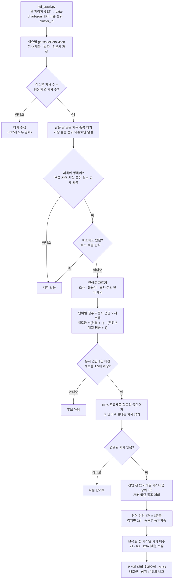
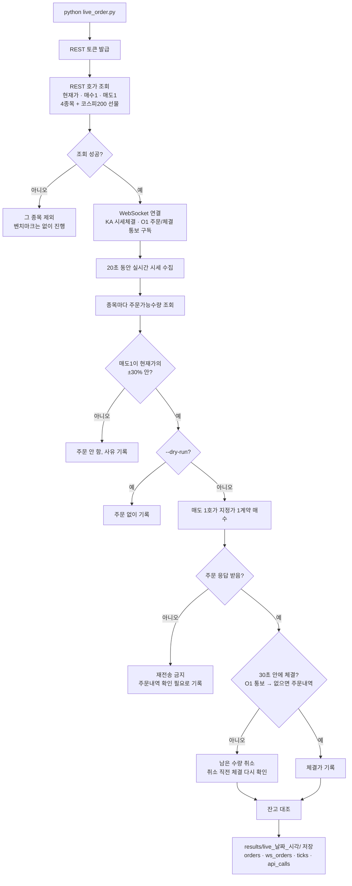

# 5주차 · 데이터 기반 전략 — KDI 월간 경제 이슈 텍스트 × 「2차 병목」 발견 전략

**제출: 2026/11/20(금) 23:59** · 팀 리드랙(LeadLag) · team-02

> 초안(11/19). 모의 주문 평가(11/20 · 12/10)와 스크린샷은 실행 후 채웁니다.
> 수치는 모두 `results/` 의 원본 기록에서 읽은 값입니다.

| 항목 | 내용 |
| --- | --- |
| 가설 | 정책·경제 뉴스에서 「부족·지연·차질·품귀」 같은 **병목어와 함께 새로 늘어난 단어**는 공급이 모자란 소재·부품·인프라를 가리키고, 그것을 만드는 회사는 다음 달 이후 시장보다 오른다 |
| 데이터 | KDI 경제교육·정보센터 「월간 경제 이슈」 2026년 1~10월 — **이슈 397개 · 기사 제목 77,212건**(직접 수집) |
| 신호 | 달마다 병목어 제목 속 단어를 세어 「새로움」이 큰 단어 → KRX 상장사 **주요제품**의 중심어로 종목 자동 연결 → 진입 전 20거래일 거래대금 상위 3종목 |
| 매매 | 다음 달 첫 거래일 시가에 종목별 동일가중 매수, 21·63·126거래일(1·3·6개월) 보유 |
| 검증 | 코스피 대비 초과수익 · MDD · 초과수익 > 0 비율, **대조군**(병목어 조건 없음) · **민감도**(상위 10위 이슈만) |
| 실행 환경 | 백테스트(과거 데이터 시뮬레이션) + NH선물 **모의계좌** 주문(6절) |
| 코드 | 수집 `kdi_crawl.py`(Python + requests) · 분석 `kdi_bottleneck.py`(pandas · FinanceDataReader) · 설정 `strategy_config.json` |

## 1. 요약

**한 것.** KDI 월간 경제 이슈의 이슈별 기사 목록을 수집 코드로 모두 받아, 미리 정한 규칙(코드)으로만 신호를 냈습니다. 사람이나 LLM 이 키워드·종목을 고르지 않습니다(2절).

**결과.** 기간이 끝난 신호 기준 코스피 대비 초과수익은 **1개월 −0.6%(4개 중 3개 플러스), 3개월 +2.7%(3개 중 2개)** 로 0 근처입니다. 병목어 조건을 뺀 대조군(1개월 −5.5%, 3개월 +6.8%)과도 일관된 차이가 없습니다. 기간이 끝난 신호가 3~4개뿐이라 **가설은 지지되지도 기각되지도 않습니다**(5절).

**알게 된 것.**
- 2026년 경제 뉴스에서 병목어는 공급 부족보다 **파업발 차질**(삼성전자·현대차·KTX·레미콘)과 **주택 공급**에 많이 쓰였습니다.
- 2024년 사례(변압기·원전·방산)로 만든 키워드 사전은 2026년 데이터에서 신호를 **2개**밖에 내지 못했습니다 → 발견 모드로 전환(4-1절).
- 실제 데이터를 돌리며 설계 오류 3가지를 찾아 고쳤고, 결과를 본 뒤 바꾼 것은 모두 기록하고 이전 버전 결과도 함께 보고합니다(4절).

## 2. 미래 편향 · 사후 선택 편향을 막은 방법

| 위험 | 막은 방법 |
| --- | --- |
| M월 신호에 M월 이후 정보 사용 | `date ≤ M월 말` 기사만 사용 · 「새로움」 기준선은 직전 6개월(최소 3개월)만 · 진입은 M+1월 첫 거래일 시가(코스피 거래일 달력에서 계산) |
| 결과를 아는 LLM 이 키워드를 고름 | LLM 은 코드 작성·정리에만 사용. 신호는 고정 규칙으로만 산출(누가 돌려도 같은 결과) |
| 오른 걸 아는 달·종목만 시험 | 모든 달에 같은 규칙 · 단어→종목은 **KRX 주요제품 문자열 규칙**으로 자동 연결 · 종목 순위는 **진입 전 20거래일 거래대금**(그 시점에 알 수 있던 값) · 진입일에 상장 전인 회사 제외 |
| 결과를 보고 규칙을 고침 | 값은 `strategy_config.json` 에 고정, 바꿀 때마다 `_변경기록` 에 날짜·이유·「결과를 보기 전/후」 를 남김 · 결과 후 변경은 이전 버전도 함께 보고(5절 v1) |
| 대조 없이 수익만 봄 | 대조군(병목어 조건 없이 새로 많이 나온 단어로 같은 과정) · 민감도(상위 10위 이슈만) |

## 3. 데이터 수집 (`kdi_crawl.py`)

**수집 허용 확인(2026-11-18).** `robots.txt` = `User-agent: * / Allow: /`, 이용약관에 자동 수집 금지 조항 없음(`screenshots/kdi_robots_20261118.png`).

**요청 구조(브라우저 개발자도구로 확인).**

| 용도 | 요청 | 응답 |
| --- | --- | --- |
| 월 페이지 | `GET /bigdata/monthlyEconomicIssue.do?year=2026&month=09` | HTML. 이슈맵 차트 데이터 `data-chart-json` 에 이슈별 **순위 · cluster_id · 이슈명 · 기사 수** |
| 이슈 기사 | `GET /bigdata/monthlyEconomicIssue/getIssueDetailJson.do?cluster_id=…&pub_date=…&issue_name=…` | JSON `{keyword, news[], newsMinMaxDate, sentiment, trend}` — 기사 목록 전체 |

- 기사 **제목·날짜·언론사**만 저장, 기사 본문(네이버 뉴스)에는 접속하지 않음 · 요청 간격 1.5초 · 받은 원본은 `results/news/raw/` 에 저장하고 다시 돌리면 저장본 사용.
- **수집 검증:** 이슈마다 받은 기사 수를 KDI 화면의 기사 수(`kdi_cnt`)와 비교 → **397개 이슈 모두 일치**(`results/news/kdi_2026_all_crawl_log.csv`).

| 파일 | 범위 | 이슈 | 기사 | 같은 달·같은 제목 중복 |
| --- | --- | --- | --- | --- |
| `results/news/kdi_2026_all.csv` (본 분석) | 순위 40위 이내 전체 | 397 | 77,212 | 745건(1.0%) |
| `results/news/kdi_2026.csv` (민감도) | 순위 10위 이내 | 101 | 41,750 | 405건(1.0%) |

중복 기사는 가장 높은 순위 이슈의 1건만 남깁니다(한 기사가 여러 이슈에 묶인 경우).

```powershell
python kdi_crawl.py --start 2026-01 --end 2026-10 --max-rank 40 --out results/news/kdi_2026_all.csv
python kdi_crawl.py --start 2026-01 --end 2026-10 --max-rank 10 --out results/news/kdi_2026.csv
```

## 4. 전략 규칙과 설계 변경

### 4-0. 전체 흐름



M월 신호에는 M월 말까지의 기사만 쓰고, 「새로움」 기준선은 직전 달들만 씁니다(2절).

### 4-1. 사전 모드 → 발견 모드 (11/18, 결과 보기 전)

처음 설계는 사람이 정한 키워드 사전(변압기·전력망·원전기자재·탄약 등 8개)이 병목어와 **같은 제목**에 나온 횟수로 신호를 내는 방식이었습니다. 2026년 데이터에서는 신호가 **2개**(8월·9월 전력망)뿐이고 둘 다 보유기간이 끝나지 않아 검증이 불가능했습니다. 사전이 2024년 사례를 보고 만든 것이라는 한계도 있어, 사전 없이 데이터에서 단어를 찾는 **발견 모드**로 바꿨습니다.

### 4-2. 매매 규칙 (`strategy_config.json`)

| 단계 | 규칙 | 값 · 근거 |
| --- | --- | --- |
| 병목어 | 부족 · 지연 · 차질 · 품귀 · 필수 · 교체 · 확충 | 처음 기획 그대로 |
| 해소어 필터 | 병목어 + 해소·해결·완화·풀려·정상화·극복·숨통·진정세·안정세가 같은 제목에 있으면 제외 | 「부족 해소」 처럼 병목이 풀린 기사(팀 검토 반영) |
| 단어 세기 | 병목어 제목을 단어로 자르고 조사 제거, 불용어(정부·시장·우려 등) 제외. 기사 1건 = 1(동일 가중) | 상위 이슈는 기사 수가 이미 많아 순위 가중은 이중 반영(팀 검토) |
| 새로움 | (당월 + 1) ÷ (직전 6개월 평균 + 1) | 늘 나오던 단어와 새로 늘어난 단어 구분 |
| 후보 | 동시 언급 2건 이상 · 새로움 1.5배 이상, 점수(언급 × 새로움) 상위 30개 | 기사 한 건짜리 우연 배제 |
| 단어 → 종목 | 주요제품을 쉼표로 나눈 **항목의 마지막 단어(중심어)가 그 단어로 끝나는** 회사 · 숫자 섞인 단어 제외 · 「부품·제품·장비」 등 일반어 제외 | KRX KIND 상장법인목록(2,750곳, 11/18 다운로드) |
| 종목 선택 | 단어당 진입 전 20거래일 평균 거래대금 상위 3곳 · 그 기간 거래일의 절반 이상 거래가 있어야 함 | 그 시점에 알 수 있는 값 · 거래정지 종목 제외 |
| 포트폴리오 | 연결되는 단어 상위 3개 × 3종목, 같은 달 겹치는 종목 1번, 종목별 동일가중 | |
| 진입 · 보유 | M+1월 첫 거래일 시가 · 21 · 63 · 126거래일 | 처음 기획(3·6개월) + 1개월(결과가 나온 신호를 늘리려고 추가) |
| 과열 익절 | 그 단어가 상위 10위 이슈명의 30% 이상에 나오면 다음 달 첫 거래일 시가에 절반 매도 | 「TOP 10 도배」 를 숫자로 정의 |
| 비용 | 왕복 0.3% | 수수료 + 거래세 추정 |

### 4-3. 변경 기록 (`strategy_config.json` `_변경기록`)

| 날짜 | 바꾼 것 | 이유 | 결과를 |
| --- | --- | --- | --- |
| 11/18 | 순위 가중 1/순위 → 동일 가중 · 해소어 필터 · 이슈 간 중복 1건 | 팀 검토 | 보기 전 |
| 11/18 | 이슈명은 세지 않고 기사 제목만 셈 | 이슈명 「전력망 **확충** …」 이 기사 253건마다 반복돼 동시 언급이 253건으로 부풀려짐(실제 2건) | 보기 전 |
| 11/18 | 사전 모드 → 발견 모드 · 보유 21거래일 추가 | 신호 2개로 검증 불가 | 보기 전 |
| 11/18 | 상위 10위 → 전체 이슈(본 분석), 상위 10위는 민감도 | 병목어 제목 445 → 899건 | 보기 전 |
| 11/18 | **v2:** 숫자 단어 제외 · 주요제품 「중심어」 일치 | v1 연결 17건 중 7건이 엉뚱함(「2차 부분파업」→2차전지 회사, 「15」→볼펜 회사, 「서울」→리츠) | **본 뒤**(수익률이 아니라 연결 오류 때문, v1 결과 함께 보고) |
| 11/18 | 시가 0 · 거래 없는 종목 제외 | 대조군에서 6개월 내내 가격이 고정된 거래정지 종목이 선택됨(본 분석에는 없음) | **본 뒤** |

## 5. 결과

### 5-1. 신호

| 신호 달 | 단어(동시 언급 수) | 연결된 종목 |
| --- | --- | --- |
| 4월 | 플라스틱(4) · 반도체(4) | 포스코인터내셔널 · 세우글로벌 · SK하이닉스 · 동진쎄미켐 · 아이씨티케이 |
| 6월 | 레미콘(18) · 반도체(17) · 공사(5) | 서산 · 강동씨앤엘 · 모헨즈 · SK하이닉스 · 동진쎄미켐 · 에스에이엠티 · 대우건설 · 대한전선 · GS건설 |
| 7월 | 메모리(7) · 점검(4) · 물류센터(3) | 삼성전자 · 에스에이엠티 · 유니트론텍 · 한전KPS · 마스턴프리미어리츠 |
| 8월 | 매출(3) · 메모리(5) | 압타바이오 · 삼성전자 · 에스에이엠티 · 유니트론텍 |
| 10월 | AI(12) · 인프라(5) · 로봇(3) | LG씨엔에스 · 현대오토에버 · 스트라드비젼 · 케이씨에스 · 누리플렉스 · 네이블 · 로보티즈 · 레인보우로보틱스 · 코스모로보틱스 |

5월·9월은 후보 단어(사측·파업·포스코 등)가 주요제품과 연결되지 않아 신호가 없습니다. 단어별 전체 연결 기록은 `results/bt_discover_all_v2/token_mapping.csv`.

### 5-2. 비교 (기간이 끝난 신호만, 코스피 대비 초과수익)

| 분석 | 1개월 평균 | 1개월 > 0 | 3개월 평균 | 3개월 > 0 | 3개월 평균 MDD |
| --- | --- | --- | --- | --- | --- |
| **본 분석 v2** (전체 이슈) | **−0.6%** | 3/4 | **+2.7%** | 2/3 | −32.3% |
| 대조군 v2 (병목어 조건 없음) | −5.5% | 1/4 | +6.8% | 2/3 | −26.6% |
| 민감도: 상위 10위 v2 | −6.3% | 2/4 | +0.9% | 1/2 | −20.4% |
| 참고: v1 (연결 보완 전) | −5.5% | 4/5 | −7.6% | 2/3 | −38.0% |

6개월(126거래일)은 기간이 끝난 신호가 0~1개라 판단에서 제외합니다. 결과 폴더: `results/bt_discover_all_v2/` · `bt_control_v2/` · `bt_top10_v2/` · `bt_discover_all_v1/`.

### 5-3. 해석

- **우위의 증거가 없음.** 본 분석의 초과수익은 0 근처이고, 표본(3~4개)으로는 우연과 구별되지 않습니다.
- **병목 맥락의 효과도 확인되지 않음.** 대조군보다 1개월은 앞서고 3개월은 뒤처져 방향이 일관되지 않습니다.
- **v1 → v2 개선은 성과로 보지 않음.** 결과를 본 뒤 연결 규칙을 고쳤기 때문입니다.
- **변동성이 매우 큼.** 3개월 평균 MDD −30% 안팎. 같은 기간 코스피도 한 달에 +27%(5/4→6/4), −35%(7/1→7/30) 움직였습니다(네이버 증권 시세와 대조해 확인).
- **「2차」 가설과 어긋남.** 발견 모드는 1차·2차를 구분하지 못해 「반도체」 에 SK하이닉스·삼성전자 같은 대장주가 들어갔습니다(거래대금 순위 규칙이 대형주를 고르기 쉬움).

## 6. NH선물 API 실행 (모의계좌)

**무엇을 했나.** 가장 최근 신호(10월 텍스트 → 11월 포트폴리오, 9종목) 중 **주식선물이 상장된 4종목**의 12월물을 1계약씩 모의계좌로 매수했습니다. 상장 여부는 NH FUTURES API 앱이 받아 둔 종목 마스터 `stk_fut_opt.mst`(`~/NHFutures/master/날짜/`)에서 확인했습니다. 나머지 5종목(스트라드비젼 · 케이씨에스 · 누리플렉스 · 네이블 · 코스모로보틱스)은 주식선물이 없습니다.

**실행 흐름(`live_order.py`, 4주차 `nh_client.py` · `ws_feed.py` 재사용).**



**실행 결과 — 2026-11-19(목) 15:02** (`results/live_20261119_150206/`, 15:01 실행은 `--dry-run`)

| 종목 | 코드(12월물, 만기 12/10) | 주문 직전 매수1 / 매도1 | 체결가 | 계약 금액(승수 10) | 체결 확인 | 잔고 |
| --- | --- | --- | --- | --- | --- | --- |
| LG씨엔에스 | `A2K6C000` | 75,200 / 75,400 | **75,400** | 754,000원 | 실시간 통보 O1 | 1 |
| 현대오토에버 | `A2R6C000` | 305,500 / 306,500 | **306,500** | 3,065,000원 | 실시간 통보 O1 | 1 |
| 로보티즈 | `A2X6C000` | 246,500 / 247,500 | **247,500** | 2,475,000원 | 실시간 통보 O1 | 1 |
| 레인보우로보틱스 | `A2W6C000` | 414,500 / 415,500 | **415,500** | 4,155,000원 | 실시간 통보 O1 | 1 |
| (벤치마크) 코스피200 선물 | `A016C000` | 792.3 / 792.4 | 진입 시점 792.3 | — | 실시간 시세 | — |

- 4건 모두 주문 직후 체결, 체결 확인 4/4 가 WebSocket 주문/체결 통보, 잔고 대조 일치. 실시간 시세체결 240건 수신, 연결 끊김 0.
- **비용:** 매도 1호가에 샀으므로 중간가 대비 종목마다 호가 반 칸(LG씨엔에스 100원 · 나머지 500원) × 승수 10 = 합계 **16,000원**(계약 금액 합계 10,449,000원의 약 0.15%).
- **백테스트와 다른 점(정직하게):** ① 규칙상 진입일(11/2)보다 늦은 **11/19 진입** ② 9종목 중 **4종목만** ③ 계약 수는 같지만 계약 금액이 75만~416만 원으로 달라 **동일가중이 아님**(평가 때는 종목별 수익률의 단순 평균을 함께 계산) ④ 현물이 아닌 주식선물(베이시스) ⑤ 12월물 만기(12/10)까지 약 14거래일 보유로 21거래일보다 짧음.
- **평가 계획:** `python live_order.py --mark` 로 11/20(금) 장 마감 전과 12/10 만기 전에 현재가·잔고를 기록하고, 같은 기간 코스피200 선물 대비 초과수익을 계산합니다. 결과는 관찰 1건이며 전략 평가는 5절 결론을 유지합니다.
- **앱 화면 대신 API 기록:** Windows 애플리케이션 제어 정책이 NH FUTURES API 앱 실행을 막아(11월 중순부터) 앱의 체결 내역 화면을 캡처하지 못했습니다. 대신 `orders.csv`(주문번호·체결가) · `ws_orders.csv`(거래소 통보 원본) · `api_calls.csv`(모든 호출) · 터미널 화면(`screenshots/live_order_20261119.png`)을 남겼습니다.

```powershell
python live_order.py --dry-run   # 주문 없이 호가·주문가능수량 확인
python live_order.py             # 모의 주문
python live_order.py --mark      # 보유 종목 · 벤치마크 현재가 기록
```

**처음 시도에서 고친 것.** 첫 `--dry-run`(14:54)에서 REST 호가의 매도1을 호가 **잔량** 칸(3 · 1 · 4 · 5)으로 잘못 읽어, 실시간 시세가 없던 두 종목이 「지정가 4원 · 5원」으로 나올 뻔했습니다. 응답 원본(`raw_pricebid_*.json`)으로 칸 이름(`Occurs1[0].occurs1_ask_best_pric`)을 확인해 고치고, 매도1이 현재가와 30% 넘게 다르면 주문하지 않는 안전장치를 넣었습니다.

## 7. 계산 검증

| 확인한 것 | 방법 | 결과 |
| --- | --- | --- |
| 수익률 계산 | HD현대일렉트릭 2024-04-01 시가 → 2024-07-03 종가를 네이버 증권과 대조(코드 시험) | 일치 |
| 2026년 주가 자료 | 코스피 2026-05-04 시가 · 2026-07-30 종가(5,593.56) · HD현대마린엔진 2026-06-04 종가(약 67,300원)를 네이버 증권과 대조 | 일치 |
| 수집 | 이슈별 기사 수 vs KDI 화면 기사 수 | 397개 모두 일치 |
| 해소어 필터 | 빠진 제목 12건(상위 10위 데이터)을 직접 읽음 | 9건 맞음 · 3건 잘못 제외(「정상화 **지연**」, 「공급 부족 아니다…해소해야」) — 정확도 약 75% |

## 8. 한계

- **표본:** 데이터가 2026년 1~10월뿐이라 신호 달은 최대 7개, 기간이 끝난 것은 3~4개.
- **KDI 집계 공개 시점 미확인:** M월 이슈 순위가 M+1월 언제 공개되는지 확인하지 못했습니다. 첫 거래일보다 늦게 공개된다면 진입 시점에 미래 정보가 섞입니다(코드는 `published_date` 열이 있으면 공개일 다음 거래일로 미루도록 되어 있음).
- **주요제품 정보는 2026-11-18 기준:** 과거 시점의 제품 정보가 아닙니다.
- **규칙 기반 텍스트 처리:** 해소어 필터 정확도 약 75%, 파업 맥락의 단어도 걸릴 수 있음.
- **1차·2차 구분 없음:** 발견 모드는 대장주와 2차 수혜주를 구분하지 못합니다.

## 9. 폴더 구성과 실행 방법

| 경로 | 내용 |
| --- | --- |
| `kdi_crawl.py` | KDI 월간 경제 이슈 수집(requests 만 사용) |
| `kdi_bottleneck.py` | 점수 · 발견 · 백테스트(`score` · `discover` · `backtest` · `backtest-discover`) |
| `live_order.py` | NH선물 모의 주문 · 평가 기록(4주차 `nh_client.py` · `ws_feed.py` 사용) |
| `nh_client.py` · `ws_feed.py` | 4주차 REST · WebSocket 모듈(그대로) |
| `strategy_config.json` | 규칙 값 전부와 변경 기록 |
| `results/news/` | 수집한 기사 CSV · 이슈별 건수 기록 · 원본(`raw/`) |
| `results/live_*` | 모의 주문 실행 기록(`orders.csv` · `ws_orders.csv` · `ticks.csv` · `api_calls.csv` · `events.jsonl`) |
| `results/bt_*` | 실행 하나 = 폴더 하나(`summary.txt` · `token_mapping.csv` · `trades.csv` · `portfolios.csv` · `run_meta.json`) |
| `results/prices/` | FinanceDataReader 로 받은 주가(다시 받을 수 있음) |
| `screenshots/` | robots.txt · 개발자도구 요청 · 실행 화면 |

```python
# Colab (노트북 PC 의 Windows 애플리케이션 제어 정책이 pandas·numpy 파일을 차단해 분석은 Colab 에서 실행)
!pip install -q finance-datareader
!python kdi_bottleneck.py backtest-discover --news results/news/kdi_2026_all.csv --listing 상장법인목록.xls --out results/bt_discover_all_v2
!python kdi_bottleneck.py backtest-discover --control --news results/news/kdi_2026_all.csv --listing 상장법인목록.xls --out results/bt_control_v2
!python kdi_bottleneck.py backtest-discover --news results/news/kdi_2026.csv --listing 상장법인목록.xls --out results/bt_top10_v2
```

v1 재현: `strategy_config.json` 의 `discover.match_mode` 를 `substring`, `exclude_digit_tokens` 를 `false` 로 바꿔 실행.
