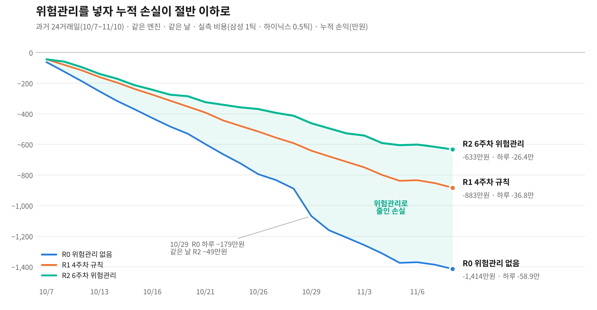
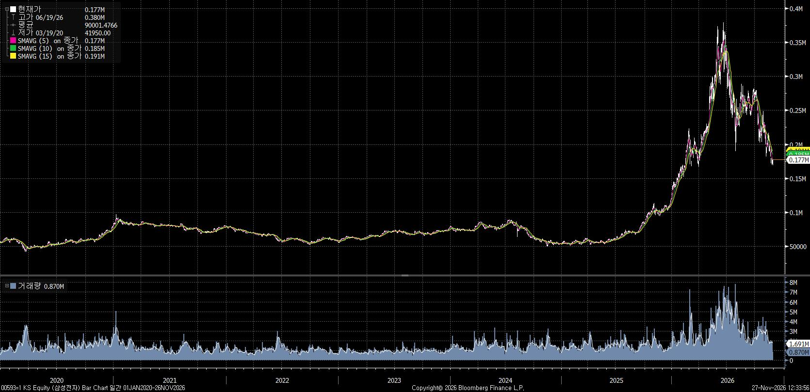
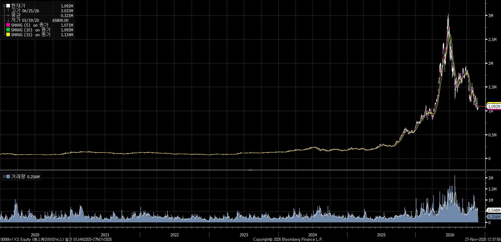

# 6주차 · 전략 + 위험관리

**제출: 2026/11/27(금) 23:59** · 팀 리드랙(LeadLag) · team-02

두 사람이 각자 이전 주차의 전략을 하나씩 골라 위험관리를 붙이고 실행했습니다. 보고서는 이 README 하나이고, 코드와 결과는 전략별 폴더에 있습니다.

| | A. 4주차 전략 + 위험관리 | B. 2주차 전략 + 위험관리 |
| --- | --- | --- |
| 담당 | 남혜원 | (팀원) |
| 폴더 | `pair_risk/` | `hedge_02/` |
| 전략 | 삼성전자·SK하이닉스 주식선물 페어 평균회귀 | 미국달러 선물 볼린저밴드 복귀(평균회귀) + 유로·엔 선물 「공통 달러 충격」 진입 필터 |
| 핵심 위험관리 | 금액·z·시간 손절 · 일일 한도 · 연속 손실 3번 중지 · 실행 중 감시 | 손절 5틱 · 최대 30봉 · 손절 뒤 3봉 대기 · 일 손실 3만원 · 해외 달러 공통 충격 역행 진입 보류 · 해외 자료 부족·지연 때 진입 차단 |
| 실행 | 11/26 · 11/27 모의계좌 | 11/27 모의계좌 (11/26 실행은 계좌 대조 미확인으로 집계 제외) |
| 결과 한 줄 | 24거래일 하루 평균 손실 −58.9만(위험관리 없음) → −26.4만원, 최악의 날 −179만 → −49만원 · 11/27 감시 규칙 실제 작동 | 11/27 완료 14건 +6,000원(수수료 0원) · 백테스트는 모두 손실 · 방향 차단이 거의 없어 필터 효과는 미확인 |

---

## A. 4주차 전략에 위험관리 붙이기 — 삼성전자·SK하이닉스 주식선물 페어 (남혜원 · `pair_risk/`)

> 이 부분의 코드·결과 경로는 모두 **`pair_risk/` 폴더 기준**입니다(예: `results/` = `pair_risk/results/`). 수치는 모두 `results/` 의 원본 기록에서 읽은 값입니다. 본문(A-1 ~ A-8)에 결론과 핵심 근거를, 아래 **부록**에 표와 분석 전체를 두었습니다. 본문의 「부록 4-3」 같은 번호는 부록의 절 번호입니다.

### A-1. 한눈에 보기

4주차 결론은 「신호는 맞지만 호가 한 칸(삼성 500원)이 되돌림보다 커서 진다」였습니다. 기대수익이 음수인 전략에서 위험관리가 할 수 있는 일은 이익을 만드는 것이 아니라 **안 통하는 날의 손실을 일찍, 작게 끊는 것**이고, 이번 주의 목표도 거기에 두었습니다.

**① 위험관리로 하루 손실이 절반 이하로 줄었습니다** (과거 24거래일 · 같은 엔진 · 같은 날 · 실측 비용)

| 규칙 | 포지션 | 하루 평균 (95% 구간) | 최악의 날 | 포지션 최악 |
| --- | --- | --- | --- | --- |
| R0 위험관리 없음 | 249 | −58.9만 (−72.7만 ~ −47.3만) | −179만 | −106만 |
| R1 4주차 규칙 | 140 | −36.8만 (−40.5만 ~ −32.0만) | −51만 | −28만 |
| **R2 6주차 위험관리** | 88 | **−26.4만** (−31.9만 ~ −20.9만) | **−49만** | −28만 |



1년치 현물 1분봉(238거래일, 급등·고점·급락 포함)에서도 R0 −48.5만 → R1 −34.3만 → **R2 −23.0만원/일**로 같은 순서이고, 상승·하락·변동성 국면 모두에서 R2 가 R1 보다 하루 6~15만원 덜 잃었습니다(부록 5-4).

**② 규칙마다 역할이 다릅니다 — 평균을 줄이는 규칙과 꼬리를 막는 규칙**

- **연속 손실 3번 중지**가 6주차 개선(−36.8만 → −26.4만)의 거의 전부를 냅니다. 전략이 통하는 조건(비용 0)에서는 24거래일 동안 한 번도 걸리지 않았고(1년에서도 1.5%), 안 통하는 날에만 진입을 멈춥니다.
- **금액 손절 15만원 · 시간 청산 30봉**은 평균을 낫게 하는 값이 아니라 **보험**입니다. 손절과 한도를 모두 없애면 하루 평균은 비슷하지만(−26.2만 → −25.6만) 최악의 날이 −57만 → −88만원, 포지션 최악이 −42만 → −76만원으로 커집니다(1년 현물 검증 기간 123일, 부록 4-8).

**③ 실시간에서 규칙이 실제로 작동했습니다** — 11/27 포지션을 들고 노트북이 18분 멈췄다가 돌아온 순간 「보유 중 시세 공백 청산」이 걸려 포지션을 정리했고, 밀린 봉으로는 주문하지 않았습니다(A-5).

**넣지 않은 것과 한계.** 분할 진입·청산, 「속도」 필터(1분봉·초 단위), 지정가 + 경보, 변동성 비례 손절, 반감기 시간 청산, 관계 붕괴 손절을 시험했지만 모두 기각했습니다(A-6). 위험관리는 손실을 줄였을 뿐 **전략의 기대수익은 여전히 음수**입니다(A-7).

### A-2. 전략 (4주차 그대로)

| 구분 | 조건 |
| --- | --- |
| 대상 | 삼성전자 선물 12월물 `A116C000` · SK하이닉스 선물 12월물 `A506C000` (승수 10주), 삼성 10 : 하이닉스 1 |
| 스프레드 · z | s = ln(삼성) − β · ln(하이닉스), 최근 40봉(1분) 평균·표준편차로 z, 하루 안에서만 |
| 진입 · 청산 | z 가 +2 를 넘으면 스프레드 매도, −2 아래면 매수(09:10~15:00) · \|z\| ≤ 0.5 에서 청산 · 15:15 장 마감 정리 |
| 주문 | 시장가, 하이닉스 먼저 → 체결 확인 → 삼성 (두 다리를 하나의 거래로, `pair_broker.py`) |
| 실행 | 11/26(목) · 11/27(금) 모의계좌 (`--mode paper`), 시세·체결 통보는 WebSocket |

### A-3. 위험관리 규칙과 값의 근거

위험관리를 끈 R0 로 돌린 포지션 249개(24거래일)의 보유 중 평가손익 경로에서 「여기서 선을 그었다면 어땠을지」를 직접 재서 값을 정했습니다. 근거 표는 부록 4-2 ~ 4-6 에 있습니다.

| 층 | 규칙 | 값 | 4주차 대비 | 값의 근거 (한 줄) |
| --- | --- | --- | --- | --- |
| ① 포지션 | 금액 손절 (0.2초마다 판정) | 평가손실 **15만원** | 같음 | 10만원 이하는 호가 튕김까지 잘라 손해, 20만원 이상은 최악의 날이 커짐 → 꼬리를 막는 보험의 크기 (부록 4-3) |
| | z 손절 | \|z\| ≥ **3.5** | 같음 | 4주차 근거 유지 |
| | 시간 청산 | **30봉** | 60 → **30** | 포지션의 90% 가 25봉 안에 끝남. 그보다 조금 긴 곳에서 꼬리를 끊음 (부록 4-4) |
| ② 하루 | 일일 손실 한도 | **50만원** (보유 평가손익 포함) | 평가손익 포함 **새로** | 보유 중 손실까지 세야 한도가 실제로 지켜짐 |
| | 연속 손실 중지 | 포지션 **3번** 연속 손실 → 그날 진입 중지 | **새로** | 「전략이 통할 때는 걸리지 않는 가장 작은 N」 원칙 (아래) |
| ③ 감시 | 실시간 끊김 중 진입 금지 | 끊긴 동안 | **새로** | 4주차 11/11 끊김 뒤 지표가 왜곡된 진입(z −6.06) |
| | 보유 중 시세 공백 청산 | **30초** 무수신 | **새로** | 정상이면 5초마다 시세가 옴. 30초 무수신 = PC·네트워크 문제 → 볼 수 없는 포지션은 들지 않음 |
| | 한쪽 다리만 체결 | > **3초** 경고, **2번**이면 중지 | **새로** | 4주차 중앙 약 200ms · 최대 1.7초보다 충분히 김 (부록 4-6) |
| | 상태 한 줄 | 1분마다 | **새로** | 보유·손절선·하루 손익·연속 손실·실시간 상태·그림자 손익 |

**연속 손실 3번 — 값을 「최적」이 아니라 원칙으로 (부록 4-2).** 실측 비용에서는 2번이 가장 좋지만(−19.0만), 2번은 전략이 통하는 날(비용 0)에도 걸려 포지션 14개를 막습니다 — 그건 「덜 거래할수록 덜 진다」일 뿐입니다. 3번은 비용 0 에서 한 번도 걸리지 않습니다(승률 약 85% → 세 번 연속 손실 확률 약 0.3%). 그래서 세 번 연속 손실을 「오늘은 신호가 통하지 않는다」는 증거로 보고 그날만 멈춥니다. 아무 날이나 거래를 줄이는 규칙(예: 일일 한도를 낮추기)과 다른 점이 이것입니다.

**15만원 · 30봉은 최적값이 아닙니다 (부록 5-4 ④).** 1년을 20거래일 창 219개로 나눠 보면 15만원에서 자르는 쪽이 나은 창은 7%, 30봉은 11% 뿐이고, 창마다 손익분기 값이 7만~30만원 · 10~60봉으로 흩어집니다. 「최적의 손절선」은 기간마다 달라 존재하지 않으므로, 최적화 대신 **최악의 날을 일일 한도(50만원) 근처로 묶는 보험의 크기**로 정했습니다.

### A-4. 넣기 전·후 비교

같은 엔진 · 같은 날 · 같은 체결 가정에서 위험관리만 바꿨습니다. 분봉 가격에 그대로 체결된다고 볼 수 없어서, 시장가가 기준 가격보다 몇 틱 불리하게 체결되는지를 세 가지로 두었습니다 — **0틱**(상한선. 아이디어 자체에 되돌림이 있나) · **0.5틱** · **실측**(모의 주문에서 잰 삼성 1틱 · 하이닉스 0.5틱. 결론의 기준). 삼성 1틱은 가격이 20만원 이상이면 500원이라 왕복 비용이 약 11만원, 미만이면 100원이라 약 3만원입니다(부록 5-1).

| 24거래일 · 하루 평균 · 최악의 날 · 포지션 최악 | R0 없음 | R1 4주차 | R2 6주차 |
| --- | --- | --- | --- |
| 0틱 | +47.2만 · −91만 · −95만 | +44.5만 · −54만 · −20만 | +44.4만 · −54만 · −20만 |
| 0.5틱 | −11.0만 · −139만 · −101만 | −11.0만 · −43만 · −23만 | −11.1만 · −43만 · −23만 |
| 실측 | −58.9만 · −179만 · −106만 | −36.8만 · −51만 · −28만 | **−26.4만 · −49만 · −28만** |

- **손절의 효과(R0 → R1)는 꼬리에서** 나옵니다 — 비용 0 에서도 위험관리 없이는 한 포지션이 −95만원까지 갑니다.
- **6주차의 효과(R1 → R2)는 비용이 클 때만** 나옵니다 — 전략이 통하는 조건에서는 끼어들지 않고, 안 통하는 상황에서 하루 10.4만원을 아낍니다.
- **실시간에서도 같은 비교**를 했습니다. 실제 주문과 함께, 같은 시세로 주문 없이 도는 「그림자 엔진」 R0 · R1 · R2 · R3 를 돌렸습니다. 11/26 은 규칙이 걸릴 상황이 없어 모두 같은 4건이었고(실제 +1만원, 부록 5-2), 11/27 은 A-5 입니다.
- **결과를 가르는 것은 「호가단위 국면」입니다.** 1년 표본에서 비용 0 이익이 500원 국면 +49.5만 ↔ 100원 국면 +8.5만원/일이고, 체결을 1분 늦추면 건당 이익이 +3.1만 → +0.3만원이 됩니다 — 「이익」의 대부분은 잡을 수 없는 호가 튕김입니다(부록 5-3 · 5-4).

### A-5. 규칙이 실제로 작동한 기록 — 11/27 실시간 (`results/live_1127/`)

스프레드 매도 포지션(13:41 진입)을 들고 있던 13:53:59 에 **실행이 18.2분 멈췄습니다**(노트북 절전으로 보임). 프로그램이 다시 돈 순간 감시 규칙이 1,090초 시세 공백을 잡아 포지션을 청산했고, 밀린 봉으로는 주문하지 않았으며, 실시간이 복구될 때까지 신규 진입을 막았습니다.

```
13:53:06 [watch] 보유 스프레드 매도 삼성 10·하이닉스 1 12봉 · 평가 -30,000원 (손절선 −150,000) | … | 실시간 OK
14:12:09 [pause] 실행이 18.2분 멈췄다가 다시 돎 (13:53:59→14:12:09)
14:12:09 [monitor] 실시간 끊김 — 다시 연결될 때까지 신규 진입 금지(보유 청산 판정은 REST 시세로 계속)
14:12:09 [monitor] 보유 중 시세 공백 1090초 ≥ 30초 — 감시할 수 없는 포지션 청산
14:12:11 [pair] 페어 16 EXIT_MONITOR → COMPLETE (삼성 10@179200.0 · 하이닉스 1@1104000.0, 단독 노출 244ms) 두 다리 청산
14:12:12 [gap] 밀린 봉 17개(13:53~14:09)는 지표만 갱신하고 주문하지 않음
14:12:17 [monitor] 실시간 복구 — 신규 진입 허용
```

| 11/27 13:07~15:40 | 실제 주문(R2 + 감시) | 그림자 R0 · R1 · R2 · R3 |
| --- | --- | --- |
| 포지션 | 2 (수렴 1 · **감시 공백 청산 1**) | 2 (수렴 2) |
| 손익 | 0원 | −120,000원 |
| 감시 규칙 발동 | 시세 공백 청산 1 · 끊김 중 진입 금지 2 | 없음 |

- 설계한 상황 그대로 작동했습니다. 다만 그림자와의 손익 차이는 대부분 그림자의 체결 가정 때문이라 **이 하루로 손익 효과를 말하지는 않습니다** — 확인한 것은 작동입니다.
- **남는 한계:** 이 규칙은 프로그램이 다시 돌 때에야 판정합니다. 멈춘 18분 동안은 보호하지 못했으므로, PC 가 멈춰도 작동하는 **서버에 미리 거는 손절 주문**이 다음 단계입니다.
- 금액 손절 → 연속 손실 중지 → 그림자 비교가 이어지는 것은 가짜 NH 서버 전체 실행으로, 규칙 하나하나는 시험으로 확인했습니다(부록 7-2).

### A-6. 시도했지만 넣지 않은 것

| 시도 | 가설 | 결과 | 자세히 |
| --- | --- | --- | --- |
| 분할 진입 · 분할 청산 | 더 벌어지면 더 들어가고, 절반 먼저 이익 실현 | 더 벌어진 포지션은 이긴 비율 5% — **물타기**. 실측 손실이 커짐 | 부록 4-5 |
| 「속도」 필터 (1분봉) | 하이닉스가 먼저 움직인 괴리 · 급변한 괴리만 진입 | 좋아 보인 것은 **호가 튕김**. 체결을 1분 늦추면 우위가 사라짐 | 부록 6 |
| 초 단위 선행 | 하이닉스가 크게 움직이면 삼성이 따라온다 | 선행은 **실제로 있음**(30초에 기대 폭의 약 40%). 그러나 약 4bp 로 호가 한 칸(24bp)보다 작음 | 부록 6-1 |
| 삼성 지정가 + 하이닉스 경보 | 선행을 지정가 취소 신호로 써 역선택을 줄임 | 역선택이 줄지 않음. 지정가 결과는 대기열 순서에 달림 | 부록 6-2 |
| 변동성 비례 손절 | 가격대가 바뀌어도 손절의 의미를 일정하게 | 원칙으로 정한 k = 3 이 고정 15만원과 **구별되지 않음** | 부록 4-7 |
| 반감기 맞춤 시간 청산 | 되돌림 속도에 맞춰 보유 한도를 조절 | 반감기가 지나도 들고 가는 쪽이 나음 — 효과 없음 | 부록 4-8 |
| 관계 붕괴 때만 손절 | 손절은 두 종목 관계가 깨졌을 때만 필요 | 15만원 손실 106건 중 관계가 깨져 있던 것은 2건 — **가설 기각** | 부록 4-8 |

변동성 · 반감기 · 관계 붕괴는 1년 현물을 설계(12~5월) / 검증(6~11월)으로 나누고, 기준값을 결과를 보기 전에 원칙으로 정해 검증 기간에서만 비교했습니다.

### A-7. 한계와 다음

- **전략의 기대수익은 여전히 음수**입니다. 위험관리는 손실을 줄일 뿐이고, 남은 과제는 진입 우위(호가 비용을 이기는 신호) 쪽입니다.
- 선물 검증은 **24거래일 · 한 추세 국면(하락)** 이고, 1년 자료는 현물 대용이라 비용 결론에는 쓰지 않았습니다. 실시간은 이틀 · 포지션 6개라, 금액 손절과 일일 한도가 실시간에서 걸린 기록은 아직 없습니다.
- 백테스트는 금액 손절을 1분봉 끝에 판정합니다(실행은 0.2초마다).
- 다음: ① 서버에 미리 거는 손절 주문 ② 실행 중 β 주기적 재추정(1년 동안 0.17 → 0.68 로 이동) ③ 블룸버그 장기 분봉으로 선물 표본 늘리기 ④ 모의계좌 실제 지정가 주문 (부록 8).

### A-8. 실행 방법

```powershell
cd pair_risk
python -m pip install -r requirements.txt
python -m unittest discover tests                                   # 시험 47개 (키 불필요, 가짜 NH 서버)
python risk_analyze.py --data hist_nov hist_dec --walk              # 값의 근거 + 전·후 비교 (24거래일) → results/risk_walk_24d/
python risk_speed_check.py --data hist_nov hist_dec --walk          # 속도 필터 체결 지연 점검 → results/risk_walk_24d/speed_delay.txt
python risk_regime.py --data hist_nov hist_dec --walk               # 국면별 결과 · 값 안정성 → results/regime_24d/
python risk_volstop.py --data kis_spot --split 20260531          # 변동성 비례 손절 (1년 현물, 설계/검증) → results/volstop_kis_spot/
python risk_adaptive.py --data kis_spot --split 20260531         # 반감기 시간 청산 · 관계 붕괴 손절 → results/adaptive_kis_spot/
python sec_leadlag.py <실행 결과 폴더들>                               # 초 단위 선행·후행 (체결 기록 ticks.csv) → results/sec_leadlag/
python risk_analyze.py                                              # (참고) 9거래일, β 0.59 고정 → results/risk_fixed_9d/

# 실행 (환경변수 NH_APP_KEY · NH_APP_SECRET, 국내 모의)
python run_pair.py --mode paper --smoke-order --run-minutes 1       # ① 주문 왕복 확인
python run_pair.py --mode paper                                     # ② 본 실행 — 장중 아무 때나 켜도 됨(오늘 분봉으로 지표 준비), 15:40 종료
```

실행 PC 수칙(2·4주차 교훈): **전원 연결 · 절전 끄기**(`powercfg /change standby-timeout-ac 0`), 같은 키를 쓰는 다른 프로그램 끄기.

### 부록 (A) — 자세한 근거와 분석 전체

> 본문 A-1 ~ A-8 의 근거 표와 분석 전체입니다. 절 번호(4-2 ~ 8)는 본문과 부록에서 서로 가리킬 때 쓰는 번호입니다. 「7-1절」은 본문 A-5 입니다.

#### 4. 규칙별 값의 근거

근거 데이터: 11월물·12월물 1분봉, 4주차와 같은 24거래일(10/7~11/10), β 는 날마다 직전 20거래일로, 판정 봉 종가 ± 실측 비용. **위험관리를 끈 규칙(R0)으로 돌린 포지션 249개의 보유 중 평가손익 경로**에서 「선을 그었다면 어땠을지」를 직접 쟀습니다(`risk_analyze.py`, `results/risk_walk_24d/`).

#### 4-2. 연속 손실 3번 — 값을 「최적」이 아니라 원칙으로

| 연속 손실 한도 (4주차 규칙에 더함) | 실측 비용 하루 평균 | **비용 0** 일 때 포지션 수 |
| --- | --- | --- |
| 없음 (4주차) | −36.8만 | 247 |
| 2번 | −19.0만 | 233 (전략이 통하는 날에도 걸림) |
| **3번** | **−26.6만** | **247 (한 번도 안 걸림)** |
| 4번 | −29.1만 | 247 |

- 실측 비용에서는 2번이 가장 좋지만, 그것은 「거래를 덜 할수록 덜 진다」일 뿐이고 표본에 맞춘 값이 됩니다. 비용 0 에서도 2번은 발동해 포지션 14개를 막습니다.
- 원칙: **전략이 통할 때는 걸리지 않는 가장 작은 N.** 비용 0 에서 포지션 승률은 약 85%(211/247)라 세 번 연속 손실 확률은 0.15³ ≈ 0.3% 입니다. 세 번 연속 손실은 「오늘은 비용·국면 때문에 신호가 통하지 않는다」는 강한 증거로 보고 그날 진입을 멈춥니다.
- 6주차 개선(−36.8만 → −26.4만)의 거의 전부가 이 규칙에서 나옵니다(연속 손실만 더하면 −26.6만).

#### 4-3. 금액 손절 15만원 — 평균보다 최악의 날을 줄이는 선택

| 손절선 X | 닿은 포지션 | 끝까지 들고 감 (평균) | 닿은 봉에서 청산 (평균, 청산 비용 포함) | 자르면 포지션당 | 하루 평균 (이 값으로) | 최악의 날 |
| --- | --- | --- | --- | --- | --- | --- |
| 10만 | 62 | −13.1만 | −17.2만 | −4.1만 | −44.5만 | −57만 |
| **15만** | 27 | −20.0만 | −22.4만 | −2.4만 | **−36.8만** | **−51만** |
| 20만 | 13 | −27.5만 | −27.4만 | +0.2만 | −33.7만 | −56만 |
| 25만 | 6 | −40.3만 | −33.5만 | +6.8만 | | |

- 10만원 이하로 자르면 확실히 손해입니다. 그 정도 평가손실은 대부분 **호가 한 칸 튕김**(삼성 10계약 한 칸 = 5만원)이라 기다리면 일부 돌아오는데, 자르면 청산 비용(삼성 1칸 + 하이닉스 0.5칸 — 삼성 20만원 이상이면 5.5만원, 미만이면 1.5만원)만 더 냅니다.
- 자르는 쪽과 들고 가는 쪽의 **손익분기는 약 20만원**입니다. 20거래일 창을 굴려 봐도 5개 창 모두 20만~25만원이었습니다(`results/regime_24d/`).
- 20만원으로 올리면 하루 평균은 3만원 나아지지만 **최악의 날이 5만원 나빠지고 포지션 최악이 28만 → 30만**이 됩니다. 이번 주 목표가 「안 통하는 날 손실을 작게」이므로 15만원을 유지했습니다. 9거래일만 보면 15만원에서 자르는 쪽이 포지션당 +8만원 나아 기간에 따라 결론이 흔들리는 값이고, **1년 현물로 보면 평균을 낫게 하는 값이 아니라 꼬리를 막는 보험**입니다(5-4절).
- 이긴 포지션이 중간에 밀린 폭(MAE)은 95% 가 6.5만원 안 — 15만원 손절이 이길 포지션을 자를 일은 거의 없습니다.

#### 4-4. 시간 청산 30봉

| N | 남은 포지션 | N 봉에서 청산 | 끝까지 들고 감 | 자르면 포지션당 |
| --- | --- | --- | --- | --- |
| 10 | 92 | −11.8만 | −9.9만 | −1.9만 |
| 20 | 35 | −16.8만 | −15.3만 | −1.5만 |
| **30** | 10 | −24.0만 | −25.1만 | +1.1만 |
| 45 | 4 | −33.8만 | −38.8만 | +5.0만 |
| 60 | 2 | −52.0만 | −60.0만 | +8.0만 |

- R0 포지션의 보유 시간은 중앙 6봉 · 90% 25봉입니다. 20봉 이하로 자르면 되돌아오는 중인 포지션까지 잘라 손해이고, **30봉부터 자르는 쪽이 나아집니다**(20거래일 창 5개 모두 30봉). 1년 현물에서는 이 값도 흔들립니다(5-4절).
- 그래서 90%(25봉)보다 조금 긴 30봉에 두었습니다. 평균 효과는 거의 0(하루 −36.8만 → −36.7만)이고, 60봉보다 일찍 큰 손실 꼬리를 끊는 안전장치입니다.

#### 4-5. 분할 진입·분할 청산 — 시험했지만 넣지 않음

| 변형 (4주차 규칙 기준) | 비용 0 | 실측 비용 | 판단 |
| --- | --- | --- | --- |
| 4주차 (1단위) | +44.5만/일 | −36.8만/일 | 기준 |
| 분할 진입: z 2.0 에 1단위, **2.5 에 1단위 더**(최대 20:2) | +52.8만 | **−39.1만** | 기각 |
| 2단위로 진입, \|z\| ≤ 1.0 에서 **절반 먼저 청산** | +79.5만 | −36.0만 (포지션당 −13.3만, 최악의 날 −70만) | 기각 |

- 진입 뒤 z 가 2.5 까지 더 벌어진 포지션은 81개(33%), **평균 −9.4만원 · 이긴 비율 5%**. 더 벌어지는 것은 대개 회사 고유 움직임이라 되돌아오지 않습니다 — 분할 진입은 「지는 포지션을 키우는」 물타기가 됩니다.
- 분할 청산은 비용 0 에서는 좋아 보이지만(크기가 2배라서), 실측 비용에서는 포지션당 손실이 4주차의 2배이고 최악의 날이 커집니다 — 크기를 키운 만큼 호가 비용도 커집니다.
- 분할 규칙은 코드에 남겨 두고(`init_units`·`max_units`·`add_z`·`partial_exit_z`, 기본 끔) 시험(`tests/test_risk.py` `ScaleTest`)으로 동작만 확인했습니다.

#### 4-6. 실행 중 감시 값

| 규칙 | 값 | 이유 (4주차 실측) |
| --- | --- | --- |
| 실시간 끊김 중 진입 금지 | — | 끊긴 동안은 1분봉을 REST 로 보충해 판정이 늦고, 11/11 페어 13 처럼 끊김 뒤 지표가 왜곡된 진입(z −6.06)이 있었음 |
| 시세 공백 청산 | 30초 | 실시간이 끊겨도 REST 현재가가 5초마다 오므로 정상이면 30초 무수신은 없음. 30초 무수신 = 네트워크·PC 문제(11/11·11/13 절전 의심 끊김 최장 36분) → **볼 수 없는 포지션은 들고 있지 않음**. 4주차는 멈춘 동안 보유가 없어 운이 좋았음 |
| 한쪽 체결 > 3초 | 2번이면 중지 | 4주차 42개 페어 주문의 한쪽만 체결된 시간 중앙 약 200ms · 최대 1.7초(재연결 직후) → 3초는 평소의 15배 |
| PC−거래소 시각 차이 | 2초 | 4주차 측정 +0.44~0.53초. 2초를 넘으면 봉 마감 판정이 밀림 |

#### 4-7. 변동성 비례 손절선 — 시험했지만 고정 15만원과 차이 없음 (`risk_volstop.py`)

5-4절에서 고정 15만원이 가격대에 따라 의미가 달라지는 것(삼성 10만원일 때 약 8σ, 33만원일 때 약 2.5σ)을 보고, 금액 손절을 **「진입 때 스프레드 σ × 삼성 다리 명목금액 × k」** 로 바꾸는 방식을 시험했습니다(엔진 옵션 `stop_sigma_k` · 바닥 `stop_floor_won` · 천장 `stop_cap_won`, 기본 끔).

- **k 는 결과를 보기 전에 원칙으로:** 1년 현물을 설계(2025-12~2026-05, 115일) / 검증(2026-06~11, 123일)으로 나누고, 설계 기간에 이긴 포지션이 밀린 폭의 95% 지점(2.68σ)을 올림해 **k = 3**. 바닥 5만원(삼성 10계약 × 500원 한 칸 — 튕김 하나로 잘리지 않게).

| 검증 기간 (123일, 실측 비용) | 하루 평균 (95%) | 최악의 날 | 포지션 최악 |
| --- | --- | --- | --- |
| R2 고정 15만원 | −26.2만 (−28.6 ~ −23.8) | −57만 | −42만 |
| 변동성 k = 3 (원칙으로 정한 값) | −26.9만 (−29.4 ~ −24.4) | −58만 | −51만 |
| 변동성 k = 3 · 천장 15만원 | −27.8만 (−30.3 ~ −25.4) | −59만 | −42만 |
| 변동성 k = 5 · 천장 20만원 | −24.8만 (−27.2 ~ −22.5) | −58만 | −42만 |
| 변동성 k = 8 (천장 없음) | −20.3만 (−22.3 ~ −18.3) | −62만 | −62만 |

- **원칙으로 정한 k = 3 은 고정 15만원과 구별되지 않습니다**(95% 구간이 거의 겹침). 선물 24거래일에 그대로 적용해도 −26.4만 ↔ −27.4만원으로 같았습니다.
- k 를 키울수록(손절을 넓힐수록) 평균 손실은 줄지만 한 포지션의 최악 손실이 커집니다 — 5-4절의 「평균을 낫게 하는 손절이 아니라 꼬리를 막는 보험」과 같은 교환 관계입니다. 큰 k 를 고르면 검증 기간을 보고 고르는 셈이라 채택하지 않았습니다.
- 결론: **실행 규칙은 고정 15만원 그대로** 두고, 변동성 손절(k 3 · 바닥 5만 · 천장 15만)은 다음 실행부터 그림자 엔진(`R2v`)으로 함께 돌려 실시간 표본을 쌓습니다. 장점은 성과가 아니라 **가격대가 크게 바뀌어도 손절의 의미(몇 σ에서 자르나)가 일정하다**는 점이고, 이것만으로 바꿀지는 실시간 표본을 보고 정합니다.

#### 4-8. 「보험료를 줄이는」 개선 후보 두 가지 — 시험했지만 넣지 않음 (`risk_adaptive.py`)

5-4절 ④에서 금액 손절 15만원 · 시간 청산 30봉이 평균을 낫게 하는 값이 아니라 보험임을 확인했습니다. 그래서 같은 보험을 덜 자주, 필요할 때만 쓰는 두 방식을 1년 현물로 시험했습니다. 기준값은 결과를 보기 전에 원칙으로 정했고, **설계 기간(12~5월, 110일)에서 근거만 보고 검증 기간(6~11월, 123일)에서 비교**했습니다(결과 `results/adaptive_kis_spot/`).

- **③ 되돌림 속도에 맞춘 시간 청산:** 직전 5거래일 스프레드에서 괴리가 반으로 줄어드는 시간(반감기)을 재고, 보유가 **반감기의 2배**(괴리의 75% 가 돌아올 시간)를 넘으면 청산합니다(10~60봉 안). 반감기는 중앙 7봉(10~90%: 4~15봉)이라 보유 한도는 대개 14봉 안팎입니다.
- **④ 관계가 깨졌을 때만 자르기:** 보유 중 최근 30봉의 1분 수익률 상관이 **평소의 하위 5%**(설계 기간 기준 −0.06) 아래로 떨어지면 청산합니다. 「손절이 도움이 되는 것은 두 종목 관계가 깨졌을 때」라는 가설입니다.

**설계 기간 근거 — R0 포지션을 그 순간 잘랐다면 − 끝까지 들고 갔다면 (실측, 포지션당)**

| 그 순간 | 해당 포지션 | 자르면 포지션당 |
| --- | --- | --- |
| 15만원 손실에 닿음 (지금 규칙) | 106 | −3.0만 |
| · 그중 그때 관계가 깨져 있던 포지션 | **2** | −12.8만 |
| 상관이 처음 하위 5% 아래로 (④) | 91 | −1.4만 |
| 30봉 보유 (지금 규칙) | 106 | −1.5만 |
| 반감기 2배 보유 (③) | 255 | −1.0만 |

**검증 기간 (123일, 실측 비용, 하루 평균)**

| 규칙 | 포지션 | 하루 평균 (95%) | 최악의 날 | 포지션 최악 |
| --- | --- | --- | --- | --- |
| R2 (고정 30봉 · 15만원) | 524 | −26.2만 (−28.6 ~ −23.8) | −57만 | −42만 |
| R2 + ③ 반감기 2배 시간 청산 | 516 | −26.7만 (−29.1 ~ −24.5) | −57만 | −42만 |
| R2 + ④ 관계 붕괴 청산 | 524 | −26.2만 (−28.7 ~ −23.8) | −57만 | −42만 |
| 금액 손절을 ④로 바꾸고 30만원만 남김 | 454 | −22.1만 (−24.2 ~ −20.1) | −58만 | −44만 |

- **③은 효과가 없습니다.** 반감기가 지나도 들고 가는 쪽이 평균적으로 나았고(m = 1~4 모두), 검증 기간 하루 평균도 R2 와 같습니다(m 을 바꿔도 −26.3 ~ −26.9만). 되돌림은 「한 가지 속도」로 오지 않아서, 느린 포지션도 결국 돌아오는 경우가 많았습니다.
- **④의 가설은 지지되지 않았습니다.** 15만원 손실에 닿은 106개 중 그 순간 관계가 깨져 있던 것은 2개뿐입니다 — **큰 손실은 상관이 유지된 채 스프레드만 벌어질 때 납니다.** 실측 검증 기간에 붕괴 청산은 1건이었고, 기준을 0.0~0.4 로 바꿔도 결과가 같거나 나빴습니다.
- 마지막 줄이 나아 보이는 것은 붕괴 손절 덕분이 아닙니다. 손절선을 30만원으로 올리면 「남은 일일 한도가 손절선보다 작으면 진입 금지」 규칙 때문에 **하루 20만원만 잃어도 진입이 멈춥니다**(붕괴 손절 없이 손절선만 30만원으로 올려도 같은 결과). 손절 15만원에 일일 한도를 35만원으로 줄여도 −20.0만 · 최악의 날 −44만원으로 비슷하게 나옵니다. 이는 **비용 후 손실인 전략은 덜 거래할수록 좋아 보이는 것**이라, 위험관리 개선이 아니라 전략의 우위 문제로 봅니다.
- 같은 표에서 손절과 한도를 모두 없애면 하루 평균은 −25.6만원으로 R2 와 비슷하지만 **최악의 날 −88만 · 포지션 최악 −76만원**입니다. 손절이 평균에서는 거의 비용이 들지 않으면서 꼬리를 절반으로 줄인다는 점이 다시 확인됩니다 — 「보험료가 비싸다」기보다 「보험료는 싸고 효과는 꼬리에만 있다」에 가깝습니다.

#### 5-1. 비교 기준 읽는 법 · 과거 24거래일 상세

**비교 기준 읽는 법**

- **비용 가정** — 분봉에는 「그 분의 가격」만 있어 실제로 그 가격에 체결됐는지 알 수 없으므로, 시장가 주문이 기준 가격보다 몇 틱 불리하게 체결되는지를 세 단계로 두었습니다(한 다리 · 주문 한 번당).
  - **0틱**: 봉 가격 그대로 체결. 현실에서는 불가능한 상한선이며 「전략 아이디어 자체에 되돌림이 있는가」를 봅니다.
  - **0.5틱**: 두 종목 모두 0.5틱. 호가 차가 1틱일 때 중간값에서 반대편 호가까지 가는 만큼입니다.
  - **실측 (삼성 1틱 · 하이닉스 0.5틱)**: 4주차·이번 주 모의 주문에서 잰 미끄러짐(주문 시점 가격 대비 체결가). 보고서의 결론은 이 기준입니다. 11/27 측정값도 삼성 1.33틱 · 하이닉스 0틱으로 비슷했습니다.
  - 금액으로는 삼성 1틱 = 틱 × 100주(10계약 × 승수 10)이므로 **가격대에 따라 5배** 다릅니다 — 왕복 비용이 삼성 20만원 미만(100원 틱) 약 3만원, 20만원 이상(500원 틱) 약 11만원입니다. 그래서 청산 비용을 고정값이 아니라 그 시점 가격의 틱으로 계산했습니다.
- **최악의 날** = 하루 모든 거래의 순손익 합 중 가장 낮은 날 → 일일 한도 50만원 · 연속 손실 중지 · 보유 손실 포함 한도가 막는 위험.
- **포지션 최악** = 진입부터 마지막 청산까지 한 포지션의 순손익(분할 청산은 합산) 중 가장 낮은 것 → 금액 손절 · z손절 · 시간 청산이 막는 위험.
- 손절선이 15만원인데 포지션 최악이 −28만원인 이유: 손절은 1분봉이 끝날 때 판정하므로 1분 안에 선을 크게 넘으면 넘은 뒤에 자르고, 청산 호가 비용(500원 틱 국면에서 한 번에 약 5.5만원)이 더해집니다. 15만원은 「정확히 멈추는 선」이 아니라 「닿으면 나가기 시작하는 선」입니다.

| 비용 | R0 없음 | R1 4주차 | R2 6주차 |
| --- | --- | --- | --- |
| 0틱 | +47.2만/일 · 최악의 날 −91만 · 포지션 최악 −95만 | +44.5만/일 · −54만 · −20만 | +44.4만/일 · −54만 · −20만 |
| 0.5틱 | −11.0만/일 · −139만 · −101만 | −11.0만/일 · −43만 · −23만 | −11.1만/일 · −43만 · −23만 |
| 실측 | −58.9만/일 · −179만 · −106만 | −36.8만/일 · −51만 · −28만 | **−26.4만/일** · −49만 · −28만 |

- **손절의 효과(R0 → R1)는 꼬리에서** 나옵니다. 비용 0 에서도 위험관리 없이는 한 포지션이 −95만원까지 가고, 손절이 이를 −20만원에서 끊습니다.
- **6주차의 효과(R1 → R2)는 비용이 클 때만** 나옵니다. 0틱·0.5틱에서는 거의 같고, 실측 비용(전략이 안 통하는 상황)에서 하루 10.4만원을 아낍니다 — 4-2절의 설계 의도 그대로입니다.
- 참고(9거래일 10/28~11/09, β 0.59 고정): R0 −61.7만 · R1 −35.6만 · R2 −22.9만/일 — 같은 순서·비슷한 크기(`results/risk_fixed_9d/`).

#### 5-2. 실시간 실행 — 11/26(목) 12:57~15:40

실행 `results/live_1126/` (원본 `pair_paper_20261126_125737`). 그림자 엔진은 같은 실시간 시세로 주문 없이 돌고, 체결은 판정 순간의 1호가(사면 매도호가, 팔면 매수호가)로 가정했습니다.

| | 실제 주문(R2) | 그림자 R0 없음 | 그림자 R1 4주차 | 그림자 R2 6주차 | 그림자 R3 속도 |
| --- | --- | --- | --- | --- | --- |
| 포지션 | 4 (수렴 4) | 4 | 4 | 4 | 2 |
| 손익 | **+10,000원** | 0원 | 0원 | 0원 | 0원 |
| 위험관리 발동 | 없음 | — | 없음 | 없음 | 없음 |

| 거래 | 시각 | 방향 | 진입 z | 보유 | 실제 손익 | 그림자 손익 |
| --- | --- | --- | --- | --- | --- | --- |
| 1 | 13:38~13:45 | 스프레드 매도 | +2.38 | 7봉 | +10,000 | +10,000 |
| 2 | 14:27~14:28 | 스프레드 매도 | +2.15 | 1봉 | −10,000 | −10,000 |
| 3 | 14:36~14:38 | 스프레드 매수 | −2.14 | 2봉 | 0 | −10,000 |
| 4 | 14:56~15:01 | 스프레드 매수 | −2.54 | 5봉 | +10,000 | +10,000 |

- **페어 주문 8건 모두 `COMPLETE`**, 한쪽만 체결된 시간 중앙 186ms · 최대 1,656ms(청산 1건이 REST 확인), 체결 확인 16건 중 15건 WebSocket 통보. 실시간 연결 1번 · 끊김 0 · 시세체결 51,476건.
- 미끄러짐(판정가 대비) 삼성 평균 0.88틱 · 하이닉스 0.62틱 — 4주차와 비슷한 틱 수지만, **삼성 1틱이 100원**이라 금액은 4주차의 5분의 1입니다(5-3절).
- 위험관리 규칙이 걸릴 상황(평가손실 15만원 · 연속 손실 3번 · 끊김)이 없어 **R0·R1·R2 그림자가 같은 4건**이었습니다. 문제없는 날에는 규칙이 끼어들지 않는다는 성질이 실시간에서도 그대로였습니다. 실제 주문이 그림자보다 1만원 나은 것은 거래 3 의 청산 체결이 1호가보다 유리했기 때문입니다.
- 반나절(12:57 시작) · 4건이라 이 하루로 전략을 평가하지 않습니다.

#### 5-3. 국면별 — 변동성 국면과 「호가단위 국면」

국면은 결과를 보기 전에 정한 기준으로 나눴습니다(`risk_regime.py`, `results/regime_24d/`).

- **스프레드 변동성 저 / 중 / 고:** 날마다 1분봉 스프레드 s = ln 삼성 − β ln 하이닉스 의 1분 변화량 표준편차(bp)를 하나 구하고, 전체 날을 이 값으로 줄 세워 **3분위**로 나눴습니다(1년 표본 238일 → 78 / 80 / 80일). 절대 기준(예: 15bp 이상)은 근거를 대기 어려워 기간 안에서의 상대 순위를 썼고, 기준이 손익이 아니라 **스프레드 자체의 흔들림**이므로 결과를 보고 경계를 옮길 여지가 없습니다. 짝거래는 스프레드의 출렁임을 먹는 전략이라 이 값이 가장 직접적인 국면 구분입니다.
- **추세 상승 / 하락:** 직전 20거래일 삼성 선물(1년 표본은 현물) 수익률의 부호.
- **호가단위 국면:** 삼성 가격 20만원 이상(호가 500원) / 미만(100원).

| 국면 (24거래일) | 날 | R0 0틱 | R1 0틱 | R2 0틱 | R0 실측 | R1 실측 | R2 실측 | R2−R1 실측 |
| --- | --- | --- | --- | --- | --- | --- | --- | --- |
| 스프레드 변동성 저 | 8 | +50.0만 | +48.5만 | +48.0만 | −41.5만 | −29.1만 | −19.5만 | +9.6만 |
| 변동성 중 | 8 | +69.4만 | +64.4만 | +64.4만 | −58.5만 | −40.5만 | −27.9만 | +12.6만 |
| 변동성 고 | 8 | +22.2만 | +20.8만 | +20.8만 | −76.8만 | −40.8만 | −31.8만 | +9.0만 |
| 삼성 20만원 이상 (호가 500원) | 21 | +51.9만 | +49.1만 | +48.9만 | −65.4만 | −39.9만 | −28.8만 | +11.1만 |
| 삼성 20만원 미만 (호가 100원) | 3 | +14.3만 | +12.3만 | +12.7만 | −13.3만 | −15.0만 | −9.3만 | +5.7만 |

- **6주차 규칙이 아끼는 금액은 변동성 국면과 거의 무관**합니다(하루 9~13만원).
- 변동성이 높은 날은 위험관리 없음(R0)이 가장 크게 지고(−76.8만), 손절이 그 절반을 막습니다.
- **호가단위 국면이 결과를 가릅니다.** 삼성 선물은 20만원 이상이면 호가가 500원, 미만이면 100원입니다. 20만원 미만인 날은 비용 0 이익이 +49만 → +12만으로 크게 줄었는데, 4주차에서 본 대로 **「이익」의 대부분이 500원 호가 튕김**이었기 때문입니다. 대신 비용도 5분의 1이 되어 실측 손실이 −29만 → −9만원으로 줄었습니다. 11/26 실시간(+1만원)이 이 국면이었습니다.
- 한계: 24일이 모두 하락 추세 국면(직전 20거래일 수익률 음수)이라 상승장 비교는 못 했고, 20만원 미만은 3일뿐입니다 → 블룸버그 장기 분봉으로 확인(8절).


(출처: Bloomberg, `00593=1 KS Equity` 일봉 2020-01-01~2026-11-26, 11/27 경영관 단말기 화면)

**우리 결과가 어떤 국면에서 나왔나.** 삼성 선물은 2020~2024년 5만~9만원대에 머물다 2025년부터 급등해 6/19 38만원 고점을 찍었고, 11/26 기준 17.7만원입니다. 24거래일 검증과 4주차·6주차 실행은 모두 **고점 뒤 하락 구간**에 있습니다.

| 가격대 | 호가 한 칸 | 가격 대비 | 해당 시기 |
| --- | --- | --- | --- |
| 약 6만원 | 100원 | 약 17bp | 2020~2024년 대부분 |
| **약 17.7만원** | **100원** | **약 6bp** | **11/26 실행** |
| 약 25만원 | 500원 | 약 20bp | 10월 검증 구간·4주차 실행 |
| 약 38만원 | 500원 | 약 13bp | 6월 고점 |

호가 한 칸을 가격 대비로 보면 **20만원 바로 아래가 이 전략의 비용이 가장 싼 구간**입니다(KRX 주식선물 호가단위: 5만~20만원 미만 100원, 20만~50만원 미만 500원). 같은 100원이라도 2020~2024년처럼 가격이 낮으면 비용이 다시 커지므로, 장기 분봉을 받으면 결과를 가격대별로 나눠 봐야 합니다.


(출처: Bloomberg, `00066=1 KS Equity` 일봉 2020-01-01~2026-11-27, 11/27 경영관 단말기 화면)

| 두 종목 비교 (일봉) | 삼성전자 선물 | SK하이닉스 선물 |
| --- | --- | --- |
| 2020년 저점 (3/19) | 41,950원 | 65,800원 |
| 2026년 고점 | 380,000원 (6/19) | 3,033,000원 (6/25) |
| 11/26~27 | 약 177,000원 | 약 1,092,000원 |
| 2020년 저점 → 현재 | 약 4.2배 | 약 16.6배 |
| 고점 → 현재 | 약 −53% | 약 −64% |
| 현재 호가 한 칸 (가격 대비) | 100원 (약 6bp) | 1,000원 (약 9bp) |

- 두 종목은 **같은 주(6/19 · 6/25)에 고점**을 찍고 함께 내려왔습니다 — 반도체 업종 공통 움직임이 크다는, 페어를 고른 근거와 맞습니다.
- 그러나 6년 동안 하이닉스가 삼성보다 4배 가까이 더 올랐고, 하락도 하이닉스가 더 컸습니다. 두 회사의 가격 관계는 **장기로는 크게 옮겨 가므로**, 이 전략이 z 를 하루 안에서만 계산하고 날을 넘겨 들고 가지 않는 설계(4주차 3-4절)가 맞습니다. 날을 넘기는 보유는 이 관계 이동 위험을 그대로 지게 됩니다.

#### 5-4. 1년 현물로 다시 보기 — 국면·가격대·값 안정성 (한국투자증권 현물 1분봉 238거래일)

24거래일은 모두 하락 국면이어서, **삼성전자·SK하이닉스 현물 1분봉 1년치**(2025-12-01~2026-11-27, 한국투자증권 Open API 과거일자 분봉 조회 `kis_minute.py`)로 같은 엔진·같은 규칙을 다시 돌렸습니다. 이 기간에 삼성은 10만 → 37만(6월) → 17만원, 하이닉스는 53만 → 299만 → 102만원으로 **급등·고점·급락이 모두** 들어 있습니다. 앞쪽 5일은 β 준비에 써서 238거래일입니다(결과 `results/regime_238d/` · `results/risk_kis_spot/` · `results/risk_walk_238d/`).

> **왜 현물인가 · 왜 한국투자증권인가.** 만기가 지난 선물 월물의 분봉은 NH선물 API로 받을 수 없고(선물회사 API라 현물 주식 시세도 없음), 블룸버그는 11/27 시도에서 받지 못했습니다(8절). 선물은 현물을 따라 움직이므로 「신호가 되돌아오나 · 국면별로 다른가 · 값이 안정적인가」는 현물로 볼 수 있고, **비용 결론만은 선물 자료로** 냅니다(현물과 선물은 거래량·체결 비용이 다름). 한국투자증권 Open API 를 쓴 것은 과거일자 1분봉 조회가 공개 문서로 확인되고, REST 방식이라 NH선물 API 와 같은 코드 구조로 쓸 수 있으며, 팀원이 계좌를 보유하고 있었기 때문입니다. NH투자증권(namuh PLUG)·키움증권도 오픈 API 를 제공하므로 같은 기간 자료로 교차 확인하는 것은 다음 과제로 둡니다.

**① 전·후 비교 — 1년에서도 같은 순서 (하루 평균)**

| 비용 | R0 없음 | R1 4주차 | R2 6주차 | R2 최악의 날 (R0) |
| --- | --- | --- | --- | --- |
| 0틱 | +34.7만 | +31.8만 | +31.4만 | −45만 (−145만) |
| 0.5틱 | −11.8만 | −16.0만 | −13.5만 | −56만 (−187만) |
| 실측 | −48.5만 | −34.3만 | **−23.0만** | −57만 (−222만) |

**② 국면별 — 6주차 규칙이 아끼는 금액은 국면과 무관 (실측, 하루 평균)**

| 국면 (결과 보기 전에 정한 기준) | 날 | R0 0틱 | R1 실측 | R2 실측 | R2−R1 |
| --- | --- | --- | --- | --- | --- |
| 추세 상승 (직전 20일 수익률 +) | 155 | +29.4만 | −33.1만 | −22.4만 | +10.7만 |
| 추세 하락 | 83 | +44.4만 | −36.6만 | −24.0만 | +12.6만 |
| 스프레드 변동성 저 / 중 / 고 | 78 / 80 / 80 | +15.6 / +43.8 / +44.1만 | −20.8 / −38.4 / −43.3만 | −12.2 / −23.5 / −32.9만 | +8.6 / +14.9 / +10.5만 |
| **삼성 20만원 미만 (호가 100원)** | 86 | **+8.5만** | −19.8만 | **−13.5만** | +6.3만 |
| **삼성 20만원 이상 (호가 500원)** | 152 | **+49.5만** | −42.5만 | −28.3만 | +14.2만 |

- 24거래일에서 본 결론이 **상승장·하락장·변동성 국면 모두에서** 유지됩니다 — 6주차 규칙은 4주차보다 하루 6~15만원 덜 잃습니다.
- **호가단위 국면의 효과가 1년 표본(86일 · 152일)에서 뚜렷합니다.** 비용 0 이익이 호가 500원 국면 +49.5만 ↔ 100원 국면 +8.5만원으로 약 6배 차이 — 「이익」이 호가 한 칸 크기를 따라 커지는 것은 그 대부분이 호가 튕김이라는 뜻입니다(5-3절 3일 표본의 결론을 확인).

**③ 호가 튕김 점검 — 1년 · 같은 방법(6절)**: 판정 봉 종가에 바로 체결하면 비용 0 건당 +3.1만원, 체결을 1분 늦추면 **+0.3만원**. 1년 내내 이익의 약 90% 가 잡을 수 없는 튕김이었습니다.

**④ 값 안정성 — 굴리는 20거래일 창 219개 (실측)**

| | 24거래일 (창 5개) | 1년 현물 (창 219개) |
| --- | --- | --- |
| 15만원에서 자르는 쪽이 들고 가는 쪽보다 나은 창 | 0/5 | **16/219 (7%)** |
| 손익분기 손절선이 있는 창 · 그 값 | 5/5 · 20만~25만 | 101/219 · **7만~30만에 흩어짐** |
| 30봉에서 자르는 쪽이 나은 창 | 5/5 | **25/219 (11%)** |
| 손익분기 보유 봉이 있는 창 · 그 값 | 5/5 · 30봉 | 82/219 · **10~60봉에 흩어짐** |

- **금액 손절 15만원 · 시간 청산 30봉은 평균을 낫게 하는 값이 아닙니다.** 1년 동안 대부분의 창에서 그 선에서 자르는 쪽이 오히려 손해였고(포지션당 −4만원 안팎), 손익분기 값도 창마다 크게 흩어집니다. 이 두 규칙의 역할은 **꼬리를 막는 보험**입니다 — 위험관리 없음(R0)의 최악의 날 −222만원이 R2 에서 −57만원으로 줄었습니다.
- 그래서 「15만원」을 최적값처럼 쓰지 않고 「최악의 날을 한도(50만원) 근처로 묶는 보험의 크기」로 설명합니다. 또 같은 금액이라도 가격이 3배 오르면 명목금액 대비 비율이 1/3 이 되므로, **변동성이나 명목금액에 비례하는 손절선**이 다음 개선 후보입니다(8절).

**⑤ 연속 손실 3번 원칙** — 1년 비용 0 에서 3번 규칙이 진입을 막은 것은 포지션 2,396개 중 35개(1.5%, 하루 평균 −0.4만원)로 거의 걸리지 않았고, 4번은 한 번도 걸리지 않았습니다. 실측 비용에서는 3번이 하루 −34.3만 → −22.9만원으로 6주차 개선의 대부분을 냅니다. 「통할 때는 거의 안 걸리고 안 통할 때 막는다」는 설계가 1년에서도 유지됩니다.

**⑥ β(두 종목 관계)가 1년 동안 크게 옮겨 감** — 월평균 워크포워드 β: 2025-12 0.17 → 2026-02 0.37 → 2026-06 0.68 → 2026-11 0.62. 실행 설정의 고정 β 0.59(10~11월 기준)는 연초였다면 크게 틀렸을 값입니다 → 실행에서도 β 를 주기적으로 다시 정하는 것을 다음 개선으로 둡니다(8절). 하루 안에서만 거래하는 설계는 이런 관계 이동의 위험을 날을 넘겨 지지 않으려는 것입니다.

#### 6. 「속도」 보완 시도 — 중간 발표 피드백

팀장님 피드백(「흔한 페어 전략, 속도로 차별화」)에 따라 두 가지 속도 필터를 같은 엔진에 붙여 시험했습니다(`speed_filter`, `risk_speed_check.py`).

1. **하이닉스 선행** — 최근 3봉 스프레드 변화 중 하이닉스가 만든 몫이 50% 이상일 때만 진입. 4주차에서 하이닉스가 1분 먼저 움직이는 경향(시차 상관 0.08)을 봐서, 「하이닉스가 먼저 움직였으면 삼성이 따라온다」는 리드랙 가설.
2. **괴리 속도** — 1봉 동안 z 가 1.5 이상 급변한 괴리만(또는 완만한 괴리만) 진입.

| 24거래일 · 비용 0 · 건당 손익 | R2 | +하이닉스 선행 | +급변만 | +완만만 |
| --- | --- | --- | --- | --- |
| 판정 봉 종가에 체결 | +4.3만 | +4.1만 | **+5.3만** | +3.8만 |
| **1분 뒤 종가에 체결** | +0.2만 | −0.0만 | **−0.2만** | +0.2만 |

- 「급변만」이 좋아 보였던 것은 **호가 튕김을 고른 것**이었습니다. 1분봉 종가는 마지막 체결가라 매수·매도호가 사이를 오가고, 삼성 호가 한 칸(500원, 약 24bp)이 스프레드의 1분 변동(약 18bp)보다 커서 한 칸만 튀어도 z 가 1σ 넘게 움직입니다. 체결을 1분 늦추면 그 튕김이 빠지고 우위도 사라집니다(4주차 3-8절과 같은 점검).
- 진입 신호의 대부분은 **삼성이 만든 괴리**였습니다(삼성 선행 195건 · 하이닉스 선행 123건, 9거래일에서는 74 · 25건).
- 하이닉스 선행 필터는 실측 손실을 줄였지만(−26.4만 → −21.9만/일) 거래 수가 줄어서이고 건당 손익은 같습니다. **결론:** 1분봉 위의 속도 필터로는 차별화되지 않습니다 → 초 단위로 다시 봤습니다.

#### 6-1. 초 단위 선행·후행 — 실시간 체결 기록 4일 (`sec_leadlag.py`)

4주차 실행 11/11·11/12·11/13 과 이번 주 11/26 의 실시간 체결·호가 기록(`ticks.csv`, 약 27만 건)으로 두 종목 호가 중간값을 1초 격자로 만들고, 「한 종목이 몇 초 안에 크게 움직이고 다른 종목은 그대로일 때, 다른 종목이 따라오는가」를 쟀습니다(결과 `results/sec_leadlag/`).

| 하이닉스가 5초 동안 15bp 이상 움직이고 삼성은 ±2bp 안 | 11/11 | 11/12 | 11/13 | 11/26 |
| --- | --- | --- | --- | --- |
| 사건 수 | 426 | 815 | 562 | 14 |
| 삼성이 따라올 것으로 기대되는 폭 (β 0.59 × 하이닉스 움직임) | 10.3bp | 9.8bp | 10.0bp | 11.3bp |
| 삼성이 5초 안에 따라온 폭 | +2.3bp | +2.0bp | +1.9bp | +1.4bp |
| 삼성이 30초 안에 따라온 폭 | +4.8bp | +4.0bp | +4.4bp | +0.4bp |
| 삼성 호가 차 (시장가 왕복 비용) | 500원 · 24.4bp | 500원 · 23.7bp | 500원 · 23.6bp | **100원 · 5.7bp** |

**사건 정의를 이렇게 정한 이유** — 하나의 값을 최적화하지 않고, 미리 정한 5개 조합(1초·8bp, 3초·8bp, 3초·15bp, 5초·15bp, 5초·25bp)을 모두 돌렸습니다(`results/sec_leadlag/report.txt`). 위 표는 그중 대표입니다.

- **15bp:** 하이닉스 호가 한 칸(1,000원)이 약 8bp라 한쪽 호가만 바뀌어도 중간값이 4~5bp 움직입니다. 약 두 칸인 15bp 이상이면 흔들림이 아니라 가격 이동이고, 이때 삼성의 기대 반응(β 0.59 × 15bp ≈ 9~10bp)이 측정할 만한 크기가 됩니다.
- **삼성 ±2bp:** 500원 국면에서 삼성 호가 한 칸이 약 24bp라 호가가 하나만 바뀌어도 중간값이 약 12bp 움직입니다. ±2bp 는 사실상 「삼성 호가가 아직 전혀 바뀌지 않음」 — 하이닉스만 움직이고 삼성은 반응 전인 순간만 고르는 조건입니다.
- **5초:** 1초는 15bp 를 넘는 일이 드물고, 너무 길면 그사이 삼성도 움직여 「삼성은 그대로」 조건이 의미를 잃습니다.
- **대표로 고른 이유:** 사건 수(4일 1,817건)와 기대 폭(10bp)의 균형. 25bp 는 사건 11건으로 통계가 안 되고, 8bp 는 기대 폭이 약 5bp 라 측정 오차에 묻힙니다.
- **결론은 조합에 달려 있지 않습니다:** 하이닉스 선행 5개 조합 모두 삼성이 같은 방향으로 기대 폭의 약 25~40% 를 30초 안에 따라왔고, 삼성 선행 5개 조합은 모두 1bp 안팎이었습니다.
- **한계:** ±2bp 는 500원 국면에 맞춘 값입니다. 100원 국면(11/26)에서는 너무 빡빡해 사건이 14건뿐이었습니다(아래).

- **선행은 실제로 있습니다.** 호가 500원이던 사흘 모두 삼성이 하이닉스 움직임의 약 40% 를 30초 안에 같은 방향으로 따라왔습니다. 반대 방향(삼성 → 하이닉스)은 따라오는 폭이 1bp 안팎으로 거의 없습니다.
- **하지만 따라오는 폭(약 4bp)이 삼성 호가 한 칸(약 24bp)의 6분의 1입니다.** 그 순간 삼성 1계약을 시장가로 사고 30초 뒤 시장가로 판다고 재현하면(0.5초 지연, 겹치는 신호 제외), 비용 0 에서는 거래당 +660~1,140원이지만 실제로는 거래당 −3,400 ~ −4,400원, 이긴 비율 2~5% 입니다.
- 11/26 은 호가 100원 국면이라 삼성 중간값이 자주 움직여 「삼성은 그대로」 조건에 맞는 사건이 14건뿐이었습니다 — 국면마다 사건 정의를 다시 맞춰야 합니다.
- 1초 수익률 시차 상관은 같은 초 0.09, 앞뒤 1~3초 0.02~0.03 으로 작고 양쪽이 비슷합니다 — 평균적으로는 「동시 반응」이고, 하이닉스가 크게 움직인 순간에만 삼성의 따라가기가 보입니다.
- **다음 방향 — 지정가 주문의 타이밍.** 4주차 8-3절에서 지정가는 「가격이 불리하게 움직일 때만 체결되는」 역선택 때문에 결과가 대기열 순서에 달렸습니다. 삼성 지정가를 걸어 둔 동안 하이닉스가 불리한 쪽으로 크게 움직이면 주문을 거두고, 유리한 쪽이면 두는 식으로 이 선행을 「경보」로 쓰면 역선택을 줄일 수 있습니다(마켓메이커가 관련 상품 급변 때 호가를 거두는 것과 같은 원리). 실제 지정가·취소 주문이 필요해 7주차 과제로 둡니다.

#### 6-2. 삼성 지정가 + 하이닉스 「경보」 — 체결 기록 재현 (`limit_alarm_replay.py`)

6-1절의 선행을 **지정가 주문의 타이밍**에 쓰면 역선택이 줄어드는지 시험했습니다. 삼성 다리를 「받는 쪽」 지정가로 걸고(4주차 8-3절 ②) 30초를 기다리되, **그동안 하이닉스 호가 중간값이 내 주문에 불리한 쪽으로 k bp 움직이면 바로 취소**합니다(삼성을 사려는데 하이닉스가 떨어지면 삼성도 곧 떨어져, 체결되자마자 손해일 가능성). 같은 4일 체결 기록 · 같은 R2 판정 · 실제 지정가·취소 주문이 아니라 재현입니다. 대기열 순서를 모르므로 체결 판정을 보수(내 가격을 관통해야 체결)와 낙관(같은 가격 체결이 나면 체결) 두 가지로 했습니다(결과 `results/limit_alarm/`).

| 방식 (4일 합계) | 보수 판정 | 낙관 판정 | 지정가 체결 뒤 30초 삼성 움직임 (보수 · 낙관, +면 유리) | 진입 체결/시도 (경보 취소) 보수 · 낙관 |
| --- | --- | --- | --- | --- |
| 시장가 (지금) | −38만 | −38만 | — | — |
| 삼성 지정가 | −12만 | +32만 | −2.6 · +10.5bp | 8/39 (0) · 19/26 (0) |
| 지정가 + 경보 5bp | −11만 | −4만 | −3.6 · +11.3bp | 5/42 (21) · 15/27 (7) |
| 지정가 + 경보 10bp | −13만 | +14만 | −2.6 · +9.3bp | 8/39 (3) · 18/26 (1) |
| 지정가 + 경보 15bp | −13만 | +19만 | −2.6 · +9.4bp | 8/39 (2) · 18/26 (1) |

- **경보는 역선택을 줄이지 못했습니다.** 체결 뒤 30초 삼성 움직임(역선택 지표)이 경보를 넣어도 나아지지 않았고(보수 −2.6 → −3.6bp), 낙관 판정에서는 이길 진입까지 취소해 손익이 나빠졌습니다(+32만 → −4만 ~ +19만).
- 이유로 보이는 것: 30초 대기 동안 하이닉스가 10~15bp 움직이는 일은 드물고(취소 1~3번), 5bp 는 너무 자주 걸려 평범한 흔들림에도 취소합니다. 하이닉스 → 삼성 선행(30초에 약 4bp)이 삼성 호가 한 칸(500원 국면 24bp)에 비해 작아, 지정가 체결 여부를 가르는 힘이 약합니다.
- 지정가 자체의 결과는 4주차와 같이 **대기열 순서에 달려 있습니다**(보수 −12만 ↔ 낙관 +32만). 결론을 내려면 모의계좌에서 실제 지정가·취소 주문으로 체결률과 체결 뒤 움직임을 재야 합니다 — 경보 규칙은 그때 다시 볼 후보로만 남깁니다.
- 한계: 4일 · 진입 시도 26~42번. 재현이라 내 주문이 시장에 주는 영향은 없습니다.

#### 7-2. 11/26 실시간 · 가짜 서버 시험

**11/26 실시간:** 4건 모두 수렴 청산이라 손절·연속 손실 중지·감시 규칙이 걸릴 상황이 없었습니다. 1분마다 남는 상태 줄과 종료 기록은 아래와 같습니다(`results/live_1126/events.jsonl`).

```
15:39:39 [watch] 보유 없음 | 하루 10,000원 · 거래 4 · 연속손실 0 | z -0.85 | 실시간 OK | 중지 없음 | 그림자 R0 0 · R1 0 · R2 0 · R3 0
15:40:00 [position] 종료 잔고 {'S': 0, 'H': 0}
15:40:00 [shadow] 그림자 R0_위험관리없음: 오늘 포지션 4 · 손익 0원 · 중지 없음
15:40:00 [shadow] 그림자 R3_속도필터(하이닉스선행): 오늘 포지션 2 · 손익 0원 · 중지 없음
```

**가짜 NH 서버 실행(11/25):** 실제 실행 프로그램(`run_pair.py`) 전체를 가짜 서버에 붙여 13분 돌리며, 규칙이 걸리도록 값만 낮춰(진입 z 0.8 · 금액 손절 3만원 · 연속 손실 2번, `results/mock_dryrun_1125/strategy_test_config.json`) 금액 손절 → 연속 손실 중지 → 그림자 비교가 실제로 이어지는 것을 확인했습니다(`results/mock_dryrun_1125/console.txt`).

```
23:40:03 [intent] 페어 5 EXIT_AMOUNT_STOP [H SELL 1 → S BUY 10] — 페어 평가손실 -90,000원 ≤ −30,000 (1단위)
23:44:11 [intent] 페어 15 EXIT_AMOUNT_STOP [H BUY 1 → S SELL 10] — 페어 평가손실 -30,000원 ≤ −30,000 (1단위)
23:44:12 [risk] 포지션 단위 연속 손실 2회 — 오늘 신규 진입 중지(청산 판정은 계속)
23:45:25 [shadow] 그림자 R0_위험관리없음: 오늘 포지션 2 · 손익 0원 · 중지 없음
23:45:25 [shadow] 그림자 R2_6주차위험관리: 오늘 포지션 2 · 손익 -80,000원 · 중지 연속 손실 2회
```

규칙 하나하나는 시험(`tests/test_risk.py` 15개: 위험관리 없음 · 연속 손실 · 평가손익 한도 · 분할 · 시간 청산 · 시세 공백 청산 · 끊김 중 진입 금지 · 한쪽 체결 지연 · 그림자 체결)으로도 확인했습니다.

#### 8. 다음 검증 상세 · 블룸버그 시도

- 선물 검증은 **24거래일 · 한 추세 국면(하락)** 입니다. 국면·가격대·값 안정성은 1년 현물로 보완했지만(5-4절), 현물이라 비용 결론에는 쓰지 않았습니다.
- 금액 손절·시간 청산 값은 1년에서 안정적이지 않았습니다. 변동성 비례 손절선 · 반감기 맞춤 시간 청산 · 관계 붕괴 손절은 설계/검증으로 시험했지만 고정 값과 차이가 없어(4-7 · 4-8절) 넣지 않았습니다(변동성 손절은 그림자 `R2v` 로만). 큰 손실은 관계가 유지된 채 스프레드만 벌어질 때 나므로, 남은 개선 방향은 손절 「판정 방식」(서버에 미리 거는 손절 주문)과 전략의 우위 쪽입니다. **실행 중 β 주기적 재추정**은 다음 실행 후보입니다.
- 백테스트는 금액 손절을 봉 종가로만 판정(실행은 0.2초마다) → 실제 손절은 더 일찍 일어납니다.
- 위험관리는 손실을 줄였지만 **전략의 기대수익은 여전히 음수**입니다(호가 100원 국면에서도 −9만원/일).
- **다음 검증 — 표본 늘리기(7주차):**
  1. **블룸버그 장기 분봉**(경영관): 국면별(상승·하락·호가단위) 결과와 손절·시간 값의 안정성을 약 90거래일로. 11/27 경영관 단말기에서 시도 — 근월물 연결 티커(`00593=1 KS Equity` · `00066=1 KS Equity`, 12월물 `00593=Z6 KS`)와 차트의 1분봉(최근 약 6개월)은 확인했으나, 엑셀 `BDH` 요청은 장중·일별 모두 원인 표시 없이 `#N/A Review` 로 막혔고, `BQL` 요청은 「월별 데이터 한도(monthly limit) 초과」로 거절됨. 블룸버그 데이터 한도는 단말기 한 대 기준이라 공용 단말기의 이번 달 한도가 찼을 가능성이 크지만, `BDH` 쪽 원인은 헬프데스크에 문의해 확인 중 → 12월 초 한도가 다시 채워진 뒤 재시도. 변환·분석 코드는 준비됨(`bbg_import.py` · `risk_regime.py` · `bbg_pull.py`). 일별 자료는 KRX 정보데이터시스템·DataGuide 로 대체 가능.
  2. **초 단위 선행:** 블룸버그 틱 + 프로그램 끝(12/11)까지 매일 쌓는 체결 기록으로 사건 수를 늘리고, 국면(호가단위)별로 사건 정의를 맞춤.
  3. **다른 페어**로 같은 가설: 「호가 한 칸이 되돌림 폭보다 작은 페어에서는 결과가 달라야 한다」를 확인.
  4. **지정가 실제 주문**(`pair_broker.py` 에 지정가·취소 추가): 재현으로는 결과가 대기열 순서에 달려 있고, 하이닉스 경보는 도움이 되지 않았음(6-2절) → 모의계좌 실제 지정가로 체결률·체결 뒤 움직임을 잼.

#### 폴더 구성 (4주차 대비 바뀐 것)

| 경로 | 내용 |
| --- | --- |
| `pair_engine.py` | (수정) 분할 진입·청산, 단위별 손절선, 연속 손실 중지, 평가손익 한도, 모니터링 진입 막기, `risk_off`(비교용), 속도 필터 — **새 설정을 끄면 4주차 동작 그대로** |
| `risk_monitor.py` | (새로) 실행 중 감시 `Monitor` · 그림자 비교 `ShadowBook` |
| `run_pair.py` | (수정) 감시·그림자 연결, `--no-shadow` |
| `risk_analyze.py` | (새로) 값의 근거 + 전·후 비교 |
| `risk_regime.py` | (새로) 국면별 결과 · 굴리는 창으로 값 안정성 |
| `risk_volstop.py` | (새로) 변동성 비례 손절선 — 설계/검증으로 k 정하고 비교 |
| `risk_adaptive.py` | (새로) 반감기 맞춤 시간 청산 · 관계 붕괴 손절 — 설계/검증 (`results/adaptive_kis_spot/`) |
| `risk_speed_check.py` | (새로) 속도 필터 체결 지연 점검 |
| `sec_leadlag.py` | (새로) 초 단위 선행·후행 분석 (체결 기록 `ticks.csv`) |
| `limit_alarm_replay.py` | (새로) 삼성 지정가 + 하이닉스 경보 재현 |
| `pair_crosscheck.py` | (새로) 같은 가설을 다른 페어로 — 되돌림 폭 vs 호가 한 칸 |
| `kis_minute.py` | (새로) 한국투자증권 Open API 현물 1분봉 받기 (원자료 `kis_spot/` 은 시세 이용 조건 때문에 저장소에 올리지 않음) |
| `bbg_import.py` · `bbg_pull.py` | (새로) 블룸버그 1분봉·틱 변환 · 단말기 PC 에서 받기 |
| `strategy_config.json` | (수정) R2 6주차 값 + `shadows`(R0·R1·R2·R3) + `monitor` |
| `tests/test_risk.py` | (새로) 위험관리 시험 17개 (전체 47개) |
| `hist_nov/` · `hist_dec/` | 24거래일 검증에 쓴 1분봉(4주차와 같은 자료) |
| `results/risk_walk_24d/` · `results/regime_24d/` · `results/risk_fixed_9d/` | 근거·비교·국면 결과 |
| `results/regime_238d/` · `results/risk_kis_spot/` · `results/risk_walk_238d/` | 1년 현물 검증 결과(5-4절) |
| `results/sec_leadlag/` | 초 단위 분석 결과 |
| `results/live_1126/` · `results/live_1127/` | 11/26 · 11/27 실시간 실행 기록(그림자 포함) |
| `results/mock_dryrun_1125/` | 가짜 서버 전체 실행 기록(규칙 작동 확인) |
| `screenshots/` | 24거래일 누적 손익 그림(A-1, `results/risk_walk_24d/risk_report.txt` 날짜별 표로 그림) · 블룸버그 삼성·하이닉스 선물 장기 일봉 화면(5-3절) |

---

## B. 2주차 전략에 위험관리 붙이기 — 미국달러 선물 볼린저 복귀 + 해외 FX 충격 필터 (정찬필 · `fx_filter/`)

> 이 부분의 코드·결과 경로는 모두 **`fx_filter/` 폴더 기준**이다(예: `generated_reslults/` = `hedge_02/generated_reslults/`).

week02의 평균회귀 전략에 **유로·엔 선물에서 달러가 함께 강해지거나 약해질 때, 그 흐름에 반대되는 국내 달러 선물 진입을 보류하는 조건**을 추가했다. 예를 들어 두 해외 가격이 모두 달러 강세를 나타내면 국내 달러 선물의 매도 진입을 막는다. 이 조건이 손실을 줄이는지 과거 데이터로 비교한 뒤, 같은 설정을 NH 모의계좌에서 실행했다.

**추가한 조건이 수익을 개선한다는 증거는 아직 부족하다.** 모든 백테스트가 손실이었고, 본 실행에 사용한 설정에서 해외 달러 움직임을 이유로 진입을 막은 것은 10월 백테스트 1건·11월 백테스트 0건이었다. 2026-11-27 모의계좌에서는 완료 거래 14건에 수수료 0원 기준 +6,000원을 기록했지만, 그날도 해외 달러 움직임 때문에 막은 진입은 없었다. 따라서 이 하루의 이익을 추가 조건의 효과로 해석할 수 없었다. 설정별 비교는 2절, 본 실행 설정의 선택 이유는 3절, 실제 실행 결과는 4절에 설명한다.

**재검증 변경:** 11.27 금요일, 추가적인 확인을 위해 중간 분봉의 연속 체결 조건을 제거했다. 아래 2~4절은 원래 실행 기록을 보존한 설명이고, 현재 구현은 두 끝점 종가를 사용한다. 수정 전후 비교는 이 문서의 8절에 정리했다.

유로·엔은 관측 대상으로만 사용한다. 실제 주문 대상은 국내 미국달러 선물 1계약이며, 해외 포지션을 함께 보유하는 헤지는 아니다.

### 1. 실험 목적과 기존 전략

볼린저밴드 밖으로 벗어났던 가격이 안으로 복귀하면 평균회귀 진입을 검토한다. 그러나 달러가 여러 통화에 대해 동시에 강해지거나 약해지는 상황에서는 역방향 진입이 불리할 수 있다는 가설을 세웠다. 이를 검토하기 위해 기존 진입·청산 규칙을 유지하고 FX 진입 제한만 추가했다.

| 기존 규칙 | 설정·행동 |
| --- | --- |
| 볼린저밴드 | 종가 20봉, 표준편차 배수 2 |
| 매수 진입 | 직전 종가가 하단 밖, 이번 완료봉 종가가 하단 안으로 복귀 |
| 매도 진입 | 직전 종가가 상단 밖, 이번 완료봉 종가가 상단 안으로 복귀 |
| 최소 밴드폭 | 8틱 |
| 익절 | 완료봉 종가가 중심선에 도달 |
| 손절 | 진입 체결가에서 불리하게 5틱; 본 실행은 현재가로 판단 |
| 보유·재진입 | 최대 30봉, 손절 후 3봉 대기 |
| 거래 제한 | 1계약, 일 최대 진입 20회, 일 손실 제한 30,000원 |
| 운영 시간(KST) | 신규 진입 09:05~15:15, 15:30 종료·잔여 포지션 정리 |

손절 5틱과 일 손실 제한은 보장된 손실 상한이 아니다. 슬리피지·응답 지연으로 실제 손실이 초과할 수 있으며, 일 손실 제한은 신규 진입을 제한하는 규칙이다.

#### 1.1 왜 유로·엔 선물을 관측하는가

선정 논리는 **원/달러 자체의 움직임만으로 판단하는 평균회귀 전략에, 서로 다른 두 통화에 대한 달러 움직임을 추가로 확인한다**는 것이다. 다만 아래는 현재 구현을 설명하는 설계 근거다. 다른 통화 후보와 비교해 유로·엔 조합이 최적임을 입증한 선정 실험은 없다.

| 선정 관점 | 이번 설계에서의 이유 | 입증되지 않은 부분 |
| --- | --- | --- |
| 원/달러 외부의 관측치 | 원/달러가 밴드 밖으로 움직였을 때 해외 통화에서도 같은 달러 방향의 움직임이 나타나는지 확인 | 해외 움직임이 원/달러를 선행하거나 이후 수익을 예측한다는 증거는 아님 |
| 한 통화가 아닌 두 통화 | 유로만 또는 엔만 움직인 경우를 공통 달러 충격으로 분류하지 않고, 두 통화가 동시에 조건을 충족할 때만 차단 | 두 통화의 동시 움직임도 달러 요인 때문이라고 인과적으로 확정할 수 없음 |
| 방향을 동일하게 해석 | 코드에서 두 선물을 모두 통화 1단위당 달러 가격으로 정규화하고 `-log(현재/이전)`을 사용하므로 양수를 달러 강세로 통일할 수 있음 | 다른 달러 표시 통화 선물도 가능한 구조이므로 유로·엔만의 독점적 장점은 아님 |
| 같은 수집·실행 환경 | 이번에 NH API로 6EZ26·6JZ26의 과거 분봉을 확보하고 본 실행에서 실시간 수신한 기록이 있어 같은 처리 흐름에 연결 가능 | 수집 가능성이 모든 시간대의 충분한 체결 빈도와 자료 품질을 보장하지 않음 |

예를 들어 국내 달러 선물 가격이 볼린저 상단에서 안으로 복귀하면 기존 전략은 매도를 검토한다. 이때 유로·엔 선물 가격이 모두 하락해 달러 강세 방향의 큰 움직임을 나타내면, 단순한 국내 가격 되돌림으로 보고 매도하는 것을 보류한다. 반대로 두 해외 가격이 함께 상승해 달러 약세를 나타내면 국내 달러 매수를 보류한다. **이것은 예측 모델이나 헤지 비율 추정이 아니라, 기존 진입에 붙인 확인 조건이다.**

두 통화를 모두 요구하는 방식은 한 통화만의 움직임을 제외하는 대신 신호를 줄이고 자료 요건을 강화한다. 실제로 11/27 본 실행의 FX 단계 차단 8건 중 7건은 엔의 최신 유효 변화율이 오래된 경우, 1건은 유로·엔 종료시각 불일치였다. 따라서 “엔은 관측에 적합하다”는 가정도 연속봉 충족률과 함께 다시 평가해야 한다. 유로·엔이 한국 거래시간에 항상 충분히 활발하다는 근거로 선정한 것은 아니다.

#### 1.2 선정 근거를 더 검증하려면

현재 자료는 **이 조합을 시험할 이유**를 설명하지만, **다른 조합보다 선택해야 할 이유**까지 증명하지 못한다. 다음 비교가 남아 있다.

1. 같은 기간에 유로 단독·엔 단독·두 통화 동시 조건을 비교하고, 각 구성에 맞는 자료 요건 대조군을 둔다.
2. 국내 신호 시점의 연속봉 충족률·지연·종료시각 일치율을 통화별로 계산한다. 원자료 총 봉 수보다 실제 판단 시점의 가용성이 중요하다.
3. 다른 통화나 달러 지표를 후보로 추가한다면 사전에 후보를 고정하고, 동일한 가용성·비용 조건으로 새 기간에서 평가한다.
4. 단순 가격 상관관계뿐 아니라 차단한 진입의 이후 손익, 놓친 이익, 손실 감소와 최대낙폭을 확인한다. 동시 상관만으로 선행성이나 수익성을 주장하지 않는다.

### 2. 백테스트: 자료와 비교 방법

#### 2.1 사용 자료

| 구간 | 국내 선물 | 국내 1분봉 | 유로·엔 선물 입력 봉 수 | 용도 |
| --- | --- | ---: | --- | --- |
| 2026-10-20~10-30, 9거래일 | A756B000 | 3,593 | 유로 57,209 / 엔 58,387 | 기존 구간 재현, 후보 비교 |
| 2026-11-10~11-25, 12거래일 | A756C000 | 4,838 | 유로 75,403 / 엔 74,903 | 기본 후보를 추가 기간에 적용 |

유로는 6EZ26, 엔은 6JZ26이다. 해외 입력에는 통계 보정용 선행 기간도 포함되어 국내 평가 기간보다 길다. 10월 해외 자료는 8/19부터, 11월 해외 자료는 9/9부터 확보했다.

10월 국내 만기 계약의 NH 과거 차트 요청이 빈 결과여서 week02에 보관된 같은 계약의 실제 분봉을 사용했다. 다른 월물 가격으로 대체하지 않았다. 10/29 국내 자료는 13:52까지로 불완전하며 누락 분을 임의로 채우지 않았다.

수집 원자료와 출처 기록은 `results/data_20261126_021718_739961_fetch-nh/`(10월), `results/data_20261126_072510_885775_fetch-nh/`(11월)에 보관한다.

#### 2.2 체결 가정과 대조군

백테스트와 본 실행은 [analyze.py](fx_filter/analyze.py)의 같은 `Engine`과 `FXShockFilter`를 사용한다. 백테스트는 신호 이후 다음 봉 시가에 불리한 슬리피지를 적용하고, 봉 안 가격 경로를 알 수 없을 때 손절을 우선 처리한다. 기본 슬리피지는 **체결당 1틱**, 비용 스트레스는 **체결당 2틱**이다. 수수료는 0원으로, 실측 수수료를 반영한 손익이 아니다. MDD는 1분봉 종가 평가곡선 기준이다.

진입을 막는 이유는 두 가지이며, 이 문서에서는 다음 용어로 구분한다.

- **방향 차단:** 유로·엔이 함께 나타내는 달러 강세·약세와 반대되는 국내 진입을 막는 것. 이 조건을 적용하는 부분을 **방향 필터**라고 부른다.
- **자료 차단:** 판단에 필요한 가격이나 과거 통계가 없거나, 가격이 오래됐거나, 두 통화의 관측 시각이 맞지 않아 진입을 막는 것. 달러 강세·약세를 판단해서 막은 경우와 구분한다.

두 효과를 분리하기 위해 다음 세 가지를 비교했다. `fx_base`는 본 실행에 사용한 기본 설정의 이름이며, 별도 종류의 필터를 뜻하지 않는다.

| 구성 | 해외 자료 부족 시 | 공통 달러 충격에 역행하는 진입 |
| --- | --- | --- |
| `baseline` | 해외 자료 때문에 차단하지 않음 | 차단하지 않음 |
| `baseline_common_coverage` | 차단 | 차단하지 않음 |
| `fx_base` | 차단 | 차단 |

`baseline`과 `fx_base`만 비교하면 자료가 없는 시간에 거래하지 않은 효과까지 방향 필터의 성과로 오인할 수 있다. 따라서 **방향 필터의 추가 효과는 `baseline_common_coverage`와 비교**한다. 3분·10분 후보에도 각각 같은 자료 요건의 대조군을 두었다.

#### 2.3 10월 결과: 후보별 비교

표의 `방향`과 `자료`는 각각 위에서 정의한 방향 차단과 자료 차단의 신호 수다. 거래 수 차이와 일대일로 대응하지는 않는다. 진입을 막으면 후속 포지션·쿨다운·손실 제한 경로도 바뀌기 때문이다.

| 설정 | 변경 목적 | 거래 | 손익(원) | MDD(원) | 방향 | 자료 |
| --- | --- | ---: | ---: | ---: | ---: | ---: |
| baseline | 기존 전략 | 112 | -221,000 | 228,000 | 0 | 0 |
| baseline_common_coverage | 자료 요건만 적용 | 104 | -182,000 | 204,000 | 0 | 27 |
| fx_base | 5분·20일·2σ | 103 | -176,000 | 198,000 | 1 | 27 |
| fx_horizon3 | 관측 길이 3분 | 107 | -203,000 | 213,000 | 0 | 11 |
| fx_horizon10 | 관측 길이 10분 | 94 | -182,000 | 194,000 | 0 | 41 |
| fx_threshold1p5 | 충격 기준 1.5σ | 97 | -183,000 | 205,000 | 2 | 25 |
| fx_threshold2p5 | 충격 기준 2.5σ | 104 | -182,000 | 204,000 | 0 | 27 |
| local_trend | 국내 MA60 기울기 필터, 해외 자료 요건 유지 | 71 | -159,000 | 180,000 | 0 | 21 |
| baseline_coverage_horizon3 | 3분 자료 대조군 | 107 | -203,000 | 213,000 | 0 | 11 |
| baseline_coverage_horizon10 | 10분 자료 대조군 | 94 | -182,000 | 194,000 | 0 | 41 |
| fx_cost2 | 기본 FX 후보, 체결당 2틱 비용 | 66 | -258,000 | 261,000 | 1 | 6 |

`baseline → 자료 대조군`의 개선은 39,000원, `자료 대조군 → fx_base`의 추가 개선은 6,000원이다. 후자의 방향 차단은 10/29 10:15 매수 1건으로, 유로 z=-3.038497·엔 z=-2.102904였다. 이는 과거 데이터 재생 결과이며 당시 실제 거래에서 손실을 회피했다는 뜻은 아니다.

3분·10분 후보는 각 대조군과 거래 수·손익이 같고 방향 차단이 없다. 1.5σ는 기본 후보보다 손실이 컸고, 2.5σ는 방향 차단이 없었다. `local_trend`는 총손실이 가장 작지만 71건으로 거래가 줄었고 거래당 평균 손익은 약 -2,239원으로, `fx_base`의 약 -1,709원보다 나쁘다. 총손실만 보고 우월한 전략으로 선정하지 않았다.

#### 2.4 11월 결과: 기본 후보 추가 확인

| 설정 | 거래 | 손익(원) | MDD(원) | 방향 차단 | 자료 차단 |
| --- | ---: | ---: | ---: | ---: | ---: |
| baseline | 134 | -308,000 | 316,000 | 0 | 0 |
| baseline_common_coverage | 122 | -268,000 | 276,000 | 0 | 34 |
| fx_base | 122 | -268,000 | 276,000 | 0 | 34 |

자료 대조군과 FX 후보가 동일한 결과였다. 기존 전략 대비 40,000원 개선을 방향 필터의 효과로 설명할 수 없다. 추가 기간에 후보를 적용했지만, 충분한 독립 검증이나 수익성 입증으로 보지 않는다.

### 3. 본 실행 후보의 선정 근거

**`fx_base`는 수익 최적값이 아니라 사전에 정의한 모의 관찰용 후보를 유지한 것이다.** [당시 결정 기록](fx_filter/results/review_20261126_075617_155978_implementation_and_parameter_decision/parameter_decision.yaml)도 `filter_effectiveness_not_established`로 명시한다.

| 항목 | 선택값 | 선정 근거와 한계 |
| --- | --- | --- |
| 기존 진입·청산 | week02 규칙 유지 | 필터 추가 효과를 구분하기 위해 기존 전략을 동시에 재최적화하지 않음 |
| FX 관측 길이 | 5분 | 단기 공통 움직임을 관찰하는 사전 후보. 3·10분 비교로 우월성이 입증되지는 않음 |
| 표준화 기준 | 이전 20개 관측일, 같은 KST 30분 구간 | 당일 정보를 통계 기준에서 제외하고 시간대별 변동성 차이를 고려하려는 설계. 20일·30분 자체의 최적화는 하지 않음 |
| 충격 임계값 | ±2σ | 1.5·2·2.5 비교. 기본 후보의 경제적 차단이 1건뿐이므로 최적 임계값으로 확정하지 않음 |
| 공통 방향 | 유로·엔 모두 같은 달러 방향 | 한 통화만의 움직임과 공통 달러 움직임을 구별하려는 가설. 효과는 미확인 |
| 최소 움직임 | 각 2틱 | 작은 가격 변동을 충격으로 분류하지 않기 위한 관측 조건 |
| 자료 신선도 | 완료봉 종료 후 90초 이내, 두 통화 종료시각 일치 | 오래되거나 비동기적인 관측으로 신규 진입을 판단하지 않기 위한 운영 조건 |
| 수량·비용 | 모의 1계약, 수수료 0원 기록 | 실행 동작을 관찰하는 범위. 실제 수수료·슬리피지의 추가 검증 필요 |

### 4. 본 실행: 실시간 처리와 관찰 결과

#### 4.1 실행 흐름

```text
과거 유로·엔 CSV → 이전 관측일의 평균·표준편차 계산
WebSocket 체결 → 완료된 1분봉 생성
  → 국내 볼린저 복귀 신호 및 기존 위험 제한 확인
  → 실시간 유로·엔 5분 변화율을 과거 기준으로 표준화
  → 진입 허용 시 국내 모의계좌 REST 주문
  → O1 체결 통보·REST 대조 → 엔진 포지션과 거래 기록 갱신
```

`--history-dir`는 과거 기준 자료의 위치다. 현재 움직임은 WebSocket으로 수신하며, 필터는 완료된 1분봉 기준으로 판단한다. REST는 초기 분봉 준비·연결 복구·주문·잔고 대조에 사용한다. 실행 시 `--trade`가 없으면 주문을 보내지 않는다.

#### 4.2 실행별 결과를 분리해서 보기

| 실행 | 확인된 결과 | 해석 |
| --- | --- | --- |
| [11/26 08:40 실행](fx_filter/results/live_20261126_084055_708716_fx_base/run_meta.json) | 완료 거래 0건, `requires_manual_reconciliation`, 최종 계좌 포지션 미확인 | 정상 실행·정산 성공으로 집계하지 않음 |
| [11/27 08:45 본 실행](fx_filter/results/live_20261127_084558_564960_fx_base/trades.csv) | 완료 거래 14건, 이익 6건·손실 8건, 합계 +6,000원 | 원시 거래 기록 합산; 수수료 0원 가정 |
| [11/27 15:30 재실행](fx_filter/results/live_20261127_153011_611277_fx_base/run_meta.json) | `completed`, 거래 0건, 최종 계좌 포지션 0 | 15:30 종료 조건 이후 실행 |
| [11/27 15:31 재실행](fx_filter/results/live_20261127_153124_458467_fx_base/run_meta.json) | `completed`, 거래 0건, 최종 계좌 포지션 0 | 별도 실행이며 아침 실행의 종료 기록을 대체하지 않음 |

11/27 본 실행의 익절은 6건, 손절은 8건이며 승률은 약 42.9%다. [FX 진단 기록](fx_filter/results/live_20261127_084558_564960_fx_base/fx_diagnostics.csv)은 25건 중 `NO_COMMON_SHOCK` 15건·`UNAVAILABLE` 10건이었다. 기존 진입 조건을 통과한 후 FX 단계에서 실제 차단된 것은 8건이며 모두 자료/피드 가용성에 따른 차단이다. **공통 달러 강세·약세 판정에 따른 차단은 없었다.**

본 실행에서 WebSocket 시세·주문·체결 기록은 확인되지만, 이것만으로 모든 복구·예외 경로가 검증된 것은 아니다. 11/27 주 실행은 마지막 기록이 15:29:49에 끊기고 `run_meta.json`이 `running`으로 남아 종료 보고서가 없다. 최초 중단 원인은 기록만으로 확정할 수 없다. 이후 재실행에서 잔고 0이 확인됐다는 사실과 주 실행의 정상 종료 여부를 구분한다.

백테스트의 평가 날짜는 10월·11/10~25이고 본 실행은 11/27이므로, 손익 차이를 곧바로 체결 품질 차이로 해석하지 않는다. 같은 날짜·같은 입력 자료의 재생 비교가 추가로 필요하다.

### 5. 추가한 필터의 소스 코드

아래는 현재 소스의 핵심 부분을 발췌한 것이다. 생략된 주변 로직을 포함한 원문은 [analyze.py](fx_filter/analyze.py)와 [run_live.py](fx_filter/run_live.py)에 있다.

#### 5.1 기존 엔진에 진입 필터 연결

`Engine.on_bar_close()`에서 기존 제한을 먼저 계산하고, FX 필터 결과를 신규 진입 허용 여부에 반영한다. 차단된 신호는 이후에 지연 주문하지 않는다. 기존 포지션의 익절·손절 규칙은 유지한다.

```python
        blocked = self._entry_block(end, width_ticks, side, reward_ticks, slope)
        eligible_before_fx = not blocked
        fx_details: dict[str, Any] = {}
        if self.entry_filter is not None:
            allowed, fx_reason, fx_details = self.entry_filter(end, side)
            fx_details = dict(fx_details)
            fx_details.update({"fx_allowed": int(allowed), "fx_reason": fx_reason,
                               "eligible_before_fx": int(eligible_before_fx),
                               "filtered_by_fx": int(eligible_before_fx and not allowed)})
            if eligible_before_fx and not allowed:
                blocked = fx_reason
            if hasattr(self.j, "row"):
                self.j.row("fx_diagnostics", ts=end.isoformat(), side=side, **fx_details)
```

#### 5.2 현재 움직임과 과거 기준

`FXShockFilter._feature()`는 현재 완료봉과 정확히 5분 전 완료봉의 두 종가로 변화율을 계산한다. 재검증 수정에서 **중간 4개 분봉의 존재·거래량 조건을 제거**했다. 양 끝 봉의 가격·거래량·월물 일치와 수신 가능 시각은 계속 확인하며, 없는 가격을 보간하거나 이전 값으로 채우지 않는다. 위 2~4절의 기존 결과는 수정 전 연속 6봉 조건으로 실행한 기록이다. 유로·엔 가격이 통화 1단위당 달러이므로 부호를 반전하여 양수가 달러 강세를 나타내게 한다.

```python
        for offset in (0, self.horizon):
            row = bars.get(start - timedelta(minutes=offset))
            if row is None or row["close"] <= 0:
                return None
```

```python
        return {
            "change": -math.log(current["close"] / segment[-1]["close"]),
            "move": abs(current["close"] - segment[-1]["close"]),
            "end": start + timedelta(minutes=1),
            "available_at": max(availability) if availability else None,
            "symbol": current.get("symbol", ""),
        }
```

`_calibration()`은 오늘을 제외하고 같은 시간대의 과거 관측치만 고른다. 아래는 선택 조건 부분이다.

```python
        for end in self._ends[name]:
            if end.date() >= current.date():
                break
            if (end.hour * 60 + end.minute) // self.bucket != bucket_id:
                continue
            f = features[end]
            # A historical observation with known late availability is not made
            # retroactively available to an earlier decision.
            if f.get("available_at") and f["available_at"] > current:
                continue
            candidates.setdefault(end.date(), []).append(f["change"])
        days = sorted(candidates)[-self.lookback:]
        values = [value for day in days for value in candidates[day]]
```

최소 20개 관측일·100개 표본과 표준편차 하한을 확인한 뒤 평균·표본 표준편차를 계산한다. `evaluate()`에서 현재 변화율을 다음과 같이 표준화한다.

```python
            mu, sigma, n_days, n_samples = calibration
            z = (feature["change"] - mu) / sigma
```

#### 5.3 자료 차단과 방향 차단의 구현

자료 누락·오래된 봉·서로 다른 종료시각·통계 표본 부족은 `FX_DATA_UNAVAILABLE`로 기록한다. 이를 ‘충격 없음’으로 대체하지 않는다.

```python
        if missing:
            reason = "FX_DATA_UNAVAILABLE: " + "; ".join(missing)
            if self.enabled or self.require_coverage:
                return False, reason, details
            details["fx_state"] = "DISABLED_DATA_UNAVAILABLE"
            return True, "", details
```

유로·엔 모두 최소 움직임과 같은 달러 방향의 z점수 조건을 만족해야 공통 달러 강세·약세로 분류하고, 이에 역행하는 진입에 방향 차단을 적용한다.

```python
        strong = weak = True
        for name, (feature, z) in observed.items():
            tick = float(self.config.get(f"{name}_tick_size", 0))
            enough_move = feature["move"] >= tick * self.min_move_ticks
            strong = strong and enough_move and feature["change"] > 0 and z >= self.threshold
            weak = weak and enough_move and feature["change"] < 0 and z <= -self.threshold
        state = "USD_STRONG" if strong else "USD_WEAK" if weak else "NO_COMMON_SHOCK"
        details["fx_state"] = state
        if self.enabled and state == "USD_STRONG" and side == SELL:
            return False, "FX_USD_STRONG: overseas common move blocks USD/KRW short", details
        if self.enabled and state == "USD_WEAK" and side == BUY:
            return False, "FX_USD_WEAK: overseas common move blocks USD/KRW long", details
        return True, "", details
```

#### 5.4 실시간 피드 상태 확인

`run_live.py`는 피드 준비·복구 상태를 확인한 뒤 실제 판단 시각으로 필터를 평가한다. 완료된 해외 봉은 실행 루프에서 `self.gate.add_bar(name, bar)`로 전달한다.

```python
    def entry_filter(self, signal_end, side):
        if self.stop_entries or self.repair_needed or not self.feeds or not all(feed.healthy for feed in self.feeds):
            return False, "LIVE_FEED_NOT_READY", {"fx_valid": 0, "fx_state": "UNAVAILABLE"}
        # The exchange bar end and actual decision/receipt time are distinct.
        allowed, reason, details = self.gate.evaluate(datetime.now(KST), side)
        details["signal_bar_end"] = signal_end.isoformat()
        return allowed, reason, details
```

### 6. 파일 구성과 결과 읽는 법

| 파일 | 역할 |
| --- | --- |
| `strategy_config.yaml` / `config.py` | 공통 `base`에 `variants`의 변경값을 병합하여 실행 설정 결정 |
| `analyze.py` | 전략 엔진·위험 제한·FX 필터; 백테스트와 본 실행에서 공유 |
| `backtest.py` | 과거 봉 재생 및 모의 체결 |
| `revalidate_endpoints.py` | 같은 환경·원자료·저장 설정에서 중간봉 제한 전후를 쌍으로 재생하고 비교 기록 생성 |
| `run_live.py` | 실시간 봉 생성 연결·주문 실행·계좌 대조·종료 처리 |
| `websocket.py` / `nh_client.py` | 실시간 시세·체결 통보 / REST 인증·조회·주문 |
| `data.py` | 분봉 수집·정규화·출처 기록 |
| `runtime.py` | 실행 폴더·설정·소스 스냅샷·로그 보관; 현재 콘솔에는 상시 로그를 출력하지 않음 |
| `summarize.py` / `visualization.py` | 보고서·차트 작성 |
| `validate.py` / `tests/` | 가짜 응답 기반 동작 검증 |

제출 문서는 이 README 하나로 구성한다. 원시 결과는 `metrics.json → trades.csv → signals.csv / fx_diagnostics.csv → orders.csv / fills.csv → events.jsonl` 순서로 확인한다. 종료 보고서가 없는 실행은 원시 CSV와 종료 기록 누락을 함께 본다.

현재 보관 폴더 이름은 **`generated_reslults/`**다(실제 디렉터리 철자 그대로). 저장된 명령·메타데이터의 과거 `results/` 경로는 실행 당시 기록이므로 수정하지 않았다. 현재 YAML 기본 출력은 여전히 `results/`다. 아래 재현 명령은 이동한 자료 경로와 `--out`을 명시한다.

`report_refresh.json`의 `calculation_replayed: false`는 보고서·차트만 갱신했다는 뜻이다. 새 백테스트 실행으로 세지 않는다. `code_snapshot`은 당시 미커밋 코드까지 보관하며 현재 소스와 다를 수 있다.

### 7. 재현 명령과 검증 범위

`fx_filter`에서 실행한다. 다음은 저장 자료로 백테스트를 다시 돌리는 명령이며 새 실행 폴더가 생성된다.

```powershell
python .\backtest.py --config .\strategy_config.yaml --all-variants --data-dir .\results\data_20261126_021718_739961_fetch-nh --start 2026-10-20 --end 2026-10-30 --out .\generated_reslults

python .\backtest.py --config .\strategy_config.yaml --variants baseline baseline_common_coverage fx_base --data-dir .\results\data_20261126_072510_885775_fetch-nh --start 2026-11-10 --end 2026-11-25 --out .\generated_reslults
```

2026-11-27 본 실행에 사용한 자료를 현재 위치에서 참조하는 예시는 다음과 같다. 이후 날짜에는 월물과 과거 자료를 갱신해야 한다. FX 필터 활성화 상태의 주문 실행은 이전 자료가 최소 20일분이고 마지막 관측일이 4일 이내인지 검사한다.

```powershell
# 주문 없는 3분 관찰
python .\run_live.py --config .\strategy_config.yaml --variant fx_base --history-dir .\results\data_20261126_072510_885775_fetch-nh --run-minutes 3 --out .\results

# 국내 모의계좌 주문 활성화
python .\run_live.py --config .\strategy_config.yaml --variant fx_base --history-dir .\results\data_20261126_072510_885775_fetch-nh --trade --out .\
```

인증정보는 `NH_APP_KEY` / `NH_APP_SECRET`, 해외 관측용은 `NH_OVS_APP_KEY` / `NH_OVS_APP_SECRET` 환경변수를 사용한다. 같은 종목의 다른 주문과 섞이지 않도록 시작 시 포지션·미체결이 없는지 검사한다. 15:30 이후에는 실행 루프가 종료 조건에 걸린다.

[2026-11-26 마지막 가짜 응답 검증](fx_filter/results/validation_20261126_075023_797953_approved_fake_only/validation.txt)은 **64개 통과**다. 불명 주문·취소 직전 체결·중복 통보·재접속·미래 정보 사용 방지·엔 가격 배율·손절 큐 등을 검증했지만, 이 테스트에서 실제 계좌 주문이나 실제 WebSocket 연결을 검증한 것은 아니다. 11/27 본 실행 기록은 그 이후의 별도 운영 관찰이다. README 작성 과정에서 테스트나 매매를 새로 실행하지 않았다.

다음 분석은 ① 11/27 중단과 최종 계좌 대조 기록 확인, ② 같은 날 데이터의 백테스트와 체결 대조, ③ 자료 부족 차단과 경제적 방향 차단 분리, ④ 실제 수수료·슬리피지 반영, ⑤ 후보를 고정한 새 기간 검증 순서로 진행한다.

### 8. 중간 분봉 연속 조건 제거 후 재검증

사용자 요청에 따라 중간 분의 봉 존재·거래량 양수 조건을 제거했다. 현재와 정확히 관측 길이 전의 두 완료봉으로 변화율을 계산하며, **두 끝점 가격이 없는 경우까지 임의로 채운 것은 아니다.** 끝점의 거래량·월물, 90초 신선도, 유로·엔 종료시각 일치, 과거 보정 표본 조건은 유지했다. 같은 변경을 실시간 엔진과 백테스트의 과거 통계 계산에 공통 적용했다.

기존 14개 실험 각각에 대해 같은 Python·입력 파일·설정·체결 모형으로 수정 전과 수정 후를 재생했다. 수정 전에는 보관된 `_feature` 메서드만 연결하고, 나머지 엔진은 동일하게 사용했다. **14쌍, 총 28회**의 비교이며 모든 원자료 SHA-256이 과거 실행 기록과 일치하는지 확인했다. 실제 계좌 주문과 본 실행 재시작은 하지 않았다.

- [68개 오프라인 테스트 통과 기록](fx_filter/results/endpoint_revalidation/validation_20261127_171004_764060_approved_fake_only/validation.txt)
- [검증 환경 패키지 버전](fx_filter/results/endpoint_revalidation/environment.txt)

#### 기본 후보 `fx_base`의 수정 전후

| 평가 기간 | 거래 수 | 자료 차단 | 방향 차단 | 손익(수수료 0원) |
| --- | --- | --- | --- | --- |
| 10/20~30 | 103 → 105 | 27 → 6 | 1 → 1 | -174,000 → -212,000원 |
| 11/10~25 | 122 → 136 | 34 → 16 | 0 → 0 | -268,000 → -299,000원 |

**불필요하게 강했던 자료 조건을 완화하는 목적은 달성했지만, 이 표본에서 기본 후보의 손익은 개선되지 않았다.** 10월 손실은 38,000원, 11월 손실은 31,000원 늘었다. 10월 수정 후 자료 대조군은 -219,000원, 방향 필터까지 적용하면 -212,000원으로 추가 차이는 7,000원이다. 11월에는 두 구성이 모두 -299,000원으로 여전히 방향 필터의 추가 효과가 없었다.

과거 통계 표본도 함께 늘어나므로 이번 변경은 기존 신호에 대해 자료 차단만 해제하는 작업과 다르다. z점수, 진입 시점, 일 손실 제한과 후속 거래 경로가 달라질 수 있다. 2틱 비용 후보처럼 거래 수가 줄어드는 경우도 있으므로 ‘제한 완화 = 거래 수 단조 증가’로 해석하지 않는다.

#### 14개 설정 전체 수정 전후 비교

아래 수치는 같은 환경에서 재계산한 값이다. 손익 단위는 원이며, 자료·방향 차단은 신호 건수다.

| 기간 | 설정 | 거래 전→후 | 손익 전→후 | 자료 차단 전→후 | 방향 차단 전→후 |
| --- | --- | ---: | ---: | ---: | ---: |
| 10/20~30 | `baseline` | 113→113 | -225,000→-225,000 | 0→0 | 0→0 |
| 10/20~30 | `baseline_common_coverage` | 104→105 | -180,000→-219,000 | 27→6 | 0→0 |
| 10/20~30 | `fx_base` | 103→105 | -174,000→-212,000 | 27→6 | 1→1 |
| 10/20~30 | `fx_horizon3` | 108→110 | -199,000→-208,000 | 14→8 | 0→0 |
| 10/20~30 | `fx_horizon10` | 94→108 | -180,000→-214,000 | 41→9 | 0→0 |
| 10/20~30 | `fx_threshold1p5` | 97→99 | -181,000→-219,000 | 25→4 | 2→2 |
| 10/20~30 | `fx_threshold2p5` | 104→105 | -180,000→-219,000 | 27→6 | 0→0 |
| 10/20~30 | `local_trend` | 71→74 | -159,000→-203,000 | 21→7 | 0→0 |
| 10/20~30 | `baseline_coverage_horizon3` | 108→110 | -199,000→-208,000 | 14→8 | 0→0 |
| 10/20~30 | `baseline_coverage_horizon10` | 94→108 | -180,000→-214,000 | 41→9 | 0→0 |
| 10/20~30 | `fx_cost2` | 66→61 | -256,000→-251,000 | 6→2 | 1→1 |
| 11/10~25 | `baseline` | 134→134 | -308,000→-308,000 | 0→0 | 0→0 |
| 11/10~25 | `baseline_common_coverage` | 122→136 | -268,000→-299,000 | 34→16 | 0→0 |
| 11/10~25 | `fx_base` | 122→136 | -268,000→-299,000 | 34→16 | 0→0 |

#### 과거 보관 숫자와의 차이

원래 10월 `fx_base` 보고서는 -176,000원이지만 동일 환경에서 다시 계산한 수정 전은 -174,000원이다. 따라서 위 비교는 과거 표의 숫자를 그대로 빼지 않고 **같은 환경의 before/after**를 사용했다. 필터가 꺼진 `baseline`은 동일 환경 전후 모두 113건·-225,000원으로 같았다.

별도 수치 민감도 확인에서 엔진의 `sum`을 순차 덧셈으로 바꾸자 10월 `baseline`이 과거 보관값인 112건·-221,000원으로 재현됐다. 이는 경계값 비교가 부동소수점 합산 방식에 민감하다는 증거다. 과거 실행 환경 전체를 복원한 것은 아니므로 모든 차이의 원인을 확정하지 않으며, 이번 수정에 수치 계산 방식 변경은 포함하지 않았다. [수치 민감도 확인 기록](fx_filter/results/endpoint_revalidation/numeric_probe.json)

재현은 다음 명령으로 가능하다. 이 스크립트는 과거 설정과 원자료를 읽고 새 폴더에 비교 결과를 만든다.

```powershell
.\.venv-revalidation\Scripts\python.exe .\revalidate_endpoints.py
```

비교의 기준 결과는 `paired_…` 폴더다. 별도 일반 백테스트의 `october/`, `november/` 결과도 저장했지만, 전체 14쌍 비교가 끝난 뒤 중복되는 10월 차트 생성 작업은 중단했다. 해당 미완성 보고서는 `REPORT_INCOMPLETE.txt`로 표시했으며, 전체 검증 결과 누락을 뜻하지 않는다. 기존 2026-11-26 백테스트와 11/27 본 실행 기록은 덮어쓰지 않았다.
